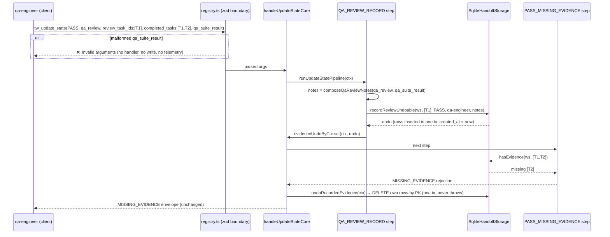

# e161-qa-claim-and-state-reads — architecture

Task T-E161-01 (architect). Spec: `specs/e161-qa-claim-and-state-reads.md` (cut `4358674`, approved). Three tickets on one serial path: E366 (SQLite undo), E161 (structured suite result), E184 (tier left out of the `tw_get_state` view). sr order is T-E366-01 → T-E161-02 → T-E184-01, all on `tools/handoff-orchestrator.ts`.

Code read for this blueprint: `tools/handoff-orchestrator.ts` (`handleGetState`, `withDispatchPinsAdvisory`, `evidenceUndoByCtx`, `undoRecordedEvidence`, `writeStateKeepingEvidence`, the `QA_REVIEW_RECORD` and `PASS_MISSING_EVIDENCE` steps, `handleUpdateStateCore`), `tools/storage.ts`, `tools/storage-sqlite.ts` (`reports` DDL, `recordReview`, `hasEvidence`, `close`), `tools/registry.ts` (`UpdateStateArgs`, `defineTool` / `emitZodGateTelemetry`, the `tw_update_state` inputSchema), `gates/qa-review.ts` (`recordReviewInFileUndoable`), `tools/evidence-file.ts`, `tools/evidence-lookup.ts`, `gates/expected-red.ts`, `gates/ac-execution.ts`, `gates/evidence-schema.ts`, `gates/visual.ts`, `index.ts` (`formatZodError`), `tools/handoff-parse.ts` (`readHandoffState` envelope).

## D-E161 — confirmed

**D-E161 is confirmed as cut:** Option A. `qa_suite_result` is an optional structured argument on `tw_update_state`. The server checks its shape at the zod boundary and writes it into the qa evidence record as one fixed, server-formatted line. It is not persisted to the handoff. There is no schema bump, no new gate and no new error code. The cut's file set does not change, so this does not go back to PM.

Reasons for confirming:

1. Option B (parsing prose) cannot be built here. The parser belongs to `tools/evidence-file.ts`, which is lane e367's file this wave. B is also the brittle shape the backlog row warns about.
2. Option A needs no persisted field. The figure lives only in the evidence record that `QA_REVIEW_RECORD` already writes (the file section, or the `reports.notes` column, which already exists). `docs/schema-versions.md` requires a bump only for a new persisted handoff, tasks, sqlite or config field, and this adds none.
3. One composition site, in the orchestrator, serves both modes. `gates/qa-review.ts` and the `reports` DDL stay untouched. The E236 undo (file mode) and the E366 undo (SQLite) cover the new line with no extra code, because the line is part of the `notes` argument they already undo.

One shape refinement, which is allowed by the spec (it is a refinement of the shape, not of the decision): `command` rejects more than CR/LF. See *Open Questions* OQ-1.

### Architect check 1: no evidence reader treats a leading `suite-result:` line specially

The line always starts with the literal `suite-result:`. Because `command` cannot contain any line terminator (OQ-1), the whole value stays on that one line. Each reader that scans `qa_reports/review_<id>.md` was checked against this:

| reader | match rule | can the suite line match? |
|---|---|---|
| `COVERS_LINE_RE` / `parseCoversIds` / `buildCoverageIndex` (`tools/evidence-file.ts`), also used by `gates/qa-review.ts`, `gates/expected-red.ts`, `gates/ac-execution.ts`, `tools/lane-status.ts` | line-anchored `^…covers…[:—-]` (flags `gim`) | No. The line starts with `suite-result`, and a `covers` later in the line (for example inside `command`) is not at a line start. |
| `sliceH2Section` / `sliceH2SectionAt` / `findH2At` / `H2_LINE_RE` (expected-red `## Expected-Red Diff`, AC-execution `## AC Execution Log`, evidence-schema v1 exact anchor and v2 normalized-contains) | `^##[ \t]+…` / `^##\s+<heading>` | No. The line does not start with `##`. Section bodies end at `\n##\s`, which the suite line cannot contain. |
| `VERDICT_HEADING_RE` (`tools/evidence-lookup.ts`, `## <ts> — PASS\|FAIL — by …`) | `^##\s+\S+\s+—\s+(PASS\|FAIL)…` (flags `gm`) | No, for the same reason. |
| `parseUncheckedLabels` (`^-\s+\[(.)\]`), `parseAssertionFailures` / `parseRegionDiffFailures` (rows that start with `\|`) | line start `- [` / `\|` | No. |
| `PROOF_LINE_RE` (`gates/ac-execution.ts`) | reads the **spec** file, not evidence | Not applicable. |
| visual evidence readers (`BASELINE_LINE_RE`, `DIFF_METRIC_LINE_RE`, `PIXEL_GATE_COMPLETE_LINE_RE`) | read `qa_reports/visual_<id>.md` only | Not applicable. QA_REVIEW_RECORD never writes visual files. |
| SQLite `hasEvidence` (`selectReportsByTaskStmt`) | `task_id` + `status = 'PASS'`; never reads `notes` | Not applicable. No code reads `reports.notes`. |

Placement: the line sits directly under the server's own `## <ts> — <status> — by qa-engineer` heading, before any qa-authored text. It can therefore never land inside a qa-authored subsection (such as `## AC Execution Log` at the end of `qa_review`). No reader gives special meaning to the first body line of a verdict section.

Why OQ-1 matters to this check: in JavaScript, `^` with the `m` flag also matches after U+2028 and U+2029. A `command` containing `\u2028covers: T-X` or `\u2028## 2026 — PASS — by x` would forge a `covers:` line or a verdict heading for `COVERS_LINE_RE` and `VERDICT_HEADING_RE`, even with CR and LF banned. The tighter character set closes that.

### Architect check 2: source pins stay intact

None of the edits below touches the bytes these tests read:

- **`test/context-budget.test.mjs` AC8.** The `hasDesignModeRequiringVisual` import block is unchanged. Add no import between `import {` and `} from "../gates/visual.js"`.
- **`test/e35-pipeline-order.test.mjs`.** No step is added, removed, renamed or reordered. `QA_REVIEW_RECORD.codes` stays `["QA_REVIEW_TARGET_REQUIRED"]`.
- **`test/e236-rejected-write-evidence.test.mjs`.** The file-mode branch (`storage instanceof FileHandoffStorage` → `recordReviewInFileUndoable`) is kept and stays first. Its call arguments change only from `parsed.qa_review` to `notes`, which is `parsed.qa_review` itself (the same string reference) when `qa_suite_result` is absent.
- **`test/ac-execution.test.mjs` I5b and `test/gates-expected-red.test.mjs` I5b.** These use `lastIndexOf("if (storage instanceof FileHandoffStorage)", callIdx)`. **Rule for sr: do not add any new occurrence of the literal `if (storage instanceof FileHandoffStorage)`, nor of `hasProofAnnotatedAC(parsed.workspace_path` or `hasExpectedRedManifest(parsed.workspace_path`, anywhere in the file.** The existing guard in `QA_REVIEW_RECORD` (line ~748) comes before both call sites (lines ~1035, ~1068), so the nearest guard each test finds is unchanged.
- **`test/visual-evidence-gate.test.mjs` AC-4.** The `SCOPE_DECISION_REQUIRED` block is not touched.
- **`test/e38-…`, `test/e32-e33-…`, `test/e20-e21-…`, `test/e28-…`, `test/e296-…`, `test/e308-single-source-tier-enum.test.mjs`.** No touched region overlaps them. For E308-AC4: the orchestrator must not contain the literal `opus, sonnet, haiku, fable`. For E308-AC6: the new zod field goes beside `qa_review` (about 60 lines above the `dispatch_pins` comment block that AC6 slices), and nothing is inserted between the `E300` comment and `dispatch_pins: z`.
- **`test/error-code-contract.test.mjs`.** Its `TOKEN_RE` / `SUFFIX_RE` scan of `tools/` treats any upper-case `SNAKE` token ending in `_REQUIRED|_MISSING|_REJECTED|…` (or starting with `MISSING_`) as a gate code. **Rule for sr: new comments and strings may only cite codes that already exist (`MISSING_EVIDENCE`, `QA_REVIEW_TARGET_REQUIRED`). Never write an invented token such as a `QA_SUITE_RESULT_…` name.**

### Architect check 3: zod rejection uses the existing boundary path and telemetry, with no new code

- `defineTool.run` calls `UpdateStateArgs.parse(rawArgs)`. A `ZodError` goes to `emitZodGateTelemetry` and is then rethrown unchanged. `index.ts` formats it as `❌ Invalid arguments for tw_update_state: <path>: <message>` with `isError: true`. The handler, the pipeline and every write are never reached, so the handoff and the evidence stay unchanged (AC-E161-5).
- `emitZodGateTelemetry` emits only for an issue whose message starts with a registered gate code (`ISSUE_GATE_CODE_RE` + `GATE_CODE_SET`). **Every custom message for this field starts with the lower-case `qa_suite_result`.** zod's own messages (`Too big…`, `Invalid input…`, `Unrecognized key…`) start with a capital letter followed by lower case, so they never match. Result: no telemetry line and no new code. `test/e303-zod-boundary-telemetry.test.mjs` and `test/e324-zod-telemetry-under-current.test.mjs` are unaffected.

### Architect check 4: no overturn

Nothing here needs a persisted handoff field, a schema bump, a `GATE_REGISTRY` entry or a `content/**` change, so `next_role` stays `sr-engineer`.

## Affected Files

| file | task | change |
|---|---|---|
| `tools/storage.ts` | T-E366-01 | modify: add the optional `recordReviewUndoable?` method to `HandoffStorage`. `FileHandoffStorage` is **not** changed. |
| `tools/storage-sqlite.ts` | T-E366-01 | modify: add the `deleteReportStmt` statement and a delete transaction. Add `recordReviewUndoable`. `recordReview` and `recordReviewUndoable` share one private insert helper, and `recordReview`'s observable behaviour is unchanged. |
| `tools/handoff-orchestrator.ts` | T-E366-01, T-E161-02, T-E184-01 | modify: in `QA_REVIEW_RECORD`, add the SQLite-undo branch (E366) and the notes composition (E161). Add the `withoutDispatchMechanismTier` envelope transform used by `handleGetState` (E184). Update the `evidenceUndoByCtx` comment. |
| `tools/registry.ts` | T-E161-02 | modify: add the `qa_suite_result` zod field and its JSON `inputSchema` property. |
| `dist/tools/{storage,storage-sqlite,handoff-orchestrator,registry}.*` | each sr task | rebuild (`npm run build`), committed with the task that changes the source. |
| `test/e366-sqlite-rejected-write-evidence.test.mjs`, `test/e161-qa-suite-result.test.mjs`, `test/e184-get-state-omits-tier.test.mjs`, `test/dispatch-mechanism.test.mjs` (RT2 retitle only) | qa (T-E366-02, T-E161-03, T-E184-02) | qa-owned deliverables, listed here only for completeness. |

Not touched: `gates/**`, `schema/**`, `content/**`, `prompts/**`, `bin/**`, `docs/**`, `tools/evidence-file.ts`, `tools/evidence-lookup.ts`, `tools/handoff-write.ts`, `tools/handoff-parse.ts`, `index.ts`.

## Data Structures

```ts
// tools/registry.ts — inferred, not hand-declared:
// UpdateStateInput["qa_suite_result"] is
//   { passed: number; total: number; command?: string } | undefined

// tools/handoff-orchestrator.ts — local alias (type-only, from the existing
// `import type { … UpdateStateInput … } from "./registry.js"`):
type QaSuiteResult = NonNullable<UpdateStateInput["qa_suite_result"]>;
```

No new persisted shape. The `reports` table, the handoff frontmatter, `HandoffState` and `WriteHandoffStateOptions` are all unchanged.

## Interface Contracts

### T-E366-01 — SQLite undoable record (E366)

**`tools/storage.ts`**, `HandoffStorage`, in the `// --- QA evidence ---` group, directly after `recordReview`:

```ts
  // Optional undoable variant of recordReview: records exactly the same
  // rows/bytes and returns an undo that removes only what THIS call recorded.
  // The undo never throws; on failure it leaves the record as it is. Used by
  // tw_update_state so a write the server refuses leaves no verdict behind.
  // A storage without it is recorded through recordReview, with no undo.
  recordReviewUndoable?(
    workspacePath: string,
    taskIds: string[],
    status: "PASS" | "FAIL",
    reviewer: string,
    notes: string,
  ): Promise<() => void>;
```

`FileHandoffStorage` does **not** implement it (see Decision Records). File mode keeps its own `instanceof` branch.

**`tools/storage-sqlite.ts`**, `SqliteHandoffStorage`:

- New field `private deleteReportStmt: Database.Statement<[string, string, string, string, string, string]>`, prepared in the constructor next to `insertReportStmt`:
  ```sql
  DELETE FROM reports
   WHERE workspace_path = ? AND task_id = ? AND created_at = ?
     AND status = ? AND reviewer = ? AND notes = ?
  ```
  `(workspace_path, task_id, created_at)` is the primary key. The other three columns are defence in depth: the delete removes a row only if it is still exactly the row this call wrote.
- New private helper, which holds the insert body that `recordReview` has today:
  ```ts
  // Inserts one reports row per id in one synchronous transaction, all
  // sharing one created_at, and returns that created_at. Throws exactly as
  // recordReview always has (a duplicate (ws, id, created_at) violates the
  // primary key → the transaction rolls back → nothing is inserted).
  private insertReportRows(
    workspacePath: string, taskIds: string[], status: "PASS" | "FAIL",
    reviewer: string, notes: string,
  ): string
  ```
- `recordReview(...)`: `this.insertReportRows(...); return Promise.resolve();`. Its observable behaviour is unchanged: same rows, same transaction, still a synchronous throw on a primary-key conflict.
- `recordReviewUndoable(workspacePath, taskIds, status, reviewer, notes): Promise<() => void>`:
  1. `const createdAt = this.insertReportRows(workspacePath, taskIds, status, reviewer, notes);`. On a throw, nothing was inserted, nothing is returned, and the error propagates exactly as from `recordReview`.
  2. `const ids = [...taskIds];` (a snapshot, so a later mutation of the caller's array cannot change what is undone).
  3. Return `Promise.resolve(undo)`, where `undo` is **one-shot** (a `let done = false` latch: a second call is a no-op) and **never throws**:
     ```ts
     try {
       this.db.transaction((rows: string[]) => {
         for (const id of rows) this.deleteReportStmt.run(workspacePath, id, createdAt, status, reviewer, notes);
       })(ids);
     } catch {
       // Best effort, as in gates/qa-review.ts undoRecordedAppends: a closed
       // database or a failed delete leaves the rows as they are.
     }
     ```
     A duplicate id in `ids` cannot happen here, because step 1 would already have thrown. Building the transaction inside the `try` also covers a closed handle, because `db.transaction` / `run` throw `TypeError: The database connection is not open`.
- No `import` changes. `tools/storage-sqlite.ts` stays the only module that loads `better-sqlite3`.

**`tools/handoff-orchestrator.ts`**, `QA_REVIEW_RECORD` step. Replace only the record block that follows the `QA_REVIEW_TARGET_REQUIRED` early return (the step name, `codes`, the guard condition, the id resolution and the rejection envelope stay byte-identical):

```ts
          // File mode records through the undoable variant (same bytes), and a
          // storage that offers recordReviewUndoable (SQLite) does the same, so
          // handleUpdateStateCore can revert the record if this write does not
          // land. Any other storage records as before, with no undo.
          if (storage instanceof FileHandoffStorage) {
            evidenceUndoByCtx.set(
              ctx,
              await recordReviewInFileUndoable(parsed.workspace_path, ids, parsed.status, "qa-engineer", notes),
            );
          } else if (storage.recordReviewUndoable) {
            evidenceUndoByCtx.set(
              ctx,
              await storage.recordReviewUndoable(parsed.workspace_path, ids, parsed.status, "qa-engineer", notes),
            );
          } else {
            await storage.recordReview(parsed.workspace_path, ids, parsed.status, "qa-engineer", notes);
          }
```

In T-E366-01, `notes` is introduced as `const notes = parsed.qa_review;`, declared directly after the `ids.length === 0` early return. T-E161-02 then changes only that one declaration (below), so the E161 diff stays a single line in this block. Call `storage.recordReviewUndoable(...)` as a method (not a detached reference), so `this` binds. `if (storage.recordReviewUndoable)` narrows the optional member on the `const` destructured `storage`.

Update the comment above `evidenceUndoByCtx` from "(file mode)" to "(file mode, or a storage offering `recordReviewUndoable`, i.e. SQLite)". No other line in the undo plumbing changes.

**Undo ordering vs. the E236 file-mode path.** A single write takes exactly one branch, so it registers **at most one** undo in `evidenceUndoByCtx`, which is keyed by its own `ctx`. The existing call sites are reused unchanged, in their existing order:

| outcome after `QA_REVIEW_RECORD` | existing code path | effect (both modes) |
|---|---|---|
| a later step returns a rejection (for example `MISSING_EVIDENCE`, `QA_COMPLETION_EVIDENCE_MISSING` (file mode only), the visual, expected-red or AC-execution checks, `MISSING_REVIEW_EVIDENCE`) | `if (pipelineRejection) { undoRecordedEvidence(ctx); return pipelineRejection; }` | rows deleted, or bytes truncated, **before** the rejection envelope is returned. The envelope is unchanged. |
| a step throws | `catch (err) { undoRecordedEvidence(ctx); throw err; }` around `runUpdateStatePipeline` | undone, and the same error is rethrown |
| `storage.writeState` throws (for example SQLite `STATE DRIFT` from `txUpsert`'s `expectedLastUpdated` check) | `writeStateKeepingEvidence` → `catch` → `undoRecordedEvidence(ctx); throw err` | undone, and the same error propagates (AC-E366-2) |
| `writeState` succeeds | `writeStateKeepingEvidence` → `evidenceUndoByCtx.delete(ctx)` | rows kept. Post-write side effects (dispatch sidecar, RAG GC, metrics) can no longer undo. |
| `recordReviewUndoable` itself throws (primary-key conflict) | no undo registered → the pipeline `catch` → `undoRecordedEvidence` finds none → rethrow | identical to today's `recordReview` throw |

`PASS_MISSING_EVIDENCE` still runs after the record, so this write's own rows still satisfy `storage.hasEvidence` (AC-E366-3). The undo runs synchronously inside the request (better-sqlite3), so the rejection is returned only after the rows are gone.

### T-E161-02 — `qa_suite_result` (E161)

**`tools/registry.ts`, zod.** Insert directly after `qa_review: z.string().max(10000).optional(),` (keep the comment style):

```ts
    // qa_suite_result: qa's structured suite figures. Shape-checked here (no
    // gate, no error code); recorded by QA_REVIEW_RECORD as one fixed
    // server-formatted line at the head of the qa evidence, only on a write
    // that records qa_review evidence. Never persisted to the handoff; no
    // schema bump. passed < total is recorded as given, not rejected. (E161)
    qa_suite_result: z
      .object({
        passed: z.number().int().min(0),
        total: z.number().int().min(1),
        command: z
          .string()
          .min(1)
          .max(200)
          .refine((s) => !QA_SUITE_COMMAND_FORBIDDEN_RE.test(s), {
            message: "qa_suite_result.command must be one line: no control characters, U+0085, U+2028 or U+2029",
          })
          .refine((s) => s.trim().length > 0, {
            message: "qa_suite_result.command must not be blank",
          })
          .optional(),
      })
      .strict()
      .refine((r) => r.passed <= r.total, {
        message: "qa_suite_result.passed must not exceed qa_suite_result.total",
        path: ["passed"],
      })
      .optional(),
```

Module-level constant, declared above `UpdateStateArgs`:

```ts
// C0 controls (includes \t \n \v \f \r), DEL, NEL, and the two JS regex line
// terminators that `^` in m-flag mode treats as a line start. (E161)
const QA_SUITE_COMMAND_FORBIDDEN_RE = /[\u0000-\u001F\u007F\u0085\u2028\u2029]/;
```

Notes for sr:

- zod 4 (`^4.6.6`): `z.number().int()` accepts only safe integers, so `${n}` always renders as plain decimal digits. `.strict()` is the form `dispatch_pins` already uses.
- Each custom message starts with lower-case `qa_suite_result` (check 3).
- `UpdateStateArgs` keeps its top-level `.refine` / `.superRefine` chain untouched.
- `UpdateStateInput` picks the field up by inference. No other type edit is needed.
- **Encoding hazard (observed while writing this doc).** The `QA_SUITE_COMMAND_FORBIDDEN_RE` source must contain the six-character ASCII escape sequences (backslash, `u`, `2`, `0`, `2`, `8` and likewise `2029`), never the raw U+2028 / U+2029 characters. An editing tool turned the escapes into raw characters once during this hop. A raw U+2028 inside a regex literal is a JS line terminator and a syntax error. Check after editing: `grep -c "u2028" tools/registry.ts` is ≥ 1, and `perl -CSD -ne 'print "$.\n" if /[\x{2028}\x{2029}]/' tools/registry.ts` prints nothing. Apply the same check to `dist/tools/registry.js`.

**`tools/registry.ts`, JSON `inputSchema`.** Insert directly after the `qa_review` property:

```ts
        qa_suite_result: {
          type: "object",
          properties: {
            passed: { type: "integer", minimum: 0, description: "Tests that passed." },
            total: { type: "integer", minimum: 1, description: "Tests run; passed must not exceed it." },
            command: {
              type: "string",
              minLength: 1,
              maxLength: 200,
              description: "Optional exact suite command, one line (no control characters, U+0085, U+2028 or U+2029).",
            },
          },
          required: ["passed", "total"],
          additionalProperties: false,
          description:
            "Optional structured suite result for a qa-engineer PASS/FAIL write: {passed, total, command?}, integers with 0 ≤ passed ≤ total and total ≥ 1. Attested, not verified. When this write records qa_review evidence (agent_id \"qa-engineer\", status PASS or FAIL, qa_review set), the server records it as one fixed line at the head of that evidence — `suite-result: <passed>/<total> passed (server-recorded from qa_suite_result)`, or `…; command: <command>)` when command is given — followed by a blank line and the qa_review text (file mode: the new section of qa_reports/review_<id>.md; SQLite: each reports row's notes). Ignored on any other write. Not persisted to the handoff. Transient: applies to THIS write only. Recording-only — gates nothing; passed < total is recorded as given.",
        },
```

This is the final wording of the `e161.schema-desc` string. AC-E161-9 checks `type: "object"`, `required` ⊇ `passed, total`, `additionalProperties: false`, and that the description states: recorded into the evidence record, not persisted to the handoff, gates nothing.

**`tools/handoff-orchestrator.ts`, composition.** Two module-private functions placed directly above `UPDATE_STATE_GATE_PIPELINE` (below `writeStateKeepingEvidence`). They are not exported:

```ts
// The fixed, server-formatted suite-result line (spec Copy/Strings
// e161.suite-line / e161.suite-line-cmd). command is recorded verbatim; the
// zod boundary already guarantees it is one line. (E161)
function suiteResultLine(r: QaSuiteResult): string {
  const base = `suite-result: ${r.passed}/${r.total} passed (server-recorded from qa_suite_result`;
  return r.command !== undefined ? `${base}; command: ${r.command})` : `${base})`;
}

// The notes QA_REVIEW_RECORD hands to the record call. Without
// qa_suite_result: qaReview itself, unchanged (byte-identical record). With
// it: the suite line, a blank line, then the trimmed qa_review text — the
// line first, so it never lands inside a qa-authored subsection.
function composeQaReviewNotes(qaReview: string, suite: QaSuiteResult | undefined): string {
  if (suite === undefined) return qaReview;
  return `${suiteResultLine(suite)}\n\n${qaReview.trim()}`;
}
```

In `QA_REVIEW_RECORD`, the T-E366-01 declaration `const notes = parsed.qa_review;` becomes `const notes = composeQaReviewNotes(parsed.qa_review, parsed.qa_suite_result);`. It sits after the `QA_REVIEW_TARGET_REQUIRED` early return, so that rejection is unchanged. It sits inside the `if (parsed.qa_review && agent_id === "qa-engineer" && PASS|FAIL)` block, so a write that does not record ignores the field (AC-E161-6). Nothing else reads `parsed.qa_suite_result`. The `storage.writeState({...})` options object does **not** receive it.

**Composed bytes, per mode** (`L` is the suite line, `R` is `parsed.qa_review`):

| mode | field present | recorded |
|---|---|---|
| file | no | `## <ts> — <status> — by qa-engineer\n\n${R.trim()}\n\n` (today's bytes; header unchanged) |
| file | yes | `## <ts> — <status> — by qa-engineer\n\n${L}\n\n${R.trim()}\n\n`. `recordReviewInFileUndoable`'s own `notes.trim()` is a no-op here unless `R` is blank (then `…\n\n${L}\n\n`). File header unchanged. |
| SQLite | no | `notes = R` (raw, as today) |
| SQLite | yes | `notes = ${L}\n\n${R.trim()}` |

### T-E184-01 — tier left out of the read view (E184)

**`tools/handoff-orchestrator.ts`.** `handleGetState` becomes:

```ts
  const result = getActiveStorage().readState(workspace_path);
  return { content: [{ type: "text" as const, text: withDispatchPinsAdvisory(withoutDispatchMechanismTier(result)) }] };
```

The new function goes directly after `withDispatchPinsAdvisory`. It follows the same rules: it never throws, and its output is byte-identical whenever it does nothing.

```ts
// Read-view omission of the previous hop's dispatch_mechanism_tier (E184).
// The next writer reads tw_get_state first, so a tier value there invites
// copying instead of self-reporting. The record itself is untouched: the
// handoff file, readHandoffState/parseHandoff and .current/<lane>/dispatch.jsonl
// still carry it. Drops only the TOP-LEVEL key; when it is absent, or the
// payload is not a JSON object, returns the original text byte-identical.
// Never throws.
function withoutDispatchMechanismTier(text: string): string {
  try {
    const envelope = JSON.parse(text) as unknown;
    if (!envelope || typeof envelope !== "object" || Array.isArray(envelope)) return text;
    if (!Object.prototype.hasOwnProperty.call(envelope, "dispatch_mechanism_tier")) return text;
    delete (envelope as Record<string, unknown>).dispatch_mechanism_tier;
    return JSON.stringify(envelope);
  } catch {
    return text;
  }
}
```

- Order: the tier is dropped first, then the advisory is applied. Every other key keeps its relative order, and the advisory is still appended last (AC-E184-3). `readState`'s text is compact `JSON.stringify` output, so re-serialising changes only the removed key.
- Byte-identical when the key is absent: file mode with no tier (E300-R2/R3 stay green), every SQLite read (it never stores the tier), and the `exists: false` envelope.
- `dispatch_mechanism`, `dispatch_pins`, `lane_registry` and every other key are passed through. Nested objects are not walked.
- Unchanged: the write path (`handoff-write.ts`), `parseHandoff` / `readHandoffState`, `appendDispatchRecord`, the `tw_get_state` / `dispatch_mechanism_tier` registry descriptions (spec Out of Scope), and `prompts/build.ts` `renderHandoffStateBlock` (filed as `E184-NEW-1`).

## Sequence Diagram

The SQLite qa PASS write that a later gate rejects (AC-E366-1, AC-E161-7):



On an accepted write, `writeStateKeepingEvidence` drops the undo after `writeState` succeeds. If `writeState` throws, the same `DELETE` runs before the error propagates.

## Decision Records

| Context | Decision | Consequences |
|---|---|---|
| D-E161: where the suite figure lives | Optional zod field, recorded by the server as a fixed line in the existing evidence record. Not persisted to the handoff. | No schema bump, no gate, no new code. The figure is greppable and parser-free for a later `E161-NEW-1` check. Nothing in the handoff shows it (by design). |
| Where the notes are composed | In the orchestrator (`composeQaReviewNotes`), passed as `notes` to whichever record call runs | One composition site for both modes. `gates/qa-review.ts` and the `reports` DDL stay untouched. Both undos cover the line for free. |
| Line position | First in the section body, before `qa_review` | It cannot land inside a qa-authored H2 subsection. The section heading and the file header stay byte-identical. |
| `qa_review` trimming when the field is present | Compose with `qa_review.trim()` in both modes | Both modes record the same bytes after the blank line (OQ-2). With the field absent, the raw `qa_review` is passed through, so AC-E161-4 holds byte for byte. |
| `command` character set | Reject C0 controls, DEL, U+0085, U+2028, U+2029 and blank values. Max 200 UTF-16 code units. | Closes `covers:` / verdict-heading forgery through JavaScript `m`-flag line terminators (OQ-1). Tabs are rejected too: a cost accepted for a one-line command. |
| D-E366: rollback mechanism | Undo handle (DELETE by PK plus status/reviewer/notes, one transaction, one-shot, never throws), not a transaction spanning record → writeState | Safe on the HTTP server's shared connection. Same-write evidence still satisfies `MISSING_EVIDENCE`. Residual: a failed delete leaves the rows (OQ-5). |
| How the orchestrator reaches the SQLite undo | An optional `HandoffStorage.recordReviewUndoable`, feature-detected; no `instanceof SqliteHandoffStorage` | The orchestrator does not import `storage-sqlite`, so `better-sqlite3` stays off the file-mode load path. Test doubles without the method keep today's behaviour. |
| Should `FileHandoffStorage` implement `recordReviewUndoable`? | No. The file branch stays `instanceof FileHandoffStorage` → `recordReviewInFileUndoable`, first in the chain. | The E236 path and its source shape stay byte-identical (AC-E366-5). The cost is two undo entry points instead of one (OQ-4). |
| `recordReview` and `recordReviewUndoable` in SQLite | Share one private `insertReportRows` helper | "Same inserts" holds by construction, and `recordReview`'s behaviour (sync throw on a PK conflict) is unchanged. |
| D-E184: omit vs. label | Omit the top-level key in `handleGetState` only, through an envelope transform that is a no-op when the key is absent | Nothing to copy in the Pre-Flight read. The record (file, library read, sidecar) is unchanged. Residual: the prompt state block (`E184-NEW-1`). |

## Deferred Resources

_None. The spec's Dependencies / Prerequisites records zero external references (Resource Audit: no URL, Figma, mockup or ticket system; `external_refs` omitted)._

## Open Questions

None needs a human ruling. Every item below was resolved by the architect, and is listed so the integrator pre-review and the human can see each judgement call and overrule any of them.

- **OQ-1: `command` character set is wider than the spec's "no CR/LF". Resolved by architect.** The spec bans only `\n` and `\r`. JavaScript's `^` in `m` mode also starts a line after U+2028 and U+2029, and `COVERS_LINE_RE` (`gim`), `VERDICT_HEADING_RE` (`gm`) and `H2_LINE_RE` (`gm`) are all line-anchored. With only CR/LF banned, a `command` could forge a `covers:` line (false coverage) or a `## … — PASS — by …` heading (flipping `hasEvidenceAnywhere`'s last-verdict test). Decision: reject C0 controls (U+0000–U+001F), U+007F, U+0085, U+2028 and U+2029, plus a blank (whitespace-only) value. This tightens the field's shape, which the spec allows; the decision itself is unchanged. AC-E161-5's listed cases are a subset, and qa may add U+2028 and tab cases.
- **OQ-2: `qa_review` is trimmed when the field is present. Resolved by architect.** AC-E161-2 says "the trimmed `qa_review` text" (file), and AC-E161-3 says "the `qa_review` text" (SQLite). Decision: compose `${line}\n\n${qa_review.trim()}` in both modes. Composing the raw text instead would leave a leading-whitespace `qa_review` with extra blank lines in file mode, breaking AC-E161-2. The two ACs coincide for any fixture without surrounding whitespace; qa should compute the SQLite expectation as `line + "\n\n" + qa_review.trim()`. With the field absent, nothing changes: the raw `qa_review` goes to both modes as today.
- **OQ-3: integer range. Resolved by architect.** zod 4's `.int()` already limits values to safe integers, so the line always renders as plain decimal digits. No extra upper bound is set (a suite larger than 2^53 is not a real case).
- **OQ-4: `FileHandoffStorage` gets no `recordReviewUndoable`. Resolved by architect.** Adding it would let the orchestrator drop its file-mode `instanceof` branch, but that would rewrite the E236 call site that I5b's `lastIndexOf` guard scan and `test/e236-…` depend on, for no behavioural gain. Unifying the two is left to a later cleanup outside this lane.
- **OQ-5: residual window and failure cases, accepted as in E236. Resolved by architect.**
  1. Between the record and the undo there are `await`s. A concurrent request for the **same** workspace on the HTTP server could briefly see this write's rows. The E236 file-mode path has the same window, and the spec's rejected-transaction option would have been worse.
  2. If the database is closed or the delete fails, the rows stay. "The undo never throws" is the spec's chosen contract (AC-E366-4).
- **OQ-6: duplicate ids in `review_task_ids` in SQLite mode (behaviour that already exists, not new). Resolved by architect: left unchanged, out of scope.** `[T, T]` violates the `reports` primary key (one shared `created_at`), and `recordReview` has always thrown a raw SQLite error in that case. File mode de-duplicates instead. `recordReviewUndoable` keeps the throw: nothing is inserted and nothing is registered, so the result is identical to today. The integrator may file this as a finding if wanted. It is not fixed here because it would change `recordReview`'s behaviour.
- **OQ-7: STOP conditions from the spec. Resolved by architect: none triggered.** No `GATE_REGISTRY` entry, no `content/**` change, no schema bump and no new error code is needed by this blueprint.
