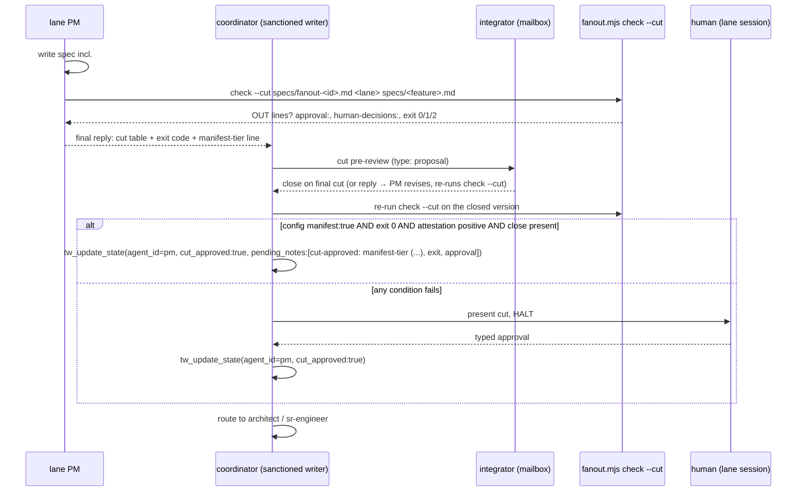

# e296-manifest-tier-cut-approval — architecture

Blueprint for lane e296 (wave manifest `specs/fanout-post-v4-w3.md`, base `c392cc3`). Spec: `specs/e296-manifest-tier-cut-approval.md` (AC1–AC13, *Design intent*, R1/R2, `## Cut`). This file refines that spec; it reverses none of its fixed design intent. Code tasks: T-E296-03, T-E296-04. Content tasks: T-E296-01, T-E296-02 (exact anchors in *Content Landing Points*). Every file below is inside the lane row's `擁有` set; `tools/registry.ts`, `tools/handoff-parse.ts`, `index.ts`, `bin/**`, `templates/**` are not touched.

## Affected Files

| file | task | change |
|---|---|---|
| `tools/fanout-manifest.ts` | T-E296-04 | optional 9th `approval` column; `## Cut` parser; `checkCut`; `runCheckCut`; `runCheck` dispatch; `USAGE` 4th line; new `FANOUT_CODES` entries; `LANE_PROVISIONAL` text |
| `dist/tools/fanout-manifest.{js,js.map,d.ts,d.ts.map}` | T-E296-04 | rebuilt by `npm run build` |
| `scripts/fanout.mjs` | T-E296-04 | header comment only (usage line + exit-code line); routes and the single dist import unchanged |
| `tools/config.ts` | T-E296-03 | `CutApprovalAutoTier.manifest: boolean`, default `false`, strict `=== true` parse |
| `dist/tools/config.{js,js.map,d.ts,d.ts.map}` | T-E296-03 | rebuilt |
| `docs/config.md` | T-E296-03 | JSON example + field-table row + one Semantics bullet |
| `content/const-08-chain-31-mid.md` | T-E296-01 | manifest-tier insertion in the *Cut-Approval Auto-Tier* bullet (line 3) |
| `content/coord-03-core-fallback.md` | T-E296-01 | manifest-tier writer action appended to the *Auto-tier writer action* paragraph (line 45) |
| `content/skill-pm.md` | T-E296-02 | Spec Schema `**Cut**` bullet; Gate Summary row; Cut-Approval Gate cell sentence |
| `docs/lane-protocol.md` | T-E296-02 | §5 rule 2 *cut 預審* bullet rewritten; *architect hop* bullet gains one sentence |
| `content/skill-integrator.md` | T-E296-02 | Stage 2 sentence; Stage 4 cut pre-review sentence; Stage 6-4 BEHIND sentence (E309) |
| `test/e296-manifest-tier.test.mjs` (new) + re-pins | T-E296-05 (qa) | see *Test Surface* |

After `npm run build`, `git status --porcelain dist/` must list only the eight `dist/tools/config.*` / `dist/tools/fanout-manifest.*` files. Any other `dist/` path appearing is base drift, not lane work: stop and report it rather than committing it (it would be out of bounds for `fanout check`).

## Data Structures

All in `tools/fanout-manifest.ts`.

```ts
// constants (next to LANES_HEADER; LANES_HEADER itself is NOT changed)
/** Optional 9th header cell of a dispatchable `## Lanes…` table (E296). */
export const APPROVAL_COLUMN = "approval" as const;
/** Allowed `approval` cell values; "" = empty cell. Anything else → APPROVAL_VALUE_UNKNOWN. */
export const APPROVAL_VALUES = ["human", "—", ""] as const;   // "—" is U+2014
/** Exact header of a spec's `## Cut` table (= skill-pm's inline cut table header). */
export const CUT_HEADER = ["id", "desc", "depends_on", "est. files", "touches", "design-link"] as const;
/** `touches` value for a ticket that writes only governance bookkeeping. */
export const CUT_TOUCHES_NONE = "—";
```

`FANOUT_CODES` gains (CLI codes, deliberately outside the gate-suffix vocabulary of `test/error-code-contract.test.mjs` — none ends in `_REQUIRED` / `_MISSING` / `_INCOMPLETE` / `_EXCEEDED` / `_UNVERIFIED` / `_REJECTED` / `_UNRESOLVED` / `_MISMATCH` / `_HELD` / `_CHANGE` / `_SUSPECT` or starts with `MISSING_`; keep it that way, that test is lane e308's):

| key | code | exit | raised by |
|---|---|---|---|
| `approvalValueUnknown` | `APPROVAL_VALUE_UNKNOWN` | row error (validate 2; render/check/check --cut 2 for that lane) | `parseLanes` |
| `approvalHuman` | `APPROVAL_HUMAN` | 1 (FAIL line) | `checkCut` |
| `decisionsHumanRowAbsent` | `DECISIONS_HUMAN_ROW_ABSENT` | 1 (FAIL line) | `checkCut` |
| `cutSectionAbsent` | `CUT_SECTION_ABSENT` | 2 | `parseCutSection` |
| `cutSectionDuplicate` | `CUT_SECTION_DUPLICATE` | 2 | `parseCutSection` (refinement, see Decision Records) |
| `cutTableAbsent` | `CUT_TABLE_ABSENT` | 2 | `parseCutSection` — no table, or a header with zero data rows |
| `cutHeaderDiffers` | `CUT_HEADER_DIFFERS` | 2 | `parseCutSection` |
| `cutRowMalformed` | `CUT_ROW_MALFORMED` | 2 | `parseCutSection` — cell count ≠ 6, or empty `id` (refinement) |
| `cutTouchesUnquotedPath` | `CUT_TOUCHES_UNQUOTED_PATH` | 2 | `parseCutSection` |
| `cutTouchesEmpty` | `CUT_TOUCHES_EMPTY` | 2 | `parseCutSection` — zero path tokens and the cell is not exactly `—` (refinement) |
| `specUnreadable` | `SPEC_UNREADABLE` | 2 | `runCheckCut` (refinement; `MANIFEST_UNREADABLE` stays the manifest's code) |

Type changes:

```ts
export type FanoutErrorScope = "title" | "base" | "lanes" | "row" | "pins" | "decisions" | "cut" | "input";
//                                                                                  ^^^^^ new: spec-side `## Cut` errors

export interface DispatchableLane {
  // …every existing field unchanged…
  /** Optional 9th `approval` cell: "human" when the cell is `human`; undefined for `—`, empty, or an 8-column table. Ignored by render/check. */
  approval: "human" | undefined;
}

export interface CutTicket {
  /** `id` cell, trimmed. */
  id: string;
  /** Path tokens of the `touches` cell (pathTokens order, de-duplicated within the row); [] when the cell is exactly `—`. */
  touches: string[];
  /** 1-based line of the row in the spec. */
  line: number;
}

export type CutSectionResult = { ok: true; tickets: CutTicket[] } | { ok: false; errors: FanoutError[] };

export interface CutOut {
  token: string;
  ticket: string;
  /** The 禁止 token it matches, when any (annotation only, as in checkLane). */
  forbidden?: string;
}

export interface CutCheckReport {
  lane: string;
  tickets: number;
  /** Sum over tickets of their (row-de-duplicated) touches tokens. */
  tokens: number;
  out: CutOut[];
  approval: "human" | undefined;
  humanDecisions: { count: number; latest?: string };
  /** APPROVAL_HUMAN / DECISIONS_HUMAN_ROW_ABSENT, in that order, only when failing. */
  failures: FanoutError[];
  output: string;
  exitCode: 0 | 1;
}

export type CutCheckResult = { ok: true; report: CutCheckReport } | { ok: false; errors: FanoutError[] };
```

`tools/config.ts`:

```ts
export interface CutApprovalAutoTier {
  // …four existing fields unchanged…
  // Manifest tier (Constitution §3.1): a fan-out lane cut contained in a
  // human-approved manifest row may auto-approve. Strict === true only.
  manifest: boolean;
}
CUT_APPROVAL_AUTO_TIER_DEFAULTS = { maxFiles: 2, maxPriority: "P3", allowSchemaChange: false, allowDesignArmed: false, manifest: false };
// parse block, after allowDesignArmed:
manifest: tier.manifest === true,
```

Key order in the defaults object and the parsed object: `manifest` LAST (qa's `deepEqual` re-pins assume it; `deepStrictEqual` ignores key order anyway, but keep the source tidy). No `schema_version` bump (additive-optional, the `host` / `driftBaselineIds` precedent). A present `cutApprovalAutoTier` without `manifest` still arms the threshold tier exactly as today.

## Interface Contracts

### (a) 9-column Lanes header — `parseLanes` (≈ :400–486)

1. Replace the `dispatchable` predicate at :415 with a helper; `LANES_HEADER` is not edited:
   ```ts
   function isDispatchableHeader(h: string[]): boolean {
     const base = (n: number) => LANES_HEADER.every((c, i) => h[i] === c) && h.length === n;
     return base(LANES_HEADER.length) || (base(LANES_HEADER.length + 1) && h[LANES_HEADER.length] === APPROVAL_COLUMN);
   }
   ```
   A 9-column header whose 9th cell is anything else (or whose first 8 differ) stays provisional; `missingColumns` is still `LANES_HEADER.filter(c => !header.includes(c))` (unchanged).
2. Row cell count (:448–451) compares against **its own table's header length**:
   `if (r.cells.length !== header.length) rowErr("ROW_CELL_COUNT", \`row has ${r.cells.length} cell(s), expected ${header.length} (${header.join(" | ")})\`)`.
   For an 8-column table `header` equals `LANES_HEADER`, so the message bytes are identical to base.
3. Destructure the first eight cells exactly as today; `const approvalCell = header.length > LANES_HEADER.length ? r.cells[LANES_HEADER.length] : "";`.
4. After the `範圍切線` check and before `if (!ok) continue;`: when `approvalCell` is not in `APPROVAL_VALUES`, `rowErr(FANOUT_CODES.approvalValueUnknown, \`approval cell is "${approvalCell}" — allowed: human, —, or empty\`)` and `ok = false`. Case-sensitive: `Human`, `-` (ASCII), `yes` are all errors (never guess).
5. Push `approval: approvalCell === "human" ? "human" : undefined` on the `DispatchableLane`.
6. `lookupLane` `LANE_PROVISIONAL` message (:689): `promote it to the 8-column Lanes table` → `promote it to the 8- or 9-column Lanes table`. Nothing else in that message changes.
7. `renderPrompt`, `checkLane`, `runValidate` never read `approval`. `validate` stdout (`fanout: ok — … dispatchable lane(s), … provisional, … decision(s)`) is unchanged, so the AC9 exit-code sweep and the AC10 render sha256 (`045b56ae…128a`, w2 control `485eabe0…f863`) hold by construction. No golden under `test/fixtures/e177a/**` or `test/fixtures/e178b/**` moves.

### (b) `## Cut` parser

```ts
export function parseCutSection(specText: string): CutSectionResult
```
Pure. Uses the existing private `splitLines` / `splitSections` / `firstTable` / `tableRows` and the exported `pathTokens` / `unquotedPaths`.

1. `const cut = splitSections(splitLines(specText)).filter((s) => s.name === "Cut")` — exact name, so `## Cut Decisions` / `## Cut amendments` are never read. `splitSections` already trims the heading text, so `## Cut ` (trailing space) matches.
2. `cut.length === 0` → `CUT_SECTION_ABSENT` (`no "## Cut" section found — write the inline cut table under a "## Cut" heading (skill-pm Spec Schema)`). `cut.length > 1` → `CUT_SECTION_DUPLICATE` (lines listed, like `DECISIONS_SECTION_DUPLICATE`). Return.
3. `firstTable(cut[0])` empty → `CUT_TABLE_ABSENT`. Return.
4. `tableRows(table)`; header not exactly `CUT_HEADER` (length + every cell) → `CUT_HEADER_DIFFERS` (`header is "<got>", expected exactly "<CUT_HEADER joined ' | '>"`). Return. Zero data rows → `CUT_TABLE_ABSENT` (`… has a header but no ticket row`). Return.
5. Per data row (collect ALL row errors, then return them together, like `validate`):
   - `cells.length !== 6` or `cells[0] === ""` → `CUT_ROW_MALFORMED` (`Cut row (line N): …`); skip the row.
   - `touches = cells[4]`. For each `w` of `unquotedPaths(touches)` → `CUT_TOUCHES_UNQUOTED_PATH` (`Cut row <id> (line N): touches has unquoted path "<w>" — backtick-quote every path`).
   - `toks = [...new Set(pathTokens(touches))]`. When `toks.length === 0 && touches !== CUT_TOUCHES_NONE` → `CUT_TOUCHES_EMPTY` (`Cut row <id> (line N): touches names no backtick-quoted path — list the paths, or write — for a bookkeeping-only ticket`).
   - Otherwise push `{ id: cells[0], touches: toks, line }`.
6. All errors carry `scope: "cut"`, no `lanes`.

Known limit (same as the manifest parser): `splitSections` does not understand fenced code blocks, so a fenced example containing a line that starts with `## Cut` would be read as a section. Not worth fixing here; noted for the sr's header comment only if it touches that code.

### In-bounds rule

```ts
export function isCutTokenInBounds(token: string, lane: DispatchableLane): boolean {
  if (isGlobToken(token)) return lane.ownedTokens.includes(token);            // byte-identical only
  return lane.ownedTokens.some((t) => matchesGlob(token, t)) || isImplicitBookkeeping(token, lane.lane);
}
```
Owned wins over `禁止`, exactly as `checkLane`. A glob token is never matched against the implicit bookkeeping set (spec: glob only when byte-identical to an `擁有` token). Forbidden annotation for an OUT token: exact → `lane.forbiddenTokens.find((t) => matchesGlob(token, t))`; glob → `lane.forbiddenTokens.find((t) => t === token)`.

### `checkCut`

```ts
export function checkCut(m: Manifest, laneId: string, specText: string): CutCheckResult
```
Pure: no fs, no git. Order (first failing step is the whole answer):
1. `lookupLane(m, laneId)` → not ok → `{ ok: false, errors }` (LANE_NOT_FOUND / LANE_PROVISIONAL / that lane's row errors incl. `APPROVAL_VALUE_UNKNOWN` — exit 2, same as `check`).
2. `m.errors.filter((e) => e.scope === "decisions")` non-empty → `{ ok: false, errors }` (exit 2; see Decision Records). `title` / `base` / `pins` errors are ignored, as `check` ignores them.
3. `parseCutSection(specText)` not ok → `{ ok: false, errors }`.
4. Compute `out` (ticket order, then token order), `approval = lane.approval`, `human = m.decisions.rows.filter((d) => d.decider === "人類")`, `latest = human.map((d) => d.date).sort().at(-1)` (dates are validated `YYYY-MM-DD`, so string order is date order).
5. `failures`: `approval === "human"` → `{ code: APPROVAL_HUMAN, scope: "row", lanes: [lane], message: \`lane ${lane}'s approval cell is human — present this cut to the human in the lane session\` }`; `human.length === 0` → `{ code: DECISIONS_HUMAN_ROW_ABSENT, scope: "decisions", message: "the ## Decisions table has no 人類 row — the manifest is not human-approved" }`.
6. `exitCode = out.length === 0 && failures.length === 0 ? 0 : 1`.

stdout (`output`, every line `\n`-terminated; two spaces after `OUT` / `FAIL` and before each parenthesis, as in `check`):

```
owned (from 擁有): <lane.ownedTokens joined ", ">
implicit lane bookkeeping: .current/<lane>/**, specs/<lane>-*.md, qa_reports|review_reports/*<lane>* (case-insensitive)
OUT  `<token>`  (<ticket id>)[  (禁止: <forbidden token>)]          ← one per out-of-bounds (token, ticket)
approval: <human|—>
human-decisions: <n> row(s); latest <date|—>
FAIL  APPROVAL_HUMAN: <message>                                      ← only when failing
FAIL  DECISIONS_HUMAN_ROW_ABSENT: <message>                          ← only when failing
fanout check --cut: <lane> — <T> ticket(s), <N> token(s), <K> out of bounds
note: a glob in touches is in bounds only when byte-identical to an 擁有 token; glob-in-glob containment is never inferred.
note: prose restrictions inside 擁有 (e.g. （只限 …）) are not machine-checked.
```

- The OUT token IS printed inside backticks — AC11's proof greps `^OUT  \`tools/registry.ts\``. `<ticket id>` is the `id` cell; the `禁止` suffix is byte-identical in shape to `checkLane`'s.
- `approval:` prints `—` (U+2014) for undefined. `latest` prints `—` when `n` is 0.
- The first two lines and the last line are the SAME strings `checkLane` prints: extract two private helpers (`ownedLine(lane)`, `implicitBookkeepingLine(lane)`) and reuse `PROSE_NOTE`; `checkLane`'s output must stay byte-identical (pinned by `test/e177a-check-cli.test.mjs` and `test/e178b-fanout-unmatched.test.mjs`). Add `export const CUT_GLOB_NOTE = "note: a glob in touches …";` for the new note.
- Expected on this lane (`check --cut specs/fanout-post-v4-w3.md e296 specs/e296-manifest-tier-cut-approval.md`): 5 ticket(s), 17 token(s), 0 out of bounds, `approval: —`, `human-decisions: 2 row(s); latest 2026-10-15`, exit 0 (verified against the base parser by the architect; the 17 tokens are all owned or byte-identical globs).

### (c) CLI

```ts
export function runCheckCut(args: string[]): CliResult
```
- `runCheck(args)` gains a first statement: `if (args[0] === "--cut") return runCheckCut(args.slice(1));` — BEFORE `parseArgs` (which would otherwise treat `--cut` as a value-taking flag). `check <manifest> <lane>` behaviour, messages and exit codes are untouched; `check <manifest> --cut …` (not first) stays `USAGE: unknown flag --cut`.
- `runCheckCut`: `parseArgs(args, [])` (no flags — no `--base`/`--repo`, there is no git) → string → `usageResult(p)`; `positional.length !== 3` → `usageResult("check --cut takes <manifest> <lane> <spec>")`. Read manifest via `readManifest` (exit 2 `MANIFEST_UNREADABLE`), read spec via a new private `readSpec(file)` (exit 2 `SPEC_UNREADABLE`, message `cannot read spec "<file>": <err>`). `checkCut(parseManifest(text), lane, specText)`; `!ok` → `fail(errors)` (stderr `fanout: error: CODE: message` lines, exit 2); else `{ stdout: report.output, stderr: "", exitCode: report.exitCode }`.
- Never calls `gitOut`, never writes. Exit codes exactly AC11: 0 in bounds + `approval` not `human` + ≥ 1 `人類` row; 1 otherwise (OUT and/or FAIL lines, all on stdout); 2 for every spec-side format error, a lane-level manifest error, a Decisions-table format error, an unreadable file, or a usage error.
- `USAGE` gains a fourth element, exactly `"       node scripts/fanout.mjs check --cut <manifest> <lane> <spec>"` (seven spaces, matching the existing indentation). The first line is unchanged (pinned `^usage: node scripts/fanout.mjs validate`).
- `scripts/fanout.mjs`: comment-only edits — add `//        node scripts/fanout.mjs check --cut <manifest> <lane> <spec>` after the `check` usage comment line, and change the exit-code comment to `1 = out of bounds or a failed manifest-side condition (check, check --cut)`. Routes and the single `../dist/tools/fanout-manifest.js` import stay as they are (AC15 pins exactly one dist import).

### (d) `tools/config.ts` — see *Data Structures*. The interface comment and the parse-block comment each gain one line; the existing "Strict === true" comment above `allowSchemaChange` already covers the new field's parse style.

## Content Landing Points

Byte budget (R1): const-08, coord-03 and skill-pm are composed into budgeted bundles (four zero-headroom ceilings; qa re-measures). Insert exactly the text below or tighter; do not add examples or restatements. Origin tags (`<!-- origin:start --> (E296)<!-- origin:end -->`) are stripped from every render, so they cost no budget — use them as shown. Do NOT add `<!-- rationale:start -->` fences (render-structure detector) and do NOT backtick-quote any token with a gate suffix (`_REQUIRED`, `_MISSING`, …) other than already-registered gate codes (`test/error-code-contract.test.mjs`, lane e308's). No raw `|` inside a new table cell (`check:md-tables`).

### T-E296-01 — `content/const-08-chain-31-mid.md` line 3 (AC1)

Anchor: the sentence ending `…note is the audit trail (the \`scope_decision_why\` trust class: attested, not server-verified).` — insert the block below immediately after it (one leading space, same line; the bullet stays one line). The pinned threshold-tier sentences (`MUST record the tier in the SAME write`, `` `cut-approved: auto-tier` ``, `Anything over-threshold, design-armed, or unclassifiable HALTs exactly as today`, `key absent = auto-tier disabled, every cut HALTs exactly as today`, `Advisory, not server-enforced: the server parses … distinguishes an auto-tier write`, the `` `maxFiles` 2, `maxPriority` P3, … `` defaults list) are not edited.

```text
 **Manifest tier**<!-- origin:start --> (E296)<!-- origin:end -->: the same writer may also set `cut_approved: true` without halting when ALL hold — (1) `cutApprovalAutoTier.manifest` is `true` (strict); (2) the lane branch carries `specs/fanout-<id>.md` whose `## Decisions` table has a `人類` row and whose Lanes table has this lane's row; (3) `node scripts/fanout.mjs check --cut <manifest> <lane> <spec>` exits 0, proving every file the cut names is inside that row's owned set; (4) the PM's Gate Summary attests no option choice and no needs-human-ruling item; (5) no-schema-change and non-design still hold, and the row replaces `maxFiles` / `maxPriority` (not added to them); (6) the integrator's mailbox pre-review returned `close` on this final cut (the mailbox still never carries approval); (7) the row's optional `approval` column is not `human`; (8) the SAME write carries the `pending_notes` line `cut-approved: manifest-tier (<manifest path>, Decisions <date>)`, `<date>` = the `日期` of the latest `人類` Decisions row. Any failing condition HALTs exactly as today; a manifest changed mid-wave needs a fresh `人類` row, merged into the lane, before the lane auto-approves against it.
```

Then change the closing sentence `Role-specific writer actions live in the skills (\`skill-coordinator.md\` auto-tier writer action) and MUST NOT restate this mechanism.` → `Role-specific writer actions live in the skills (\`skill-coordinator.md\` auto-tier and manifest-tier writer actions) and MUST NOT restate this mechanism.` Measured: ≈ 1,215 characters of growth (< 2,000, AC1). The insertion sits after the *Advisory, not server-enforced* sentence, so that sentence's trust class covers both tiers without restating it.

### T-E296-01 — `content/coord-03-core-fallback.md` line 45 (AC2)

Anchor: the *Auto-tier writer action* paragraph's last sentence `…Over-threshold, design-armed, or unclassifiable cuts halt exactly as the writer obligation above — when in doubt, halt.` Append on the same line (same paragraph, ≈ 755 characters):

```text
 **Manifest-tier writer action**<!-- origin:start --> (E296)<!-- origin:end -->: when `cutApprovalAutoTier.manifest` is `true`, the integrator's `close` on the final cut is in the lane mailbox, the PM's final reply carries `manifest-tier: no option choice, no needs-human-ruling item`, and `node scripts/fanout.mjs check --cut <manifest> <lane> <spec>` exits 0 on that cut, set `cut_approved: true` WITHOUT halting and record in the SAME write the `pending_notes` line `cut-approved: manifest-tier (<manifest path>, Decisions <date>)` (copy `<date>` from the printed `human-decisions:` line) plus the exit code and the printed `approval:` value. A non-zero exit, `approval: human`, a `manifest-tier: not eligible — …` line, or no `close` halts as above.
```

Mechanism is cited (the paragraph's own lead parenthetical already points to Constitution §3.1), not restated. The *Backlog Intake Loop* step 3 (threshold tier only) is unchanged — the manifest tier is lane-only.

### T-E296-02 — `content/skill-pm.md` (AC3)

(a) Spec Schema — insert a new bullet directly after line 34 (`- **Dependencies / Prerequisites** — …verbatim.`), as the list's last item:

```text
- **Cut** — MANDATORY in a fan-out lane (branch `feat/<lane>-…` and the branch's `specs/fanout-<id>.md` has this lane's row), otherwise optional: the Cut-Approval inline cut table verbatim (exact header below the Gate Summary), one row per ticket. Every `touches` cell lists backtick-quoted repo paths, tokenized like the manifest's `擁有` cell (a span is a path when it contains `/` or ends in an extension); a glob only when byte-identical to a token in the lane row's `擁有` cell; `—` for a ticket that writes only governance bookkeeping.
```

(b) Gate Summary — append one row after the **Cut-Approval Gate** row (line 110), as the table's last row:

```text
| **Manifest-Tier Self-Attestation** | The workspace is a fan-out lane (Spec Schema **Cut**). | Write the `## Cut` section, run `node scripts/fanout.mjs check --cut specs/fanout-<id>.md <lane> specs/<feature>.md` and quote its exit code in your final reply, and make the last line before your watermark exactly one of `manifest-tier: no option choice, no needs-human-ruling item` (the cut has no option for the human to choose and no `needs human ruling` item) or `manifest-tier: not eligible — <reason>`. Never set `cut_approved` on this basis — the Cut-Approval Gate dispatch branch is unchanged. |
```

(c) Cut-Approval Gate row (line 110) — append before the closing ` |`, after `…the coordinator sets it before routing to build.`:

```text
 Under the Constitution §3.1 manifest tier the writer may set the flag without the halt; you still present the cut and still halt.
```

Untouched (pinned elsewhere): line 114's header `id | desc | depends_on | est. files | touches | design-link` (`test/cut-approval-gate.test.mjs` C3) and line 116's `touches` definition (`test/e164-e167-content.test.mjs` AC7 — not in this lane's owned set; do not edit that line). AC3 proof: exactly one line matches `^- \*\*Cut\*\*`, exactly one line carries the positive attestation literal.

### T-E296-02 — `docs/lane-protocol.md` §5 rule 2 (AC4)

Replace line 86 (the *cut 預審* sub-bullet) with:

```text
   - **cut 預審**：PM hop 寫了 `specs/<feature>.md` 的 lane，都要在**任何核准寫入之前**先把 cut 送信箱預審 —— 即使 PM 接著只派單一角色的 judge（例如只派 qa）也一樣。整合者 `close` 之後，lane 跑 `node scripts/fanout.mjs check --cut specs/fanout-<id>.md <lane> specs/<feature>.md`：憲法 §3.1 manifest tier 的條件全部成立時，sanctioned writer 帶稽核句 `cut-approved: manifest-tier (<manifest path>, Decisions <date>)` 自動核准，lane **不停下來等人類**；只有條件不成立（exit 非 0、`approval` 是 `human`、PM 寫了 `manifest-tier: not eligible`、config 沒開 `manifest`）才把 cut 呈給人類。**沒有 PM hop 的 lane**（qa 直派的 mini-chain，不寫 spec）不送 cut，只在收工送 `type: report`。
```

Line 87 (*有 architect hop 的票，預審兩次*) keeps its text and gains, at its end, one sentence — wording per Open Question 1 (recommended):

```text
manifest tier 下，第二次預審也要 `close` 且沒有留下 `needs human ruling` 項，才派 sr-engineer；否則把 Open Questions 呈給人類。
```

Pinned and unchanged: rule 1 `信箱**永遠不傳核准**`, §3 `不要 push、不要 merge、不要發版、不要刪 worktree`, `有 architect hop 的票，預審兩次`, `即使 PM 接著只派單一角色的 judge（例如只派 qa）也一樣`, `（qa 直派的 mini-chain，不寫 spec）不送 cut`, `每一次等人類核准的停頓，等待都要保持掛著` (`test/e178a-integrator-role.test.mjs` AC11, `test/e295-…` AC5). `docs/lane-protocol.md` is not composed into any prompt bundle, so it has no budget ceiling.

### T-E296-02 — `content/skill-integrator.md` (AC5, AC6)

Stage 2 (line 81) — append after `…do not enter stage 3.`:

```text
 At this stage the human names every lane whose cut they still want to see in that lane's session (architect-hop lanes are the expected case); write `human` in the Lanes table's optional `approval` column for exactly those lanes, only on the human's instruction. Any other lane, in a workspace with `cutApprovalAutoTier.manifest: true`, may auto-approve its cut under Constitution §3.1 once your cut pre-review has closed.
```

Stage 4, *Cut pre-review* bullet (line 97) — append after `…The mailbox never carries approval.` (both preceding sentences are pinned by `test/e178a-integrator-role.test.mjs` AC10 and stay byte-identical):

```text
 Under the Constitution §3.1 manifest tier your `close` on the final cut is a condition of that lane's auto-approval — send `close` only on the version you have fully checked.
```

Stage 6 step 4 (line 166, E309) — one sentence changes. Replace exactly:

old: `` `node scripts/merge-invariants.mjs`, the full suite, and a push of the integration branch — the pull request picks up the new head ``

new: `` `node scripts/merge-invariants.mjs`, then a push of the integration branch and `node scripts/verify-release.mjs --ci-check --sha <HEAD>` (the local full suite only under the *CI fallback*, 5a) — the pull request picks up the new head ``

`cannot reach \`main\`` (same paragraph, earlier sentence) and the 5b-4 / 5b-5 conflict text after it are untouched. Effects on pins: `verify-release.mjs --ci-check --sha` count rises from 3 to 4 (`test/e295-…` AC7 asserts ≥ 3 — still green); the 5a `git push -u origin <branch>` line (AC6) is untouched; the decision-rights row `| accepting a mechanical out-of-bounds edit | cut approval |` stays (the integrator still never approves a cut; the sanctioned writer does, under a human-armed config and a human-approved manifest).

### T-E296-03 — `docs/config.md` §`cutApprovalAutoTier` (AC8)

- JSON example: add `"manifest": false` as the last key (comma after `"allowDesignArmed": false`).
- Field table: after the `allowDesignArmed` row, add
  `` | `manifest` | `false` | `true` lets a fan-out lane cut contained in a human-approved manifest row auto-approve (Constitution §3.1 manifest tier, all eight conditions). Strict `true` only. Never by default. | ``
- *Semantics* list: add one bullet after *Present key (even `{}`) = tier armed.*:
  `- **The manifest tier replaces the size threshold, not the safety flags.** With `manifest: true`, the lane row's owned set replaces `maxFiles` / `maxPriority` (they are not added to); the schema-change and design-armed conditions — and `allowSchemaChange` / `allowDesignArmed` — apply exactly as for the threshold tier.`
- AC8 proof: exactly one line starts `` | `manifest` | `false` | ``.

## Sequence Diagram



## Decision Records

| Context | Decision | Consequences |
|---|---|---|
| `LANES_HEADER` must not change, yet a 9th column must parse | Accept two exact header shapes via `isDispatchableHeader`; row cell count compares to the table's own header length | Old manifests, validate/render output and every existing error message are byte-identical; a 9-col table whose 9th cell is not exactly `approval` is provisional, not guessed |
| Value set for `approval` | Exactly `human`, `—`, empty; anything else is a row error | `Human` / `-` / `yes` fail validate loudly instead of silently meaning "not human" (an unknown value that was meant as `human` would otherwise auto-approve) |
| AC11 proof greps a backtick-quoted token | OUT line prints the token inside backticks: ``OUT  `<token>`  (<id>)`` | Differs from `check`'s bare-path OUT lines; intentional — the token is a spec token, not a repo path, and the proof fixes the shape |
| `check --cut` and the Decisions table's own format errors | Any `decisions`-scope parse error → exit 2 (not exit 1 `DECISIONS_HUMAN_ROW_ABSENT`) | A dropped malformed row could be the `人類` row or the latest date; refusing is never-guess. Legacy `fanout-wave5.1` / `fanout-wave6` give exit 2 — they cannot auto-approve either way |
| `touches` cell with no path token | Exit 2 `CUT_TOUCHES_EMPTY` unless the cell is exactly `—` | Closes a false-positive path: a prose-only `touches` (no backticks) would otherwise be "zero tokens, in bounds" and auto-approve |
| Malformed rows, duplicate `## Cut`, empty `id`, unreadable spec | Added `CUT_ROW_MALFORMED`, `CUT_SECTION_DUPLICATE`, `SPEC_UNREADABLE` (exit 2) | Three codes beyond the spec's list (spec allows renaming/additions; qa pins final names); every unreadable shape fails closed |
| `--cut` collides with `parseArgs` (flags take values) | `runCheck` dispatches on `args[0] === "--cut"` before `parseArgs`; `scripts/fanout.mjs` routes unchanged | `check <manifest> <lane>` untouched; AC15's single dist import holds; `--cut` elsewhere stays a usage error |
| Shared `owned` / bookkeeping / prose lines | Private helpers reused by `checkLane` and `checkCut` | One source for the strings; `checkLane` output must remain byte-identical (existing pins) |
| AC3 says "end the final reply with" the attestation line, but Constitution §1 requires every reply to END with the watermark | skill-pm wording: "the last line before your watermark" | Both rules hold; the coordinator still greps one exact line |
| Condition (5) vs the `allow*` flags | The threshold tier's schema/design conditions, including `allowSchemaChange` / `allowDesignArmed`, apply unchanged to the manifest tier; only `maxFiles` / `maxPriority` are replaced | Matches AC1's "(they are not added to)" scoping; both flags default `false`, so the conservative path is the default |
| const-08 placement | Manifest tier inserted after the *Advisory, not server-enforced* sentence, inside the same bullet | Advisory framing covers both tiers without restating; every pinned threshold-tier regex keeps matching; growth ≈ 1.2k chars |

## Deferred Resources

_None — the spec's Dependencies / Prerequisites (Resource Audit Gate line) records zero external references; `external_refs` omitted._

## Test Surface (qa, T-E296-05)

Existing files that gain cases or move pins (all in the lane's owned set):

| file | change |
|---|---|
| `test/e5-intake-tiering.test.mjs` | :71–75 `cfg.cutApprovalAutoTier` deepEqual gains `manifest: false` (the PM spec's ":73"); **also** :215–219 `CUT_APPROVAL_AUTO_TIER_DEFAULTS` deepEqual gains `manifest: false` (not named in the spec, moves for the same reason). New: AC7's five inputs (`true` → true; `"true"`, `1`, `{}`, absent → false). Content pins on const-08/coord-03 (:255–360) stay green unedited |
| `test/e177a-manifest.test.mjs` | AC9: 9-col header (`LANES_HEADER` + `approval`) dispatchable with `approval` `human` / `—` / empty → `DispatchableLane.approval` `"human"` / undefined / undefined; `APPROVAL_VALUE_UNKNOWN` (e.g. `Human`) is a `row` error for that lane only; 9-col table with an 8-cell row → `ROW_CELL_COUNT` "expected 9"; 8-col table unchanged ("expected 8"); `LANES_HEADER` + `notes` → provisional; render of a 9-col lane ignores the column. `LANE_PROVISIONAL` text is NOT pinned today (only the code), so no pin moves — optionally pin `8- or 9-column` |
| `test/e177a-check-cli.test.mjs` | AC11/AC12 CLI cases through `scripts/fanout.mjs`: in bounds exit 0; OUT exit 1 with the backtick line and `(禁止: …)`; glob byte-identical in bounds vs glob-not-identical OUT; `approval: human` → exit 1 + `FAIL  APPROVAL_HUMAN`; no `人類` row → exit 1 + `FAIL  DECISIONS_HUMAN_ROW_ABSENT`; `CUT_SECTION_ABSENT` / `CUT_HEADER_DIFFERS` / `CUT_TOUCHES_UNQUOTED_PATH` / `CUT_TOUCHES_EMPTY` exit 2; unreadable spec `SPEC_UNREADABLE` exit 2; `check --cut` with 2 positionals → usage exit 2; no-subcommand usage contains the 4th line. AC15's existing assertions unchanged |
| `test/e178b-fanout-unmatched.test.mjs`, `test/e235b-relative-worktree.test.mjs`, `test/e248-relative-mailbox-header.test.mjs` | no change expected — `checkLane` / `render` / `validate` output byte-identical; run as regression |
| `test/render-structure.test.mjs` | passes unchanged (no new rationale fences; new bullets/rows begin their own lines) |
| `test/e178a-integrator-role.test.mjs`, `test/e295-hop-cap-and-sop-halves.test.mjs`, `test/cut-approval-gate.test.mjs` | pass unchanged (pins enumerated under *Content Landing Points*) |
| `test/context-budget.test.mjs` | the four ceilings 10226 / 21138 / 8129 / 4401 re-measured and each set to the exact measured value (R1); the skill-pm "operative markers survive stripRationale" checks stay green |
| `test/fixtures/compose-golden/**` | regenerated; every changed hunk is const-08 / coord-03 / skill-pm text |
| `test/e296-manifest-tier.test.mjs` (new) | AC1–AC8 proof patterns (grep counts), AC6 awk-block counts, AC9 sweep over `specs/fanout-*.md` (exactly `fanout-wave5.1.md 2` and `fanout-wave6.md 2` non-zero), AC10 render sha256 for w3/e296 and the w2/e295 control, AC11 proof on this lane's own spec (exit 0) |

Not touched and expected green: `test/error-code-contract.test.mjs` (lane e308's; no new gate-suffix token in `tools/` or `content/`), `test/e164-e167-content.test.mjs`, `test/ac-execution.test.mjs` (not owned; their skill-pm pins are on untouched lines). If either goes red, mailbox — not a fix.

## Open Questions

1. **AC4 / architect-hop timing.** AC4 asks that "the architect's Open Questions pre-review is likewise a condition for the auto-approval of a cut that routes to architect". Read literally this cannot happen: the Cut-Approval Gate fires on the `pm → architect` edge, so `cut_approved` is written before the architect runs and before its Open Questions exist. Proposed reading (used in the line-87 sentence above): under the manifest tier the cut auto-approves after the FIRST pre-review closes; the second pre-review (Open Questions) is then a condition for dispatching sr-engineer without a human stop — it must `close` with no `needs human ruling` item left open, otherwise the lane presents the Open Questions to the human. Alternative: keep the literal AC and require `approval: human` for every architect-hop lane (AC5 already names them "the expected case"), adding no line-87 sentence. Recommendation: the proposed reading; it changes only `docs/lane-protocol.md` line 87 (no budget cost) and no code.
