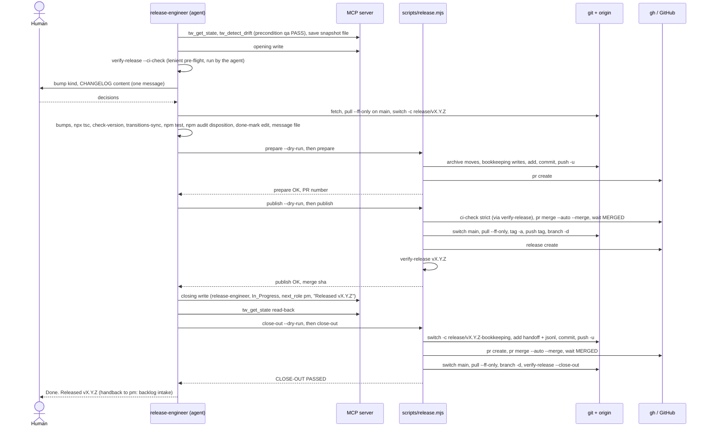

# e394-release-sop-rewrite — architecture

Companion to `specs/e394-release-sop-rewrite.md` (T-E394-01). `<base>` = `git merge-base HEAD main`; every base line number below is a line of `git show <base>:content/skill-release-engineer.md` (unchanged at lane HEAD).

Abbreviations used in the tables: **RS** = `test/e394-release-script.test.mjs` (T-E394-11), **ST** = `test/release-staging.test.mjs` (T-E394-12), **SOP** = `test/e394-release-sop.test.mjs` (T-E394-15).

## Affected Files

| path | change | task |
|---|---|---|
| `scripts/release.mjs` | new — the whole contract below; grown across seven tasks, each ≤ 300 added lines | T-E394-02..08 |
| `specs/release-sop-history.md` | new — provenance header + the 16 verbatim units of *History Move* | T-E394-09 |
| `content/skill-release-engineer.md` | rewritten whole per *SOP Outline*, ≤ 15,000 bytes | T-E394-10 |
| `scripts/verify-release.mjs`, `scripts/check-version.mjs`, `scripts/check-bookkeeping.mjs` | **unchanged** — no export is named (see *Absorption Table*), so T-E394-07 touches one file | — |
| `dist/**` | unchanged — `scripts/` is outside `tsconfig.json` `include` | — |
| tests | qa only, per the spec's Test Re-pin Map; seams in *Dry-Run Recorder and Runner Seam* | T-E394-11..16 |

No helper module (integrator constraint 2). `release.mjs` imports only `node:*` built-ins at module level, plus one runtime dynamic import of the compiled `dist/tools/lane-paths.js` in close-out (not a new module; AC-S8 requires the compiled resolver).

## Phase Split

Three phases. The agent's two MCP calls (closing write, read-back) sit between `publish` and `close-out` (integrator constraint 1).

| phase | base steps | starts on | inputs | ends with (stdout last line) |
|---|---|---|---|---|
| `prepare` | 7a, 7b, 7c, 7d, 8a | `release/vX.Y.Z`, bumps built and tested | `--version`, `--state`, `--tickets`, `--message-file` | `release: prepare OK (vX.Y.Z) — pull request #<n>` |
| `publish` | 8b, 8c, 9, 9a | `release/vX.Y.Z` (PR open) or `main` (resume after merge) | `--version` | `release: publish OK (vX.Y.Z) — tag at <merge-sha>` |
| *(agent)* | 12, 13 | `main` | closing write + `tw_get_state` read-back (MCP) | — |
| `close-out` | 13a, 13b | `main`, or `release/vX.Y.Z-bookkeeping` (resume) | `--version` | `release: close-out OK (vX.Y.Z) — CLOSE-OUT PASSED` |

### CLI

```
node scripts/release.mjs prepare   --version X.Y.Z --state <file> --tickets <E1[,E2…]|none> --message-file <file> [--dry-run]
node scripts/release.mjs publish   --version X.Y.Z [--dry-run]
node scripts/release.mjs close-out --version X.Y.Z [--dry-run]
node scripts/release.mjs --help
```

- `--version`: `^\d+\.\d+\.\d+$`, no leading `v`. The branch, tag and notes names derive from it.
- `--state`: the step-1 `tw_get_state` JSON, saved by the agent to a file **outside the repository root** (a file inside it would trip the root-file completeness check). Fields read: `last_agent`, `status`, `active_feature`, `completed_tasks`, `scope_decision_why`, `pending_notes`. It must show `last_agent="qa-engineer"`, `status="PASS"` (the PASS precondition, checked mechanically), else `USAGE`.
- `--tickets`: the backlog ids whose rows the agent done-marked (base 7c). Required when `docs/backlog.md` exists; `none` states the feature has no row. Absent while the backlog exists → `USAGE`.
- `--message-file`: the release commit message, outside the repository root. First line must match `^chore\(release\): vX\.Y\.Z — .+$`; body and any `Co-Authored-By:` trailer are the agent's (base E67d: the script appends no trailer).
- Human decisions (bump kind, CHANGELOG content, advisory disposition) are **not** script inputs: they are settled in SOP prose before `prepare`, and their results are on disk (`package.json`, `CHANGELOG.md`).
- Environment: `AGC_RELEASE_MERGE_WAIT_SECONDS` (default 900) and `AGC_RELEASE_POLL_SECONDS` (default 15) bound the `MERGED` wait; `AGC_VERIFY_CI_WAIT_SECONDS` passes through unchanged to `verify-release.mjs` (base E164).

### Step order per phase

`pre` steps run first in every phase (`USAGE` → `GH_UNAVAILABLE` → `WRONG_BRANCH`). Each later step is idempotent against observed state, so re-running the same phase after a host kill resumes (*Decision Records* row 6).

**prepare**

| step | action | stop class | resume rule |
|---|---|---|---|
| pre-1 | parse args; read `--state`, `--message-file` | `USAGE` | — |
| pre-2 | `gh auth status` | `GH_UNAVAILABLE` | — |
| pre-3 | branch = `release/vX.Y.Z` (`git rev-parse --abbrev-ref HEAD`) | `WRONG_BRANCH` | — |
| pre-4 | `git fetch origin` (skipped in dry-run); `git rev-list --count HEAD..origin/main` = 0 | `STALE_BASE` | — |
| pre-5 | `package.json` version = `--version`; README holds `#vX.Y.Z` and no `#v<PREV_TAG>`; `node scripts/check-version.mjs` exit 0 | `VERSION_INCOHERENT` | — |
| pre-6 | scope rule over `git status --porcelain=v1 -z --untracked-files=all` | `UNRELATED_CHANGES` | — |
| 7a | archive plan, then moves (*Step 7a contract*) | `EMPTY_BASELINE` | moved files leave the root; set shrinks to ∅ |
| 7b | `driftBaselineIds` += `completed_tasks`, dedup, created if absent | `DRIFT_BASELINE` | dedup = no write |
| 7c | `checkDoneMarks`, then `node scripts/check-bookkeeping.mjs` | `DONE_MARK`, `BOOKKEEPING_CHECK` | verify-only |
| 7d | `agc-version:` stamp ×3, then `node bin/agc-init.mjs check` exit 0 | `ADAPTER_STAMP` | stamp already current = no write |
| 8a-1 | stage plan (existence-filtered `STAGE_PATHS` with changes); `git add -- <plan>`; completeness | `STAGING_INCOMPLETE` | empty plan + HEAD subject `chore(release): vX.Y.Z — …` = commit already made, skip to 8a-5 |
| 8a-2 | CHANGELOG citation check over `PREV_TAG..HEAD` ∪ plan | `CHANGELOG_CITATION` | — |
| 8a-3 | AC4 spec classes over the same union | `SPEC_REQUIRE`, `SPEC_UNCLASSIFIABLE` | — |
| 8a-4 | `git commit -F <message-file>` | `MUTATION_FAILED` | skipped when commit exists |
| 8a-5 | `git push -u origin release/vX.Y.Z` | `PUSH_REJECTED` | skipped when `@{u}` = HEAD |
| 8a-6 | `gh pr create --base main --head release/vX.Y.Z --title <subject> --body <CHANGELOG entry>` | `MUTATION_FAILED` | skipped when `gh pr view release/vX.Y.Z` is OPEN |

**publish** (state machine keyed on `gh pr view release/vX.Y.Z --json number,state,mergeable,mergeStateStatus,statusCheckRollup,mergeCommit,headRefOid`)

| step | action | stop class |
|---|---|---|
| pre-3 | OPEN → branch `release/vX.Y.Z` and HEAD = `headRefOid`; MERGED → branch `main` or `release/vX.Y.Z`; CLOSED/none → stop | `WRONG_BRANCH` (CLOSED/none: `PR_CANNOT_MERGE`) |
| 8b-1 | tag `vX.Y.Z` absent locally (`git rev-parse -q --verify refs/tags/vX.Y.Z`) and on origin (`git ls-remote --tags origin refs/tags/vX.Y.Z`); present at this PR's `mergeCommit.oid` = resume | `TAG_EXISTS` |
| 8b-2 | OPEN only: `node scripts/verify-release.mjs --ci-check --strict`; only exit 0 with `CI-CHECK PASSED` continues | `CI_GATE_FAILED` |
| 8c-1 | OPEN only: cannot-merge shape (below) → stop; else `gh pr merge <n> --auto --merge` | `PR_CANNOT_MERGE` |
| 8c-2 | poll `gh pr view` until MERGED (budget) | `PR_CANNOT_MERGE`, `MERGE_WAIT_TIMEOUT` |
| 8c-3 | `git switch main`; `git -c pull.rebase=false pull --ff-only`; HEAD = `mergeCommit.oid` (assert skipped when origin already has the tag at that oid) | `MAIN_DIVERGED` |
| 8c-4 | `git tag -a vX.Y.Z -m "vX.Y.Z — <summary>"` unless the local tag is at the oid | `MUTATION_FAILED` |
| 8c-5 | `git push origin vX.Y.Z` unless origin has it at the oid | `PUSH_REJECTED` |
| 8c-6 | `git branch -d release/vX.Y.Z` when the local branch exists | `MUTATION_FAILED` |
| 9 | `gh release create vX.Y.Z --title "vX.Y.Z — <summary>" --notes <notes>` unless `gh release view vX.Y.Z` succeeds | `MUTATION_FAILED` |
| 9a | `node scripts/verify-release.mjs vX.Y.Z` exit 0 | `SELF_CHECK_FAILED` |

Cannot-merge shape: `state` CLOSED, `mergeable` CONFLICTING, `mergeStateStatus` ∈ {BEHIND, DIRTY}, or any `statusCheckRollup` entry concluded FAILURE / CANCELLED / TIMED_OUT / ACTION_REQUIRED; a non-zero `gh pr merge` is the same class. `<summary>` = the release commit subject (`git log -1 --format=%s <headRefOid>`) minus `chore(release): vX.Y.Z — `. Notes = the CHANGELOG entry body + `\n\n## Install\n\n` + a fenced block holding README's first line containing `#vX.Y.Z`, trimmed.

**close-out** (bookkeeping PR keyed on `gh pr view release/vX.Y.Z-bookkeeping --json …`)

| step | action | stop class |
|---|---|---|
| pre-3 | no PR → branch `main`; PR OPEN/MERGED → `main` or `release/vX.Y.Z-bookkeeping` | `WRONG_BRANCH` |
| 13a-1 | lane = `resolveCurrentLane(root)` from `dist/tools/lane-paths.js`; `.current/<lane>/` exists | `LANE_UNRESOLVED` |
| 13a-2 | `.current/<lane>/handoff.md` shows the closing write: `last_agent` release-engineer, `status` In_Progress, `next_role` pm, first `## Pending & Handoff Notes` bullet `Released vX.Y.Z` | `CLOSING_WRITE_ABSENT` |
| 13a-3 | no PR yet: plan = `.current/<lane>/handoff.md` + `readdirSync` `*.jsonl` of that dir, filtered to paths with changes; empty → stop; branch absent locally and on origin (`git ls-remote --heads`) | `EMPTY_STAGE`, `BRANCH_EXISTS` |
| 13a-4 | `git switch -c release/vX.Y.Z-bookkeeping`; `git add -- <plan>`; `git diff --cached --name-only` non-empty and ⊆ plan | `EMPTY_STAGE`, `UNRELATED_CHANGES` |
| 13a-5 | `git commit -m "chore(governance): post-release bookkeeping for vX.Y.Z"`; `git push -u origin release/vX.Y.Z-bookkeeping`; `gh pr create` (same title, base `main`) | `MUTATION_FAILED`, `PUSH_REJECTED` |
| 13a-6 | same as publish 8c-1..8c-3 and 8c-6 for this PR | `PR_CANNOT_MERGE`, `MERGE_WAIT_TIMEOUT`, `MAIN_DIVERGED`, `MUTATION_FAILED` |
| 13b | `node scripts/verify-release.mjs --close-out`; exit 0 with `CLOSE-OUT PASSED` | `CLOSE_OUT_NO_UPSTREAM`, `CLOSE_OUT_AHEAD`, `CLOSE_OUT_UNVERIFIED` |

The task ledger is never staged here (base E143): it rides the release commit (`STAGE_PATHS`).

### Step 7a contract (T-E394-03)

Same outcomes as the base fragments 1–5, in Node, one process, no shell, no glob.

1. `PREV_TAG` = `git describe --tags --abbrev=0`; failure → null.
2. Per tree `T` ∈ {`qa_reports`, `review_reports`}: `classifyArchiveTree` → `STOP` when `PREV_TAG` is null (both trees, even absent ones — base behaviour); else `EXCLUDE` when `T/` is absent; `INCLUDE` when `git ls-tree -r --name-only PREV_TAG -- T/` is non-empty; `STOP` when `T/` holds root-level files; else `EXCLUDE`. Any `STOP` → `EMPTY_BASELINE` with the detail, byte-identical to the base message: `step 7a has no membership baseline for <qa_reports|review_reports> (PREV_TAG='<PREV_TAG or empty>') — that tree has root-level evidence files and no baseline to diff them against; refusing to derive <CODES> for it rather than risk an unbounded sweep.` (only `PREV_TAG` is substituted). Nothing is written before this check.
3. Admitted = root-level regular files of each `INCLUDE` tree (`readdirSync`, files only, never `archive/`) whose `T/<name>` is absent from the `PREV_TAG` tree listing. `codeFromBasename`: `/^[a-z_]*T-([A-Za-z0-9]+)-/`, uppercased; no match contributes no code. `<CODES>` = sorted unique union over both trees.
4. Log, always: `step 7a: <CODES> = {E37,E38}` (comma-joined) or `step 7a: <CODES> = {∅}`.
5. Moves (`planArchiveMoves`), destination never overwritten (no-clobber: skip when it exists), `mkdir -p` per participating tree:
   - `qa_reports/review_T-<c>-*.md`, `qa_reports/visual_T-<c>-*.md` → `qa_reports/archive/<feature>/`;
   - `review_reports/review_T-<c>-*.md` → `review_reports/archive/<feature>/` (never cross-filed);
   - each root `qa_reports/expected-red_<f>.txt` absent from the `PREV_TAG` tree → `qa_reports/archive/<f>/`;
   - remaining root `*.md` of each tree whose first `COVERS_RE` line contains `T-<c>-` for any code → its own tree's `archive/<feature>/`. `COVERS_RE` = `/^\s*([-*]\s*)?(\*\*\s*)?covers(\s*\*\*)?\s*[:—-]/i` (the base POSIX class, in JS form).
6. Writes nothing else: no `docs/backlog.md` edit (base E301), no `.current/history/`, no root `tasks.md` (base E125c).

### Done-mark verification (T-E394-04)

The agent authors the done-mark text (judgment: the one-line mechanism summary) before `prepare`; the script verifies (*Decision Records* row 3). `checkDoneMarks({ backlogText, diffLines, tickets, version })` returns problems; any → `DONE_MARK`:

- each ticket id has exactly one ticket-table row (`^\| <id> \|`);
- that row's desc cell starts with `**DONE`, contains `vX.Y.Z` as a token, and does not contain `not yet released` (base E71d: amend a pre-mark in place);
- every `+`/`-` line of `git diff -U0 HEAD -- docs/backlog.md` (headers dropped) is a table row whose first or second cell names a ticket id (base E179: no new rows, no unrelated rows).

Then `node scripts/check-bookkeeping.mjs` (no `--base`); exit 1 or 2 → `BOOKKEEPING_CHECK` with its stderr. `--tickets none` skips the row checks but still runs `check-bookkeeping.mjs`.

### Staging, scope rule and citations (T-E394-05)

- `STAGE_PATHS.featureDirs` (19, order fixed): `lib/ tools/ schema/ guards/ gates/ prompts/ bin/ transport/ scripts/ content/ templates/ specs/ test/ qa_reports/ review_reports/ docs/ research/ multi-agent-scripts/ .github/`. `STAGE_PATHS.metadataPaths` (15): `tsconfig.json package.json package-lock.json index.ts CHANGELOG.md README.md CONTRIBUTING.md dist/ .current/.config.json docs/backlog.md tasks.md .current/_primary/tasks.md CLAUDE.md AGENTS.md .antigravityrules`. Plan = the members that exist on disk (base E71a) and have a change in `git status`; one `git add -- <plan…>` call.
- Scope rule (`checkScope`): a status path is expected when it is under a feature dir, equals a metadata path, is under `.current/`, or is `tasks.md` (base E71c). First other path → `UNRELATED_CHANGES` with detail `Pre-existing uncommitted changes found in <path> — this path is unrelated to the active feature. Commit or stash it first.` (base note, byte-identical).
- Completeness (`checkStagingCompleteness`): every feature dir with a status change has a staged path (base AC2 / E64); `git diff --name-only -- . ':!.current'` and `git ls-files --others --exclude-standard -- . ':!.current'` are both empty (base E94). Dry-run evaluates both against the plan instead of the index.
- Citations (`extractCitations` / `checkChangelogCitations`): the entry is CHANGELOG's `## [X.Y.Z] - ` section. A citation is a code span whose content matches `^[A-Za-z0-9_.-]+(/[A-Za-z0-9_.*-]+)*/?(:\d+)?$` and has a `/` or ends `.md .mjs .js .ts .json .yml .txt`; a `:<line>` suffix is dropped; a span containing `*` is skipped. A citation followed by `(context, not changed)` must exist on disk (base E83); any other must be in `PREV_TAG..HEAD` ∪ plan, where a trailing-`/` citation matches any file under it (base E95, E142(a)). Failures → `CHANGELOG_CITATION`, one line per citation.

### AC4 spec classes (T-E394-06)

`classifySpecCheck({ feature, unionFiles, specExists, scopeWhy, pendingNotes })` mirrors `simulatePostCommitCheck` in ST exactly:
- range specs = `deriveRangeSpecs(unionFiles)`: `^specs/[^/]+\.md$` minus `^specs/(fanout-.*|.*-architecture)\.md$`; **R** = a range spec other than `specs/<feature>.md`; **M** = a `pending_notes` entry matching `/^Multi-feature release:\s*(.+?)\.?\s*$/`, names split on `,` with a trailing `(…)` stripped (base E109/E146 example);
- M ∨ R → MULTI-FEATURE (R without M keeps the single-feature REQUIRE/SKIP/UNCLASSIFIABLE outcome for the active feature); else spec in tree → REQUIRE; else `recordsMiniChain(scopeWhy)` (`/mini-chain/i` and `/pm(\s*\/\s*|\s+)?arch(itect)?\s*(skip|skipped)/i`) → SKIP; else UNCLASSIFIABLE;
- stop details byte-identical except the REQUIRE remedy (integrator ruling on Open Question 2): REQUIRE `Release commit incomplete: specs/<active_feature>.md is absent from the release range <prev-tag>..HEAD. Stage the missing files and re-run.` with `<active_feature>` replaced by the feature name (`<prev-tag>` stays literal) → `SPEC_REQUIRE`; UNCLASSIFIABLE the base string verbatim, no substitution → `SPEC_UNCLASSIFIABLE`;
- log lines: `AC4: <BRANCH> branch — <reason>`, the base examples' wording.

It runs **before** `git commit`, over `PREV_TAG..HEAD` ∪ plan, the set the post-commit range will equal (*Decision Records* row 5; Open Question 2).

## Exit-Code Table

Machine-read by RS "AC-S2": rows whose first cell is an integer equal `EXIT_CLASSES` row for row (`code`, `id`, `phases`). Every non-zero exit prints exactly one stderr line `RELEASE_STOP <CLASS_ID>: <detail>`, last on stderr. Codes group by decade: 1–9 any phase, 10s preconditions, 20s prepare bookkeeping, 30s prepare commit/push, 40s publish, 50s close-out. Unknown errors (Node default 1) are `INTERNAL`.

| code | class | phases | trigger | SOP row: do | next_role |
|---|---|---|---|---|---|
| 1 | INTERNAL | prepare, publish, close-out | uncaught error, or the runner refused a call outside `ALLOWED` | Blocked; surface stderr | — |
| 2 | USAGE | prepare, publish, close-out | unknown phase/flag; bad `--version`; input file missing, unreadable or inside the repo; `--state` not a (qa-engineer, PASS) snapshot; message first line malformed; `--tickets` missing while the backlog exists | fix the invocation and re-run | — |
| 10 | WRONG_BRANCH | prepare, publish, close-out | current branch not the one the phase/state requires | Blocked; branch + sha in the note | — |
| 11 | STALE_BASE | prepare | `origin/main` has commits HEAD lacks | Blocked; recovery re-baselines at SOP step 5 on a new branch | — |
| 12 | VERSION_INCOHERENT | prepare | `--version` ≠ `package.json`; README pins not bumped; `check-version.mjs` non-zero | fix the bump (SOP step 7), re-run | — |
| 13 | UNRELATED_CHANGES | prepare, close-out | scope rule; close-out index holds a path outside the plan | Blocked; detail verbatim | — |
| 14 | GH_UNAVAILABLE | prepare, publish, close-out | `gh` missing or `gh auth status` non-zero | Blocked; authenticate, never work around | — |
| 20 | EMPTY_BASELINE | prepare | 7a guard STOP | Blocked; detail verbatim | — |
| 21 | DRIFT_BASELINE | prepare | `.current/.config.json` unparsable or `driftBaselineIds` not an array | Blocked | — |
| 22 | DONE_MARK | prepare | done-mark rule broken (see *Done-mark verification*) | fix the row edit (SOP step 11), re-run | — |
| 23 | BOOKKEEPING_CHECK | prepare | `check-bookkeeping.mjs` exit 1 or 2 | Blocked; output in the note | pm |
| 24 | ADAPTER_STAMP | prepare | stamp line absent or not unique; `agc-init.mjs check` non-zero | Blocked | — |
| 30 | STAGING_INCOMPLETE | prepare | feature dir changed but unstaged; root leftovers; nothing to commit | Blocked; paths in the note | — |
| 31 | CHANGELOG_CITATION | prepare | no entry for the version; unmarked citation outside the union; marked citation missing on disk | fix the entry, re-run | — |
| 32 | SPEC_REQUIRE | prepare | AC4 REQUIRE stop (incl. a named or active spec absent from the range) | Blocked; detail verbatim | — |
| 33 | SPEC_UNCLASSIFIABLE | prepare | AC4 UNCLASSIFIABLE | Blocked; detail verbatim | — |
| 34 | PUSH_REJECTED | prepare, publish, close-out | any `git push` non-zero | Blocked; branch + local sha (Constitution §6) | — |
| 35 | MUTATION_FAILED | prepare, publish, close-out | any other mutating call non-zero (`add`, `commit`, `switch`, `tag`, `branch -d`, `gh pr create`, `gh release create`) | Blocked; branch + local sha | — |
| 40 | TAG_EXISTS | publish | `vX.Y.Z` exists locally or on origin, not at this PR's merge commit | Blocked; never delete a tag | — |
| 41 | CI_GATE_FAILED | publish | `verify-release.mjs --ci-check --strict` printed a result other than `CI-CHECK PASSED` | Blocked; script reason in the note | — |
| 42 | PR_CANNOT_MERGE | publish, close-out | cannot-merge shape, PR closed/absent, or `gh pr merge` non-zero | Blocked; never update the branch, never `--admin` | — |
| 43 | MERGE_WAIT_TIMEOUT | publish, close-out | PR still open at the end of the merge-wait budget | re-run the same phase; at the `fix_try` cap Blocked | — |
| 44 | MAIN_DIVERGED | publish, close-out | `pull --ff-only` non-zero, or HEAD ≠ the merge commit | Blocked; never tag another commit | — |
| 45 | SELF_CHECK_FAILED | publish | `verify-release.mjs vX.Y.Z` non-zero | Blocked; failed checks in the note | — |
| 50 | CLOSING_WRITE_ABSENT | close-out | handoff on disk lacks the closing write | do SOP steps 14–15 first, re-run | — |
| 51 | LANE_UNRESOLVED | close-out | compiled resolver import fails or `.current/<lane>/` missing | Blocked | — |
| 52 | EMPTY_STAGE | close-out | nothing to stage, or nothing staged after `git add` | Blocked | — |
| 53 | BRANCH_EXISTS | close-out | `release/vX.Y.Z-bookkeeping` exists with no PR | Blocked; never delete it | — |
| 54 | CLOSE_OUT_NO_UPSTREAM | close-out | `--close-out` printed `FAIL: no upstream tracking branch configured` | Blocked; pushing never fixes this | — |
| 55 | CLOSE_OUT_AHEAD | close-out | `--close-out` printed `FAIL: HEAD is <n> commit(s) ahead of upstream` | wait for the merge, re-run; never push `main` | — |
| 56 | CLOSE_OUT_UNVERIFIED | close-out | any other `--close-out` FAIL (e.g. fetch failed) | Blocked | — |

`—` in `next_role` = hand back to the human; the SOP row says so in prose and the write omits `next_role` (AC-P4, constraint 5). Every `do` that says re-run is bounded by the `fix_try` cap, then Blocked.

## Data Structures

```js
// Exported, frozen.
EXIT_CLASSES: ReadonlyArray<{ code: number; id: string; phases: ReadonlyArray<"prepare"|"publish"|"close-out"> }>
STAGE_PATHS: { featureDirs: readonly string[]; metadataPaths: readonly string[] }   // 19 + 15, order as above
ALLOWED: ReadonlyArray<{ cmd: "git"|"gh"|"node"; verb: string; mutates: boolean; rule?: string }>
COVERS_RE: RegExp
ADAPTER_STAMPS: ReadonlyArray<{ path: "CLAUDE.md"|"AGENTS.md"|".antigravityrules"; line: RegExp; render(version: string): string }>
  // CLAUDE.md `<!-- agc-version: X.Y.Z -->`; the other two `# agc-version: X.Y.Z`

class ReleaseStop extends Error { classId: string; code: number; detail: string }

type Action = {
  step: string;                       // "pre-4", "7a", "8a-5", "8c-3", "13b", …
  kind: "read" | "mutate" | "fs" | "deferred";
  cmd?: string; args?: string[];      // process calls, always argv arrays
  op?: "write" | "move" | "mkdir"; path?: string; dest?: string;
  executed: boolean;                  // false for every mutate/fs/deferred action under --dry-run
};

type Snapshot = {                     // the --state file, as tw_get_state returned it
  last_agent: string; status: string; active_feature: string;
  completed_tasks?: string[]; scope_decision_why?: string; pending_notes?: string[];
};

type PrView = { number: number; state: "OPEN"|"MERGED"|"CLOSED"; mergeable?: string; mergeStateStatus?: string;
  statusCheckRollup?: Array<{ conclusion?: string }>; mergeCommit?: { oid: string } | null; headRefOid: string };
```

## Interface Contracts

All exports are pure or take the runner explicitly; importing the module has no side effect. The CLI entry sits behind `if (process.argv[1] && import.meta.url === pathToFileURL(process.argv[1]).href) process.exit(await main(process.argv.slice(2)))`.

| export | signature | task |
|---|---|---|
| `main` | `(argv: string[], deps?: { spawn?, env?, root?, out?, err?, sleep?, importLanePaths? }) => Promise<number>` — returns the exit code, never calls `process.exit` | 02 |
| `parseArgs` | `(argv) => { phase, version, dryRun, statePath?, tickets?: string[] \| "none", messageFile? }`; throws `ReleaseStop("USAGE")` | 02 |
| `createRunner` | `({ root, dryRun, spawn = spawnSync, env, out, err }) => Runner` | 02 |
| `Runner.read / mutate` | `(cmd, args, { step }) => { status, stdout, stderr }`; both call `assertAllowed` first; `mutate` under dry-run records and returns `{ status: 0, stdout: "", stderr: "" }` | 02 |
| `Runner.deferred` | `(cmd, args, { step }) => void` — a read that observes an earlier mutation of the same phase; under dry-run recorded only, otherwise run as `read` | 02 |
| `Runner.writeFile / move / mkdir` | `(rel, …, { step })`; `move` returns `false` and does nothing when the destination exists | 02 |
| `isAllowed` | `(cmd, args, { branch? }) => boolean` | 02 |
| `checkScope` | `(statusPaths: string[]) => string \| null` | 02 |
| `classifyArchiveTree` | `({ prevTag, treeExists, baselineHasFiles, rootHasFiles }) => "INCLUDE"\|"EXCLUDE"\|"STOP"` | 03 |
| `codeFromBasename`, `deriveCodes` | `(basename) => string \| null`; `({ qaAdmitted, rrAdmitted }) => string[]` | 03 |
| `planArchiveMoves` | `({ feature, codes, qaRoot, rrRoot, coversLine: (rel) => string \| null, newExpectedRed: string[], participating: { qa, rr } }) => Array<{ from, to }>` | 03 |
| `appendDriftBaseline` | `(configText: string \| null, ids: string[]) => { text, added }` — `JSON.stringify(obj, null, 2) + "\n"`, existing order kept | 04 |
| `checkDoneMarks` | `({ backlogText, diffLines, tickets, version }) => string[]` | 04 |
| `bumpAdapterStamp` | `(path, text, version) => string`; throws `ReleaseStop("ADAPTER_STAMP")` unless exactly one stamp line | 04 |
| `planStage`, `checkStagingCompleteness` | `({ statusPaths, exists }) => string[]`; `({ statusPaths, staged, unstagedTracked, untracked }) => string[]` | 05 |
| `extractChangelogEntry`, `extractCitations`, `checkChangelogCitations` | `(text, version) => string \| null`; `(entry) => Array<{ path, context }>`; `({ citations, unionFiles, exists }) => string[]` | 05 |
| `recordsMiniChain`, `deriveRangeSpecs`, `classifySpecCheck` | see *AC4 spec classes* | 06 |
| `classifyPr`, `buildReleaseNotes` | `(pr: PrView) => "MERGED"\|"OPEN"\|"CANNOT_MERGE"`; `({ changelogEntry, readmeText, version }) => string` | 07 |
| `readClosingWrite`, `classifyCloseOut` | `(handoffText) => { lastAgent, status, nextRole, firstNote }`; `(stderr) => "CLOSE_OUT_NO_UPSTREAM"\|"CLOSE_OUT_AHEAD"\|"CLOSE_OUT_UNVERIFIED"` | 08 |

### Output format

- stdout per action: `release: [<step>] $ <cmd> <args…>` (executed) or `release: DRY-RUN [<step>] <cmd> <args…>` (recorded); an arg with whitespace is JSON-quoted. fs actions print `mv <from> <to>`, `write <path>`, `mkdir <path>`.
- Child output is forwarded after the call returns: child stdout → stdout, child stderr → stderr.
- Success: stdout last line as in *Phase Split*; dry-run: `release: <phase> DRY-RUN OK (vX.Y.Z) — nothing changed`.
- Failure: stderr last line `RELEASE_STOP <CLASS_ID>: <detail>`, exit = the class code. Dry-run reports the same classes for every check it can evaluate.

### Allow-list (`ALLOWED`, enforced by `assertAllowed` at runtime and pinned by RS "AC-S3")

- mutating git: `add --`; `commit -F <file>` / `commit -m <msg>` (never `--amend`); `tag -a vX.Y.Z -m <msg>`; `push -u origin release/*`; `push origin vX.Y.Z`; `switch -c release/*`; `switch main`; `branch -d release/*`; `-c pull.rebase=false pull --ff-only` (only while the branch is `main`).
- read git: `fetch` (treated as mutating under dry-run, *Decision Records* row 4), `diff`, `log`, `status`, `show`, `ls-tree`, `ls-files`, `rev-parse`, `rev-list`, `describe`, and `ls-remote` (Open Question 1).
- gh: `pr create`, `pr merge <n> --auto --merge` (mutating); `pr view`, `run list`, `run view`, `auth status`, `release view` (read; the last two per Open Question 1); `release create` (mutating).
- node: `<root>/scripts/check-version.mjs`, `<root>/scripts/verify-release.mjs [args]`, `<root>/scripts/check-bookkeeping.mjs`, `<root>/bin/agc-init.mjs check` — spawned as `process.execPath`.
- Refused anywhere: `reset`, `rebase`, `clean`, `checkout`, `stash`, `update-ref`, `merge`, `--force`, `-f`, `--force-with-lease`, `-D`, `--squash`, `--rebase`, `--admin`, `tag -d`/`-f`, a push naming `main` or a `:` refspec, `shell: true`, any `bash`/`sh`/`npm` child. `spawnSync` is called in exactly one place (the runner).

## Dry-Run Recorder and Runner Seam

- `--dry-run` runs the same step list. `read` actions execute; `mutate`, `fs` and `deferred` actions are recorded, printed and not executed. Later steps use planned values: the stage plan stands in for the index, the archive plan for the moved files, `<merge-commit>` for the not-yet-known oid. Reads that depend on an earlier mutation of the phase are `deferred`: `agc-init.mjs check` after 7d, `git diff --cached` after 8a-1, the 8c-2 merge wait, 9a self-check, 13b `--close-out`. `git fetch` is not run (the refs stay as they are).
- AC-S1 contract: a dry-run on a good fixture exits 0 and leaves the working tree, the index, every ref (incl. `refs/remotes/*`), the fixture remote and the gh shim's mutation log unchanged.
- qa harness, in-process: `import { main, createRunner, … } from "../scripts/release.mjs"` and pass `deps.spawn` (a fake returning canned results per argv) and `deps.importLanePaths`; `Runner.actions` is the full ordered record for assertions (AC-S1 step order, AC-S3 verbs, AC-L1 S-class behaviour).
- qa harness, subprocess: copy `scripts/release.mjs` and the three absorbed scripts to `<tmp>/scripts/`, `dist/tools/lane-paths.js` to `<tmp>/dist/tools/`, a stub `<tmp>/bin/agc-init.mjs`; a bare repo as `origin`; a `gh` PATH shim that logs mutating calls (the pattern `test/e326-empty-branch-run-poll.test.mjs` uses). `AGC_RELEASE_MERGE_WAIT_SECONDS=0` makes the merge wait one poll.
- ST retarget map (T-E394-12): `deriveGuardFlags` → `classifyArchiveTree`; `codeFromFilename` / `deriveCodesFromWorkingTree` / `deriveCodesUnion` → `codeFromBasename` / `deriveCodes`; `resolveMoves` / `resolveDestination` → `planArchiveMoves`; `simulatePostCommitCheck` / `deriveRangeSpecs` / `scopeDecisionWhyRecordsMiniChain` → `classifySpecCheck` / `deriveRangeSpecs` / `recordsMiniChain`; `simulatePreCommitVerify` → `checkStagingCompleteness`; the 34-path set (E71(a)) → `STAGE_PATHS`; fragment-executing tests (E94 commands, E71(a) pre-filter, E71(b) zsh, T-E76-02 heredoc) → `prepare --dry-run` / `prepare` on the same fixtures.

## Absorption Table

`release.mjs` adds no export to, and imports nothing from, the three scripts: every call is a subprocess with the CLI unchanged (AC-H1, AC-H2). `verify-release.mjs` gains no export, so T-E394-07 is a one-file task.

| script | call (argv) | phase / step | exit / output → class | re-implemented in `release.mjs` |
|---|---|---|---|---|
| `check-version.mjs` | `node scripts/check-version.mjs` | prepare pre-5 | non-zero → `VERSION_INCOHERENT` (stderr in detail) | nothing (package/index/dist/CHANGELOG/lockfile parity stays there; release.mjs only compares `--version` to `package.json` and checks README pins, which check-version does not) |
| `verify-release.mjs` | `--ci-check --strict` | publish 8b-2 | 0 + `CI-CHECK PASSED` → go; else `CI_GATE_FAILED` | nothing (sha resolution, branch derivation, poll budget, strict posture) |
| `verify-release.mjs` | `vX.Y.Z` | publish 9a | non-zero → `SELF_CHECK_FAILED` | nothing (all six checks incl. CI ground truth and the bookkeeping-commit tolerance) |
| `verify-release.mjs` | `--close-out` | close-out 13b | 0 + `CLOSE-OUT PASSED` → go; `classifyCloseOut(stderr)` → 54 / 55 / 56 | nothing (fetch, upstream, ahead count) |
| `verify-release.mjs` | `--ci-check` (lenient) | — (SOP step 3, the agent runs it) | — | — |
| `check-bookkeeping.mjs` | `node scripts/check-bookkeeping.mjs` | prepare 7c | 1 or 2 → `BOOKKEEPING_CHECK` | nothing (id order, citations, queue, decisions); `checkDoneMarks` checks only what check-bookkeeping does not: the named rows carry this version and the diff touches no other row |
| `bin/agc-init.mjs` (not absorbed, called) | `node bin/agc-init.mjs check` | prepare 7d | non-zero → `ADAPTER_STAMP` | only the three stamp-line writes |
| `dist/tools/lane-paths.js` | dynamic import, `resolveCurrentLane(root)` | close-out 13a-1 | throw / missing dir → `LANE_UNRESOLVED` | nothing |

Re-implemented by design (no existing script holds them): 7a archive, 7b append, 7c row check, 7d stamp writes, staging plan + scope rule + completeness, CHANGELOG citation check, AC4 classes, and the git/gh choreography.

## Sequence Diagram



## Lesson Table (AC-L1)

The id list is `grep -oE '\bE[0-9]+[a-z]?\b' <base SOP> | sort -u` — exactly 69. Folds (AC-L1 round/finding rule): `E1A` → E1, `E9A` → E9, `E4X` (a batch code inside an E44–E49 archive path) → E44; D/C/A/N/F/X round ids are not counted. Every carrier test title contains the token `L:<id>` (matched as `L:<id>(?![0-9A-Za-z])`, so `L:E71` never matches `L:E71a`); SOP "AC-L1 every cited ticket has an assertion" carries the literal 69-id list and asserts each token appears in a `test(` title in RS ∪ ST ∪ SOP. Class counts: S 40, P 13, H 16.

| id | base cites it for | class | carrier (file: title fragment) |
|---|---|---|---|
| E1 | re-baseline off `main` (3a); E1A closing triple | S | RS: `L:E1 STALE_BASE when origin/main is not an ancestor`; SOP: `L:E1 closing triple` |
| E104 | `base_sha` invalidated by history rewrite (example) | H | SOP history anchors |
| E109 | multi-feature name with trailing parenthetical | S | RS: `L:E109 L:E146 multi-feature names strip a trailing parenthetical` |
| E125a | `_primary` ledger staged by the release commit | S | ST: `L:E125a STAGE_PATHS holds .current/_primary/tasks.md` |
| E125b | lowercase lane pointer (example) | H | SOP history anchors |
| E125c | no second archive path; never writes root `tasks.md` | S | RS: `L:E125c write set stays inside the Artifact allowlist` |
| E13 | terminal-marker resilience fallback | P | SOP: `L:E13 fallback is not licence to omit next_role` |
| E14 | CI ground truth, graceful degradation | S | RS: `L:E14 L:E78 L:E80 CI ground truth is delegated to verify-release.mjs` |
| E141 | bookkeeping commits ahead of the tag | S | RS: `L:E141 L:E143 close-out stages only handoff + jsonl` |
| E142 | range-corrected citation/spec checks; expected-red sweep | S | ST: `L:E142` expected-red per-feature and range fixtures |
| E143 | ledger staged by 8a, never 13a | S | RS: `L:E141 L:E143 …` |
| E144 | two close-out FAILs, two remedies | S | RS: `L:E144 close-out FAILs map to two classes` |
| E146 | multi-feature example name | S | RS: `L:E109 L:E146 …` |
| E15 | fabricated review round (E17 forensics) | H | SOP history anchors |
| E152 | range-derived spec set, non-weakening | S | ST: `L:E152` Fixtures L–P |
| E163 | pre-flight lenient + strict pre-tag CI gate | S | RS: `L:E163 publish gate is --ci-check --strict` |
| E164 | host-kill re-run with a lowered budget | P | SOP: `L:E164 host kill re-runs the phase, fix_try cap row` |
| E17 | record integrity | P | SOP: `L:E17 record integrity rule` |
| E179 | never add backlog rows | S | RS: `L:E179 done-mark check rejects an added row` |
| E18 | coordinator-relayed closing write outranks any brief | P | SOP: `L:E18 L:E9 relay rule` |
| E25 | backtest output (v3.91.0 set) | H | SOP history anchors |
| E27 | backtest output | H | SOP history anchors |
| E28 | backtest output | H | SOP history anchors |
| E29 | backtest output | H | SOP history anchors |
| E297 | release branch + PR, never push `main` | S | RS: `L:E297 no push to main; PR merge is --auto --merge` |
| E30 | backtest output | H | SOP history anchors |
| E301 | 7a never rewrites backlog citations | S | RS: `L:E301 archive step never writes docs/backlog.md` |
| E32 | backtest output | H | SOP history anchors |
| E33 | backtest output | H | SOP history anchors |
| E34 | backtest output | H | SOP history anchors |
| E35 | backtest output | H | SOP history anchors |
| E36 | v3.93.0 untracked-at-root shape | S | ST: `L:E36` F7 regression |
| E37 | v3.94.0 two-file shape | S | ST: `L:E37 L:E38` |
| E38 | v3.94.0 two-file shape | S | ST: `L:E37 L:E38` |
| E39 | transitions-sync check skipped by `npx tsc` | P | SOP: `L:E39 L:E67b bump-build path` |
| E44 | AC4 conditional on dispatch shape (E4X = E44–E49 batch task code, folded here) | S | ST: `L:E44` Fixtures C–K + exhaustiveness |
| E45 | committed-in-range shape | S | ST: `L:E45 L:E46` |
| E46 | committed-in-range shape | S | ST: `L:E45 L:E46` |
| E49 | derive codes from the working tree | S | ST: `L:E49` non-retroactivity, bare-code, already-archived |
| E50 | two parallel trees, per-tree guard, `<CODES>` logged | S | ST: `L:E50` per-tree guard, v3.96.0 collision, covers own tree |
| E53 | empty-baseline is its own class | S | RS: `L:E53 EMPTY_BASELINE exits 20 before any write` |
| E55 | handback names pm backlog intake | P | SOP: `L:E55 handback names backlog intake` |
| E57 | advisory disposition, no inline waiver | P | SOP: `L:E57 advisory disposition before the first phase` |
| E60 | lockfile parity | S | RS: `L:E60 lockfile drift stops as VERSION_INCOHERENT` |
| E64 | `gates/` staged | S | ST: `L:E64` Fixture I |
| E645 | batch prefix as a synthetic code (example) | H | SOP history anchors |
| E65 | 7b–7d before the commit | S | RS: `L:E65 prepare runs 7a, 7b, 7c, 7d before the commit` |
| E66 | zsh NOMATCH example | H | SOP history anchors |
| E67a | README pins only | P | SOP: `L:E67a README install pins only` |
| E67b | `npx tsc` bump-build path | P | SOP: `L:E39 L:E67b …` |
| E67c | `agc check` output form (note) | H | SOP history anchors |
| E67d | trailer per harness, none invented | P | SOP: `L:E67d trailer follows the harness` |
| E67e | batch-id caveat | H | SOP history anchors |
| E67f | constitution is `const-*.md` fragments | P | SOP: `L:E67f MUST-NOT names content/const-*.md` |
| E71 | shell-safety family | S | ST: `L:E71 L:E71a existence pre-filter` |
| E71a | existence pre-filter | S | ST: `L:E71 L:E71a …` |
| E71b | zsh NOMATCH on globs | S | RS: `L:E71b L:E76 array argv, no shell child` |
| E71c | `.current/**` and `tasks.md` are not scope-rule triggers | S | RS: `L:E71c scope rule ignores .current and tasks.md` |
| E71d | pre-marked row amended in place | S | RS: `L:E71d not-yet-released pre-mark must be amended` |
| E76 | one process for 7a | S | RS: `L:E71b L:E76 …` |
| E78 | sha-matched CI ground truth | S | RS: `L:E14 L:E78 L:E80 …` |
| E8 | success metrics emit is automatic | P | SOP: `L:E8 metrics emit is automatic` |
| E80 | bounded CI poll | S | RS: `L:E14 L:E78 L:E80 …` |
| E82 | budget knob cited by name, no figure | P | SOP: `L:E82 wait budget named, no seconds figure` |
| E83 | `(context, not changed)` exempts membership only | S | RS: `L:E83 L:E95 citation check` |
| E84 | bookkeeping commit made before `--close-out` | S | RS: `L:E84 close-out merges the bookkeeping PR before --close-out` |
| E9 | self-check mandatory; E9A relay | S | RS: `L:E9 SELF_CHECK_FAILED on verify-release non-zero`; SOP: `L:E18 L:E9 …` |
| E94 | root-file completeness | S | ST: `L:E94` four workspace shapes |
| E95 | CHANGELOG citation check | S | RS: `L:E83 L:E95 …` |

## History Move

`specs/release-sop-history.md` (T-E394-09) = a provenance header, then 16 units in base order, each under `## Base <group>` and copied **byte-identical**: unit text = base lines `a..b` joined with `\n`. Code fences inside a unit are kept (they are the old executable record). No unit is edited, summarised or reflowed; the sr adds only the header, the group headings and blank lines between units.

Header (exact shape; RS/SOP anchor-check it): line 1 `# Release SOP history`, then `Source: content/skill-release-engineer.md`, `Base commit: <short sha of <base>>`, `Moved: <YYYY-MM-DD>`, then one sentence: the units below are verbatim incident, backtest and rationale text removed from the release-engineer SOP when its mechanical steps moved into `scripts/release.mjs`.

| unit | base lines | group heading | holds (kinds) | sha256 prefix of unit text | first line starts |
|---|---|---|---|---|---|
| U01 | 13–27 | Hard rules | E9A forensics, E18 incident, D10 reason, E17/E83 rationale block, HEREDOC rule (retired) | `88afffde200f` | `- **PASS precondition**:` |
| U02 | 30–47 | Artifact | E179, E125a/E143, E67f rationale span, E64 judgment | `22c0ac28793a` | `Release-engineer is allowed to write to:` |
| U03 | 53 | Step 2a | six-red-commits measurement, leniency reasoning | `52bb3948c12c` | `2a. **Pre-flight CI gate**` |
| U04 | 55–56 | Steps 3a–3b | D5 rebase incident, same-version re-baseline | `86c376b58767` | `3a. **Re-baseline off HEAD**` |
| U05 | 61–63 | Steps 4–5 | E67a, E60, bump-build path observations, E67b | `b1c14e0aa87c` | ``- `README.md`: replace all`` |
| U06 | 65–67 | Step 6a | E57 waiver history, inline-STOP note | `b74069f00c8a` | `6a. **Dependency-audit disposition**` |
| U07 | 69–199 | Step 7a | F1/F2/F3/F5/F8/F9 round narratives, v3.93.0 backtest + six-release table, E67e caveat, two rationale blocks, origin span, v3.96.0 collision, lane-ledger writeback | `feb6a6a63c6f` | `7a. **Archive shipped feature's qa_reports**` |
| U08 | 200–202 | Steps 7b–7d | E65 move history, origin span, E67c rationale span | `694e70e9867a` | `7b. **Drift-baseline acknowledgment**` |
| U09 | 203–229 | Step 8a | E71a, E94 v3.104.2 escape, E95/E142(a) measurement, rationale block, E67d, AC4 branches | `b77e207e5a1f` | `8a. **Commit + push branch**` |
| U10 | 230–232 | Step 8b | strict-vs-lenient reasoning, host-kill measurement (E164) | `0f311b8eb98b` | `8b. **CI gate**` |
| U11 | 233–239 | Step 8c | retired early-tag allowance | `4ea5d588d0e9` | `8c. **Tag + push**` |
| U12 | 240–244 | Steps 9–9a | v3.72.0/v3.73.0 incident, E82 rationale block | `95967dfc1af0` | `9. **GitHub release**` |
| U13 | 245–252 | Steps 10–13 | retired pointers, E8, E1A triple, E13 incidents (v3.75.0, v3.77.0) | `cc97c8d266ce` | `10. *(retired — moved to step 7b, E65)*` |
| U14 | 254–271 | Steps 13a–13b | N9, E143, E144, E84 rationale block (6cd767b, N1) | `9d48511f3c8c` | `13a. **Bookkeeping commit + push**` |
| U15 | 273 | Step 14 | E55 instance | `66755e12a28d` | `14. **Terminal handback: backlog intake**` |
| U16 | 277–292 | Escalation Routes | the old table (with its `human` next_role cells) + scope rule incl. historical commits | `713ed5ae7115` | `Call shape: Constitution §3` |

Total 261 base lines, 95,973 bytes; every one of the 69 ids occurs in at least one unit. Lines not moved (1–12, 28–29, 48–52, 54, 57–60, 64, 68, 253, 272, 274–276) are headings, blank lines or step 1–7 procedure the rewrite restates. Review-time comparison (AC-P10): for each row, `git show <base>:content/skill-release-engineer.md | sed -n '<a>,<b>p'` must occur verbatim in the history file and its sha256 (without the final newline) must start with the listed prefix. Resident anchors (SOP "AC-P10 history anchors"): each unit's full first line occurs as a line of the history file, and each H-class id occurs as a token.

## SOP Outline

Target 13,500 bytes, hard cap 15,000 by `wc -c` (AC-H5). Over budget: cut prose, never a table row. Every section is newly written; nothing is pasted from the base except the literals listed.

| section | budget (bytes) | content |
|---|---|---|
| frontmatter + `# Skill: release-engineer` | 60 | `recommended_model: opus` unchanged |
| `## Persona` | 300 | post-PASS shipping; decisions + MCP writes by the agent, mechanics by `scripts/release.mjs` |
| `## Output rule` | 500 | `Done. Released <tag>.` only after the read-back matched (or the coordinator confirmed a relayed write) **and** close-out printed `CLOSE-OUT PASSED`; a relay session ends with its payload and claims nothing |
| `## Hard rules` | 2,700 | PASS precondition; major bump opt-in, default patch; git: never force-push, tags immutable, `main` moves only by PR merge, all release mutations run inside the script, a push rejection / collision / any `RELEASE_STOP` is Blocked with branch + local sha (pointer to Constitution §6, no recovery verbs); `check-version` before tag; version-literal test failure → `next_role="qa-engineer"`; first-class transition citizen, never stamp another role; STOP on any ⛔; no-MCP-path relay with `RELAY REQUIRED:`, never hand-edit, no brief overrides it; record integrity incl. `(context, not changed)` (membership exempt, on-disk existence not); the script's exit code is the result — never redo a phase by hand, `--dry-run` first |
| `## Artifact` | 1,500 | today's allowlist, compressed (AC-P7 list) + "`scripts/release.mjs` performs the 7a–8a and close-out writes"; MUST-NOT: `tools/ prompts/ schema/ guards/ gates/ content/skill-*.md content/const-*.md` and `` `gates/registry.ts` (`GATE_REGISTRY`) `` exactly once, no gate count; constitution-version bump → route back |
| `## SOP` | 4,700 | steps below |
| `## Escalation Routes` | 3,700 | call-shape line; note format `pending_notes[0]` = `release-engineer: <CLASS_ID> — <RELEASE_STOP detail>`; table `exit \| class \| do \| next_role` with 31 code rows (bijection with `EXIT_CLASSES`) + 9 non-script rows; history pointer as the file's last line |

SOP steps (numbering fixed for the Escalation rows):
1. `tw_get_state` → `tw_detect_drift`; tuple must be (qa-engineer, PASS), else STOP and route back; save the JSON to a file outside the repo (the `--state` input).
2. Opening write `agent_id="release-engineer"`, `status="In_Progress"`.
3. Pre-flight CI: `node scripts/verify-release.mjs --ci-check` (lenient); a definite red STOPs.
4. Human decisions in one message: bump kind (default patch, major only on explicit opt-in) and the CHANGELOG entry content.
5. On `main`: `git fetch origin`, `git -c pull.rebase=false pull --ff-only`, re-derive the version from HEAD.
6. `git switch -c release/vX.Y.Z`; a branch of that name already existing STOPs.
7. Bumps: `package.json`, `index.ts` Server literal, CHANGELOG entry, README `#v` pins, `npm install --package-lock-only` (two version fields only).
8. Build path: `npx tsc`, `node scripts/check-version.mjs`, `npm run check:transitions-sync`.
9. `npm test`.
10. `npm audit --audit-level=high` against `docs/dependency-advisories.md`; no recorded disposition → STOP (pm); never an inline waiver.
11. Edit the done-mark of the feature's backlog row(s) (amend a pre-mark in place, never add a row); write the commit message file (trailer per the harness, none if it prescribes none).
12. `node scripts/release.mjs prepare --dry-run …` then without `--dry-run` (exact command line in the SOP; it runs `check:bookkeeping` and `agc check`).
13. `node scripts/release.mjs publish --dry-run --version X.Y.Z` then without.
14. Closing write: `agent_id="release-engineer"`, `status="In_Progress"`, `next_role="pm"`, `pending_notes=["Released vX.Y.Z", "tag: <merge-sha>"]`; success-metrics emit is automatic; gate retro per `docs/gate-retro-procedure.md` every ~5 releases.
15. `tw_get_state` read-back must match step 14 exactly; mismatch STOPs.
16. `node scripts/release.mjs close-out --dry-run --version X.Y.Z` then without; requires `CLOSE-OUT PASSED`.
17. Reply `Done. Released <tag>.`; the `next_role="pm"` handback is pm's backlog intake.

Host-kill rule (one paragraph, step 12–16 scope): a phase killed by the host before it printed `release: <phase> OK` or a `RELEASE_STOP` line is silence, not a result — re-run the same command (phases resume); after the first kill set `AGC_VERIFY_CI_WAIT_SECONDS` and `AGC_RELEASE_MERGE_WAIT_SECONDS` below the host timeout; at the `fix_try` cap use the host-kill row.

Non-script rows (9, `exit` cell `—`): precondition not (qa-engineer, PASS) (step 1); pre-flight CI red (3); non-fast-forward pull on `main` (5); `release/vX.Y.Z` already exists (6); `npm test` regression or a hardcoded version literal (9, `qa-engineer`); advisory without disposition (10, `pm`); any ⛔ rejection; read-back mismatch (15); host-killed phase at the `fix_try` cap.

Literals the SOP must carry: `Done. Released <tag>.`, `RELAY REQUIRED:`, `Released vX.Y.Z`, `` `gates/registry.ts` (`GATE_REGISTRY`) `` (once), `check:bookkeeping`, `CLOSE-OUT PASSED`, `CI-CHECK PASSED`, `--dry-run`, each phase command line, `specs/release-sop-history.md` (once). Must not carry: a 7–40 hex sha token, a `v<d>.<d>.<d>` literal, `next_role="human"`, a gate count, a seconds figure for a wait budget.

## Task Mapping (sr-engineer)

Each task: ≤ 5 files, ≤ 300 changed lines; `release.mjs` is the only file of T-E394-02..08.

| task | implements (sections of this doc) | est. lines |
|---|---|---|
| T-E394-02 | CLI; Exit-Code Table as `EXIT_CLASSES`; `ReleaseStop`; Output format; Allow-list (`ALLOWED`, `isAllowed`, `assertAllowed`); Runner seam + dry-run recorder (`createRunner`, `deferred`); `main` + main guard; `pre-1..pre-6` for prepare (incl. `checkScope`, `check-version.mjs` call) and `pre-1..pre-3` dispatch for publish/close-out; phase bodies stubbed to `INTERNAL` "not implemented" | ~240 |
| T-E394-03 | Step 7a contract (`classifyArchiveTree`, `codeFromBasename`, `deriveCodes`, `planArchiveMoves`, `COVERS_RE`, the log line, `EMPTY_BASELINE`) | ~230 |
| T-E394-04 | 7b `appendDriftBaseline`; Done-mark verification (`checkDoneMarks`, `check-bookkeeping.mjs` call); 7d `ADAPTER_STAMPS`, `bumpAdapterStamp`, `agc-init.mjs check` (deferred under dry-run) | ~170 |
| T-E394-05 | Staging, scope rule and citations (`STAGE_PATHS`, `planStage`, `checkStagingCompleteness`, `extractChangelogEntry`, `extractCitations`, `checkChangelogCitations`) | ~210 |
| T-E394-06 | AC4 spec classes; 8a-4..8a-6 commit / push / PR with the prepare resume rules | ~190 |
| T-E394-07 | publish phase whole (state machine, `classifyPr`, merge wait, `buildReleaseNotes`, 9a); `verify-release.mjs` untouched | ~260 |
| T-E394-08 | close-out phase whole (`readClosingWrite`, lane import, plan, bookkeeping PR, `classifyCloseOut`) | ~190 |
| T-E394-09 | History Move (header + U01–U16), produced mechanically from `git show <base>:…` | ~290 |
| T-E394-10 | SOP Outline, ≤ 15,000 bytes; Escalation table rows from the Exit-Code Table | ~130 |

## Decision Records

| Context | Decision | Consequences |
|---|---|---|
| Absorbing the three scripts (AC-S9) | Subprocess only; no export added, no import | `verify-release.mjs` keeps a zero diff, AC-H2 holds trivially, T-E394-07 is one file; release.mjs reads results from exit codes and the scripts' fixed output lines, so those lines become a contract (already pinned by their own tests) |
| Getting `active_feature`, `completed_tasks`, `scope_decision_why`, `pending_notes` into the script | `--state <file>` = the step-1 `tw_get_state` JSON, outside the repo | one input instead of four hand-copied flags; the PASS precondition becomes a mechanical check; the multi-feature `pending_notes` line survives (the opening write replaces `pending_notes` on disk, so reading `handoff.md` at prepare time would lose it) |
| Who authors the done-mark (AC-S5) | Agent writes the row text; script verifies rows, version, no stray rows, then `check-bookkeeping.mjs` | summary wording stays judgment; row-editing a markdown table stays out of the script; costs the `--tickets` input |
| Dry-run semantics (AC-S1) | Same step list; reads run, mutations/fs/deferred reads are recorded; `git fetch` not run | dry-run proves every evaluable check passes without touching a ref; a stale `origin/main` tracking ref can make dry-run's `STALE_BASE` verdict differ from the real run's, which fetches first |
| AC4 timing (AC-S6) | Evaluate before `git commit` over `PREV_TAG..HEAD` ∪ stage plan | the set equals the post-commit range except for a path both changed in range and reverted in the stage; a stop leaves no commit behind, so the REQUIRE remedy is reworded to `Stage the missing files and re-run.` and never invites a §6-forbidden `--amend` (Open Question 2, integrator ruling) |
| Host kills mid-phase | Every step is idempotent against observed state (PR, tag, branch, upstream) and the phase resumes on re-run | the base re-run guidance (E164) extends to all three phases; needs read-only `ls-remote` / `gh release view` (Open Question 1) |
| Running close-out before the closing write | close-out reads `.current/<lane>/handoff.md` and stops `CLOSING_WRITE_ABSENT` unless the closing write is on disk | a premature close-out cannot commit a handoff that lacks it; couples close-out to the handoff file layout (YAML frontmatter + `## Pending & Handoff Notes`), pinned by RS |
| Stop reporting | One stderr line `RELEASE_STOP <CLASS_ID>: <detail>`, codes grouped by decade, 1 = `INTERNAL` | stable grep target for the agent and tests; base `STEP7A_STOP:` / exit 9 retire with the heredoc (EMPTY_BASELINE is 20) |
| Commit message transport | `git commit -F <file>` with the file outside the repo | the HEREDOC hard rule retires (argv, no shell); the file cannot trip the completeness check |
| Escalation table size vs 15,000 bytes | One generic pending-note format; rows carry exit, class, do, next_role only | 40 rows fit in ~3,700 bytes; the detail text comes from the script's stop line instead of per-row note templates |
| History granularity (AC-P10) | Whole base lines in 16 contiguous units, fences included | byte-identity is checkable with `sed -n` + sha256; the history keeps the old executable fragments next to their narratives; ~96KB in `specs/`, never loaded into a prompt |
| Counting the 69 ids | `\bE[0-9]+[a-z]?\b` over the base SOP; E1A/E9A/E4X fold | reproduces the spec's 69 exactly; the literal list is stable in the test after the base text is gone |
| Lane in close-out (AC-S8) | Dynamic import of compiled `dist/tools/lane-paths.js`, injectable as `deps.importLanePaths` | single owner of the lane rule kept; subprocess tests copy that one compiled file (it imports only `fs`/`path`) |

## Deferred Resources

_None — the spec's Dependencies / Prerequisites shows zero ignored/deferred refs (Resource Audit: zero external references)._

## Open Questions

1. **AC-S3 read-only verbs** — closed by integrator 2026-11-03: accepted, added to AC-S3. AC-S3's allowed list lacks three read-only calls this design needs: `git ls-remote` (tag on origin, AC-S7; bookkeeping branch on origin), `gh auth status` (`GH_UNAVAILABLE` before the first push), `gh release view` (publish resume after a host kill between tag push and self-check). All three read only, in line with Constitution §6's read-only allowance. Proposed: add them to AC-S3's read-only list (one-line spec edit). If refused: the origin-tag check falls back to `git fetch origin` + local `refs/tags` (auto-followed tags only, weaker), gh availability is detected from the first `gh pr view` failure, and a publish re-run after the tag push stops `TAG_EXISTS` (human recovery) instead of resuming.
2. **AC4 evaluated before the commit** — closed by integrator 2026-11-03: accepted, with the REQUIRE remedy reworded to `Stage the missing files and re-run.` and AC-S6 reworded; the other class strings stay verbatim; qa re-pins the matching release-staging test in T-E394-12. AC-S6 names it the "post-commit spec check"; this design runs the same classification before `git commit` over `PREV_TAG..HEAD` ∪ the stage plan (same set, same verbatim strings), so a stop leaves no commit and the REQUIRE string's "amend" never invites a §6-forbidden verb. Proposed: accept as satisfying AC-S6; alternative: run it after the commit as the base SOP did.
3. **69-id folds** — closed by integrator 2026-11-03: fold accepted; the E44 lesson row names E4X as the E44–E49 batch task code. The spec's 69 equals `\bE[0-9]+[a-z]?\b` over the base SOP, which leaves out `E1A`, `E9A`, `E4X`; this doc folds them into E1, E9 and E44 under AC-L1's round/finding rule. Proposed: confirm the fold (no AC text change).

## Post-Review Amendments

- **`--state` input (qa FAIL round 1, integrator ruling 2026-11-03)** — supersedes the JSON-only wording of `--state` in `## Phase Split`, `## Data Structures` (`Snapshot`), `## SOP Outline` step 1 and the `## Decision Records` row. `tw_get_state` elides long `pending_notes` (and long `completed_tasks`), so its JSON can hide a `Multi-feature release:` note or a completed id. `--state` now takes either (i) a verbatim copy of the lane `handoff.md` made before the opening write, outside the repository root — detected by its leading frontmatter fence and parsed by the compiled canonical parser (`parseHandoff` from `dist/tools/handoff-parse.js`) inside a temp workspace under the OS temp directory, deleted afterwards, also in `--dry-run`; or (ii) the JSON form, refused with `USAGE` when it carries `pending_notes_truncated`, `completed_tasks_truncated` or a read-view marker note. SOP step 1 tells the agent to make the copy (form i).
- **CI gate argv** — the publish phase passes `--ci-check --strict --sha <release head oid>`; same strictness, pinned to the head being merged.
