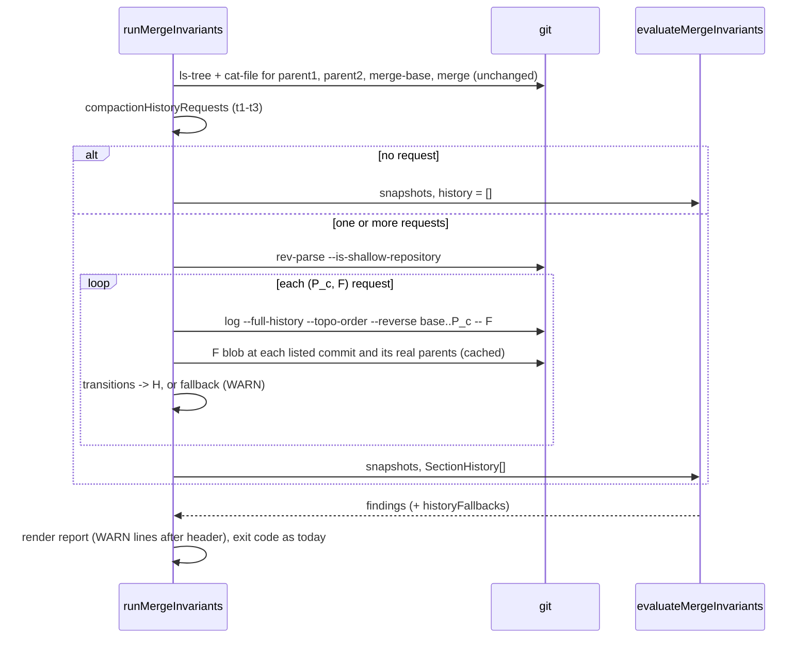

# e417-merge-invariants-lost-row — architecture

The rule, the trigger, the fallback, the cost bound, the worked cases and the
test scenarios live in `specs/e126-merge-invariants.md` — the *Condition (c)
history rule (E417)* block (steps 1–9) and AC12/AC13. This file holds only the
code-level contracts sr-engineer implements them with.

## Affected Files
- `tools/merge-invariants.ts` — modify: history walk, history-mode `U` in
  `unionReconciliationFailures`, WARN rendering, `historyFallbacks` in findings.
  Doc blocks stay at most 7 body lines each (the spec carries the rationale),
  so `agc check` raises no comment-length warning.
- `dist/tools/merge-invariants.*` (`.js`, `.d.ts` and their maps) — rebuilt with `npm run build`.
- `test/e203-merge-invariants-union.test.mjs` — sr-owned: AC12 repro cases R1–R5.
- `qa_reports/expected-red_e417-merge-invariants-lost-row.txt` — sr-owned: R1–R5 listed.
- `test/e417-merge-invariants-history.test.mjs` — qa-owned: AC13 (G1–G5, F1–F5, N1).
- `scripts/merge-invariants.mjs` — unchanged (it already prints `result.report` on stdout).

## Data Structures
```ts
export const HISTORY_COMMIT_CAP = 256;
export type HistoryFallbackReason = "shallow" | "unreadable" | "cap" | "unreconciled";

/** One walk: compacting parent P_c, ledger file F, the requested sections (spec step 1), sorted. */
export interface HistoryRequest {
  parent: CommitSnapshot;
  file: string;
  sections: string[];
}

/** Walk outcome for one F/S. `summarized` = H (task_id -> counted state); null = snapshot-only rule. */
export interface SectionHistory {
  parent: string;      // "parent1" | "parent2"
  parentSha: string;
  file: string;
  section: string;
  summarized: Map<string, RowState> | null;
  fallback: { reason: HistoryFallbackReason; detail: string } | null; // non-null => WARN line
}

export interface HistoryFallback {
  parent: string;
  parentSha: string;
  file: string;
  section: string;
  reason: HistoryFallbackReason;
  detail: string;      // the text after the class keyword in the WARN line
}

// MergeInvariantsFindings gains:  historyFallbacks: HistoryFallback[]   (always present; [] when none)
```
`summarized: null, fallback: null` is the silent case (no transition on the
path: S was compacted at or before the merge-base).

## Interface Contracts
- `compactionHistoryRequests(p1, p2, base, merge): HistoryRequest[]` — pure;
  applies trigger t1–t3. Empty result means no extra git call at all.
- `readCompactionHistory(repoRoot, baseSha, req, blobCache, opts: { cap: number; shallow: boolean }): SectionHistory[]`
  — one entry per `req.sections` item; never throws (every git failure maps to
  a `fallback`); every git call it makes carries `GIT_NO_LAZY_FETCH=1` in its env
  and uses the shared `blobCache`. Lists commits with
  `git log --full-history --topo-order --reverse --max-count=<cap+1> --format=%H %P <base>..<parent> -- <file>`.
- `evaluateMergeInvariants(p1, p2, base, merge, history: SectionHistory[] = [])`
  — still pure. With `[]` (or only null-`summarized` entries) it behaves exactly
  as today. An F/S with non-null `summarized` uses the history-mode `U` (spec
  step 4). Every non-null `fallback` becomes one `historyFallbacks` entry.
- `renderMergeInvariantsReport(shas, findings)` — unchanged signature; WARN
  lines (spec step 5 format) go right after the header line, sorted by parent
  label, file, section; the (c) reason gains the step-4 suffix when h > 0.
- `runMergeInvariants(ref = "HEAD", repoRoot = process.cwd(), opts: { historyCommitCap?: number } = {})`
  — new optional third argument, a test knob only (default `HISTORY_COMMIT_CAP`);
  `runMergeInvariantsCli` never passes it, so the CLI contract is unchanged.
  Order: four snapshots → requests → (only if non-empty) one
  `git rev-parse --is-shallow-repository` → walks → evaluate → render. Exit code
  depends only on MISSING / LOST_DONE / SIDECAR_SHORTFALL, as today.

## Sequence Diagram


## Decision Records
| Context | Decision | Consequences |
|---|---|---|
| Case 1 needs rows that are in neither parent's tip | Read P_c's history between the merge-base and P_c, only for F/S where a verdict depends on it (t1–t3) | Zero cost in ordinary merges; a fresh one-sided compaction costs at most one listing + bounded blob reads per (P_c, F) |
| Which history rows count as "summarized" | Only rows that left F/S in a commit whose count rose by exactly that many, absent from P_c's tip, and H within P_c's own count | Anything else falls back to the snapshot-only rule; the rule can only add rows a manifest provably counted, so no new false positive |
| Kept rows in history mode | Enter `U` only through H, replacing rules (i)/(ii) for that F/S | Kept rows the manifest never counted stop consuming slots; kept rows it did count (AC-E203-6, the cherry-pick shape, case 2's moved row) do |
| Case 2 (moved row on the non-compacting side) | Closed by the same H: the moved row is in P_c's pre-compaction set | No second mechanism; case 2 stays open only when P_c's history falls back |
| Unreadable / shallow / over-cap / unreconciled history | WARN line + snapshot-only rule for that F/S, exit code unchanged (human ruling 2026-11-16) | Same false negatives as before E417 in those cases, now visible |
| Real parents | `git log --format=%H %P` (commit-object parents), not `rev-list --parents` | Path-limited parent rewriting would hide the parent a merge commit on P_c's path took its manifest from |
| Partial clones | `GIT_NO_LAZY_FETCH=1` on walk reads only | A missing object is a fallback, not a fetch; the four snapshot reads keep today's behaviour |

## Deferred Resources
_None — the spec's Dependencies / Prerequisites shows zero ignored/deferred refs._

## Open Questions
None.
