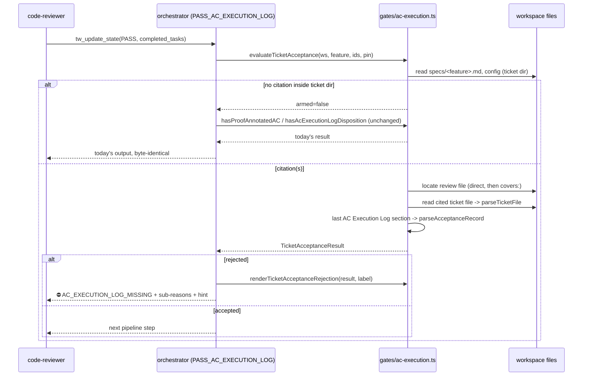

# e424-per-scenario-acceptance — architecture

Spec: `specs/e424-per-scenario-acceptance.md` (cut human-approved 2026-11-25). Lane `e424`. This doc answers OQ-1..OQ-8, fixes the interface contract qa-engineer writes T-E424-02 against, and sizes the sr tasks.

## Settled before this hop (recorded, not re-opened)

- **OQ-1 (human ruling 2026-11-25).** A spec cites its ticket file with a line starting `Ticket:` followed by a repository-root-relative `.md` path inside the configured ticket directory (`resolveTicketDir`). Any other `Ticket:` line (e.g. one naming the backlog) does not arm the check. A citation arms the check without a `proof:` line. The approved recommendation's details apply: case-insensitive `Ticket:` token with optional leading whitespace (same anchor style as `proof:`), path bare or backtick-quoted, a path that normalises outside the ticket directory is ignored and never read.
- **OQ-3 (human ruling 2026-11-25).** Acceptance record line `- <id> — <command or test> — <outcome> — pass|fail`; first field equals a ticket scenario id exactly; last field exactly `pass`; an id counts as passed only when every entry for it is `pass`.
- **Integrator rulings.** The record-parsing helper lives in `gates/ac-execution.ts`; `tools/evidence-file.ts` is out of scope and is called read-only (this design needs no change to it — see DR-4). `test/e118-reviewer-ac-completeness.test.mjs` is in this lane (T-E424-06 raises its cap).
- **Hard limits.** No new error code; `GATE_REGISTRY` stays 33; pipeline stays 17 steps (names and order); no change to existing `tools/ticket-file.ts` export signatures; no new `tools/*.ts`; a feature with no ticket citation produces byte-for-byte today's output; file mode only; the server reads files and executes nothing; `device-or-person` scenarios appear only in the rejection text as awaiting manual verification and never block.

## Affected Files

- `gates/ac-execution.ts` — modify (T-E424-03): new exports per *Interface Contracts*; internal refactor of the review-file traversal into one private locator shared by `hasAcExecutionLogDisposition` (results byte-identical) and the ticket path. New imports: `parseTicketFile` from `../tools/ticket-file.js`, `resolveTicketDir` from `../tools/config.js`, `normalizeHeadingText` added to the existing `../tools/evidence-file.js` import. Keeps importing and calling `resolveJudgeReport` and `encodeEvidenceId`; no `taskId.replace(`; no `path.join(…"qa_reports"…)` literal; no `child_process`.
- `tools/handoff-orchestrator.ts` — modify (T-E424-04): `PASS_AC_EXECUTION_LOG` step only; import line 42 gains `evaluateTicketAcceptance`, `renderTicketAcceptanceRejection`. The existing no-ticket block moves into an `else` branch with its text unchanged.
- `gates/registry.ts` — modify (T-E424-04): one comment sentence (Copy `registry.comment`) on the `AC_EXECUTION_LOG_MISSING` entry. `triggerEdge`, `armCondition`, `clearingArtifact`, `hintStatic` and the errorCode → doc-file mapping comment row untouched.
- `content/skill-code-reviewer.md` — modify (T-E424-05): step 8 per *Copy* `sop.step8`.
- `dist/**` — rebuilt (`npm run build`) in T-E424-04 and T-E424-05.
- `test/e424-*.test.mjs` (+ fixtures under `test/fixtures/e424/` if wanted) — qa-owned, new (T-E424-02).
- `test/e118-reviewer-ac-completeness.test.mjs`, `test/fixtures/compose-golden/**`, `test/context-budget.test.mjs` — qa-owned re-pin (T-E424-06), only where measured values move.
- Not touched: `tools/evidence-file.ts`, `tools/ticket-file.ts`, `tools/config.ts`, `gates/pipeline.ts`, `CLAUDE.md`, `docs/**`.

## Data Structures

New in `gates/ac-execution.ts` (TypeScript):

```ts
// One acceptance-record line that names a ticket scenario id.
export interface AcceptanceEntry {
  id: string;
  pass: boolean; // last " — " field is exactly "pass"
}

export type TicketAcceptanceProblem =
  | { kind: "many" }                                   // >= 2 distinct citations (OQ-5)
  | { kind: "missing-file" }                           // cited file unreadable (OQ-4)
  | { kind: "parse"; count: number; first: string };   // parseTicketFile problems (OQ-4)

export interface TicketAcceptanceResult {
  armed: boolean;            // >= 1 citation inside the ticket dir (OQ-1)
  specPath: string;          // absolute, from specFilePath() — same value today's text prints
  ticketPaths: string[];     // distinct citations, repo-root-relative, "/" separators, document order
  problem: TicketAcceptanceProblem | null;
  missingIds: string[];      // blocking ids with zero entries, ticket document order
  notPassedIds: string[];    // blocking ids with >= 1 entry and >= 1 entry not "pass"
  manualIds: string[];       // device-or-person ids, ticket document order
  checkedPaths: string[];    // review files examined, same rule as AcDispositionResult.checkedPaths
  rejected: boolean;         // problem !== null || missingIds.length > 0 || notPassedIds.length > 0
}
```

When `armed` is false every list is `[]`, `problem` is `null`, `rejected` is `false`. When `problem` is non-null, `missingIds`, `notPassedIds` and `manualIds` are `[]` (the ticket was not evaluated); `checkedPaths` is still filled.

Existing exports `hasProofAnnotatedAC`, `hasAcExecutionLogDisposition`, `specFilePath`, `AcArmResult`, `AcDispositionResult` keep their signatures and results.

## Interface Contracts

All in `gates/ac-execution.ts`. None throws; fs errors are handled as stated.

1. `export const AC_TICKET_HINT: string` — exactly Copy `ac.ticket.hint`.

2. `export function findTicketCitations(workspacePath: string, specContent: string): string[]`
   - Scans `specContent` line by line; lines inside fenced code blocks (a line whose trimmed text starts with three backticks or `~~~` toggles the fence; the delimiter line itself is skipped) are ignored.
   - A citation line matches `/^[^\S\n]*ticket[^\S\n]*:[^\S\n]*(.*)$/i` on a single line. The path token is: if the remainder starts with a backtick, the text up to the next backtick (no closing backtick → not a citation); otherwise the first run of non-whitespace characters.
   - The token counts only when it is non-empty, is not absolute (`path.isAbsolute` false and no drive-letter prefix), ends with `.md`, and `path.resolve(workspacePath, token)` lies strictly inside `resolveTicketDir(workspacePath)` (`rel = path.relative(ticketDir, resolved)`; `rel !== ""`, not starting with `..`, not absolute). Lexical check only; nothing is read here except the config via `resolveTicketDir`.
   - Returns each counted citation as `path.relative(workspacePath, resolved)` with `\` replaced by `/`, deduplicated, in document order. `[]` = no citation.
   - Examples (default ticket dir `docs/tickets`): ``Ticket: `docs/tickets/e9.md` `` → `["docs/tickets/e9.md"]`; `ticket: docs/tickets/./e9.md` → `["docs/tickets/e9.md"]`; ``Ticket: E424 (`docs/backlog.md` …)`` → `[]`; ``Ticket: `docs/backlog.md` E109`` → `[]`; `Ticket: docs/tickets/../backlog.md` → `[]`; `Ticket: /abs/docs/tickets/e9.md` → `[]`; a mid-line `… Ticket: docs/tickets/e9.md` → `[]`.

3. `export function sliceLastAcExecutionLog(content: string, evidenceSchema?: number): string | null`
   - Same heading-location rule as `sliceH2SectionAt(content, "AC Execution Log", evidenceSchema)` but returns the body of the **last** matching H2: under `evidenceSchema === 1` the exact anchor `^##\s+AC Execution Log\b[^\n]*` (case-insensitive, multiline); otherwise any `^##[ \t]+(.+)$` line whose `normalizeHeadingText(text)` contains `"ac execution log"`. Body = text after the heading line up to the next `\n##\s` or EOF. `null` when no heading matches.

4. `export function parseAcceptanceRecord(section: string, scenarioIds: readonly string[]): AcceptanceEntry[]`
   - Per line of `section` (split on `\n`, trailing `\r` and whitespace removed, leading whitespace removed); lines inside fenced code blocks skipped (same fence rule as 2); an optional leading `- ` or `* ` list marker stripped.
   - The line is split on the separator regex `/[ \t]+—[ \t]+/` (an em dash U+2014 with whitespace on both sides). It is an entry only when it yields at least 2 fields and the first field, trimmed, is exactly (case-sensitive) one of `scenarioIds`. `pass` is true iff the last field, trimmed, is exactly `pass`.
   - Returns entries in line order. Lines naming no listed id (raw output, prose, ids not in the list) are ignored.

5. `export function evaluateTicketAcceptance(workspacePath: string, activeFeature: string, taskIds: string[], evidenceSchema?: number): TicketAcceptanceResult`
   - Reads `specFilePath(workspacePath, activeFeature)`; empty `activeFeature` or unreadable spec → not armed. `ticketPaths = findTicketCitations(...)`; empty → not armed.
   - Armed: the review-file traversal runs exactly as `hasAcExecutionLogDisposition` (per id: direct `review_<encodeEvidenceId(id)>.md` under `resolveJudgeReport(workspacePath).dir`, then its `covers:` file; first file whose content holds the heading under `evidenceSchema` is the chosen file) and fills `checkedPaths` identically.
   - `ticketPaths.length >= 2` → `problem: {kind: "many"}`. Else read `path.join(workspacePath, ticketPaths[0])`; read error → `{kind: "missing-file"}`; `parseTicketFile(text).problems.length > 0` → `{kind: "parse", count, first: problems[0]}`.
   - Otherwise, over `parseTicketFile(text).scenarios` in order: blocking = verification kind `test`, `command` or `automated-test` (OQ-2); manual = `device-or-person`. With zero blocking ids the result is accepted (no record needed). Otherwise `section = sliceLastAcExecutionLog(chosenFileContent, evidenceSchema)` (no chosen file → no entries), `entries = parseAcceptanceRecord(section ?? "", blockingIds)`, then `missingIds` / `notPassedIds` per *Data Structures*.
   - Executes nothing; reads only the spec, the config (via `resolveTicketDir`), the cited ticket file and judge reports.

6. `export function renderTicketAcceptanceRejection(result: TicketAcceptanceResult, evidenceSchemaLabel: string): string`
   - Returns the text that follows the `⛔ AC_EXECUTION_LOG_MISSING: {completed_tasks}. ` prefix, in the Copy `ac.ticket.order` order: `ac.ticket.lead` (with `{ticketPath}` = `ticketPaths[0]`) + exactly one of [`ac.ticket.many` | `ac.ticket.missing_file` | `ac.ticket.parse`] when `problem` is set, else `ac.ticket.no_entry` (only when `missingIds` non-empty) then `ac.ticket.not_pass` (only when `notPassedIds` non-empty) + `ac.ticket.manual` (only when `manualIds` non-empty) + `Inspected: {paths}. ` + `Evidence schema: {label}. ` + `AC_TICKET_HINT`.
   - `{ids}` and `{paths}` join with `, `. `Inspected:` uses `checkedPaths.join(", ")`, or `(none — no review file resolved for the listed task(s))` when empty (today's fallback, verbatim).

7. Orchestrator `PASS_AC_EXECUTION_LOG` (inside the existing `parsed.status === "PASS" && parsed.completed_tasks.length > 0` and `storage instanceof FileHandoffStorage` guards):

```ts
const ticket = evaluateTicketAcceptance(
  parsed.workspace_path, parsed.active_feature, parsed.completed_tasks, evidenceSchemaPin,
);
if (ticket.armed) {
  if (ticket.rejected) {
    return {
      content: [{ type: "text" as const,
        text:
          `⛔ AC_EXECUTION_LOG_MISSING: ${parsed.completed_tasks.join(", ")}. ` +
          renderTicketAcceptanceRejection(ticket, evidenceSchemaLabel),
      }],
      isError: true,
    };
  }
} else {
  // existing block, unchanged byte-for-byte: hasProofAnnotatedAC → hasAcExecutionLogDisposition → today's text
}
```

   The ticket path is exclusive: when armed, the `proof:` existence check is not run (AC6 covers its case — no section means every blocking id is `No entry`). `hasProofAnnotatedAC` stays literally present (registry `armCondition` pin).

### Test seams for qa-engineer

- End to end: `tw_update_state` file mode, `agent_id: "code-reviewer"`, `status: "PASS"`, non-empty `completed_tasks`, fixture workspace with `specs/<feature>.md`, `docs/tickets/<name>.md` (default `ticketDir`), `qa_reports/review_<id>.md`, other PASS gates satisfied.
- Unit: the six exports above from `dist/gates/ac-execution.js`.
- AC9 marker: a `command` scenario such as `command touch <marker>`; assert the marker is absent after the write; source pin `gates/ac-execution.ts` contains no `child_process`.
- AC8 byte-identity: run the no-ticket writes against `dist/` of this tree and compare with the literal text today's emit site builds (the existing suites already pin it).

## Copy / Strings

Unchanged from the spec's Copy table except where this column says so. `{…}` = interpolation.

| string id | exact text | note |
|---|---|---|
| ac.ticket.lead | `Spec {specPath} cites ticket file {ticketPath}; the acceptance record must hold a passing entry for every scenario verified by a test or a command. ` | `{specPath}` absolute as today; `{ticketPath}` = `ticketPaths[0]` (repo-root-relative) — settled here |
| ac.ticket.no_entry | `No entry for scenario(s): {ids}. ` | spec, unchanged |
| ac.ticket.not_pass | `Entry not marked pass for scenario(s): {ids}. ` | spec, unchanged |
| ac.ticket.manual | `Awaiting manual verification (does not block PASS): {ids}. ` | spec, unchanged; omitted when a `problem` is set |
| ac.ticket.missing_file | `The cited ticket file could not be read: {ticketPath}. ` | spec, unchanged (OQ-4) |
| ac.ticket.parse | `The cited ticket file has {n} format problem(s); first: {problem}. ` | spec, unchanged (OQ-4); `{problem}` = `problems[0]` verbatim |
| ac.ticket.many | `The spec cites more than one ticket file ({paths}); cite exactly one. ` | spec, unchanged (OQ-5); `{paths}` = all `ticketPaths` |
| ac.ticket.hint | `Under ## AC Execution Log in a qa_reports/review_<id>.md for one of the PASS'd ids (covers: files count), write one line per ticket scenario: "- <scenario id> — <command or test> — <outcome or exit code> — pass" (or "— fail"). Every scenario verified by a test or a command needs a line ending in "— pass"; device-or-person scenarios are listed for manual verification and never block. The server reads the record and the ticket file only and runs nothing; whether each outcome is true stays with the judge.` | spec, unchanged; held as `AC_TICKET_HINT` |
| ac.ticket.order | `⛔ AC_EXECUTION_LOG_MISSING: {completed_tasks}. ` + lead + (many \| missing_file \| parse \| no_entry? not_pass?) + manual? + `Inspected: {paths}. ` + `Evidence schema: {label}. ` + hint | spec, unchanged; prefix built at the orchestrator emit site |
| sop.step8 | see full line below | spec text, unchanged |
| registry.comment | `When the spec cites a ticket file, the same step checks each test/command scenario id for a passing acceptance-record entry (gates/ac-execution.ts).` | spec, unchanged; appended as a new `//` line at the end of the entry's leading comment |
| hintStatic | unchanged, byte-identical to base | AC8 |

Full new step 8 line of `content/skill-code-reviewer.md` (only the last sentence of today's line is replaced; origin tag kept):

```
8. **AC Execution**<!-- origin:start --> (v3.77.0, E3)<!-- origin:end -->: under `## AC Execution Log` in the judge report, one entry per ticket scenario (per spec AC when there is no ticket file, `proof:` lines included): scenario id, command (or test), raw outcome / exit code, pass/fail. A scenario you cannot run is logged with a one-line reason, never skipped. Any fail is a rejection. ONE log per round covers every id (`covers:` files count). Write each entry as one line, `- <scenario id> — <command or test> — <outcome or exit code> — pass` (or `— fail`); raw output may follow below it. When the spec cites a ticket file on a line `Ticket: <path to the ticket file>`, the server reads the ticket and rejects PASS `AC_EXECUTION_LOG_MISSING` while any scenario verified by a test or a command (added-during-build ones included) has no line ending in `— pass`; device-or-person scenarios are listed for manual verification and never block. With no ticket file, a `proof:`-annotated AC and no such section, PASS is rejected `AC_EXECUTION_LOG_MISSING`; the server checks existence only. The server runs nothing.
```

## Sequence Diagram



## Decision Records

| Context | Decision | Consequences |
|---|---|---|
| DR-1 Which path runs when a spec has both a ticket citation and `proof:` lines | Ticket path is exclusive when armed | One rule set per feature; a ticket with only `device-or-person` scenarios passes with no section even if the spec also has `proof:` lines (OQ-8) |
| DR-2 Where rejection text is built | Gate module renders everything after the `⛔ CODE: ids. ` prefix; prefix stays at the orchestrator emit site | Orchestrator diff stays ~20 lines; errorCode literal stays in the orchestrator (contract test); render text unit-testable |
| DR-3 Traversal reuse | Private locator returning the chosen file + `checkedPaths`; `hasAcExecutionLogDisposition` becomes a wrapper over it | One traversal for both paths; existing results and `checkedPaths` must stay identical (existing suites pin them) |
| DR-4 Reading the last `## AC Execution Log` section (OQ-6) | Local `sliceLastAcExecutionLog` in the gate module, reusing the exported `normalizeHeadingText` read-only | `tools/evidence-file.ts` unchanged; the heading rule is restated in one small function and must track `findH2At` if that ever changes |
| DR-5 Fenced code in spec and record | Lines inside fences are ignored for citations and entries | An example `Ticket:` line or raw output in a fence never arms or counts; mirrors the ticket parser's fence rule |
| DR-6 Entry minimum shape | ≥ 2 ` — ` fields, first = id, last decides pass | A short line like `- S1 — pass` counts; a stray `S1 — …` raw-output line outside a fence counts as not passed (fails closed) |
| DR-7 Unparseable or missing cited ticket (OQ-4) | Fail closed under the same code | A typo in the citation blocks PASS with a named cause instead of silently disabling the check |

## Deferred Resources

_None — the spec's References and external-refs audit shows zero external references; every reference is an in-repo file._

## Open Questions

Every item below has a firm decision; none needs a human ruling. Listed for the integrator's second pre-review.

- **OQ-2 — `automated test` (unnamed) blocks.** Decision: yes, it is a blocking scenario. `null` verification is a parse problem (OQ-4). needs human ruling: no.
- **OQ-4 — missing or unparseable cited ticket.** Decision: fail closed under `AC_EXECUTION_LOG_MISSING` with `ac.ticket.missing_file` / `ac.ticket.parse` (count + first problem). needs human ruling: no.
- **OQ-5 — more than one citation.** Decision: two or more distinct in-dir citations reject with `ac.ticket.many`; the same path cited twice (after normalisation) counts once; out-of-dir `Ticket:` lines are not citations and do not count. needs human ruling: no.
- **OQ-6 — which record section.** Decision: today's file traversal picks the file; inside it the last `## AC Execution Log` section counts; implemented in `gates/ac-execution.ts` (DR-4); `tools/evidence-file.ts` needs no change. needs human ruling: no.
- **OQ-7 — registry doc fields.** Decision: `triggerEdge`, `armCondition`, `clearingArtifact`, `hintStatic` byte-identical; one comment sentence only. needs human ruling: no.
- **OQ-8 — arming / trigger.** Decision: confirmed unchanged edge (code-reviewer PASS with non-empty `completed_tasks`, file mode); ticket path arms on an in-dir citation alone and is exclusive (DR-1); zero blocking scenarios → accepted with no section; no advisory on accepted PASS. needs human ruling: no.
- **Citation detail (within OQ-1's ruling).** Decision: lines inside fenced code blocks are not citations (DR-5); the path must immediately follow `Ticket:` (first token or backtick-quoted). needs human ruling: no.

## Task sizing (`task_size` ≤ 5 files / 300 lines)

| task | files (excluding `dist/`) | est. lines |
|---|---|---|
| T-E424-03 | `gates/ac-execution.ts` | ~170 added / ~20 moved |
| T-E424-04 | `tools/handoff-orchestrator.ts`, `gates/registry.ts` | ~25 |
| T-E424-05 | `content/skill-code-reviewer.md` | 1 line replaced |
