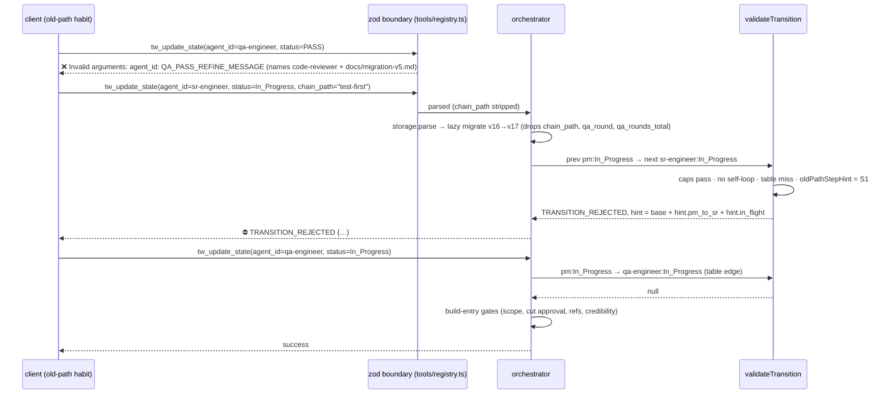

# e435-remove-old-path — architecture

Blueprint for ticket E435 (spec `specs/e435-remove-old-path.md`, cut @ `204ecf95`). Base `a1a36b2`. The sections below are written **under the recommended rulings** for Open Questions (a) and (b); each OQ row says what changes if the human picks the other option.

Key numbers (recommended rulings): `CURRENT_VERSIONS.handoff` **17** · `GATE_REGISTRY.length` **33** (35 − 3 + 1) · `UPDATE_STATE_GATE_PIPELINE` **17 steps** (one renamed) · `ALLOWED_TRANSITIONS` **22 keys** · `TRANSITION_GATE_CODES` **6** · `TransitionRejection["error"]` union **16 members** (6 + 10 handler-side).

## Affected Files

Per sr task, after the file moves in *Per-task file mapping* (end of this section).

| task | file | change |
|---|---|---|
| T-29 | `schema/versions.ts` | `CURRENT_VERSIONS.handoff: 17` |
| T-29 | `schema/migrations-handoff.ts` | new step v16 → v17 (see *Data Structures*) |
| T-29 | `tools/handoff-types.ts` | drop `ChainPath`, `HandoffState.chain_path`, `qa_round`, `qa_rounds_total`; `ResumeOfTarget = "code-reviewer"`; rewrite the `sr_return_count` comment (every feature, file mode) |
| T-29 | `tools/handoff-parse.ts` | drop `CHAIN_PATH_VALUES` and the `chain_path` / `qa_round` / `qa_rounds_total` reads; `RESUME_OF_VALUES = ["code-reviewer"]` (an on-disk `resume_of: qa-engineer` is dropped by the existing `parseEnumField`); heal write passes no `qaRound` / `qaRoundsTotal` |
| T-29 | `tools/handoff-write.ts` | drop options `chainPath`, `qaRound`, `qaRoundsTotal`, the `chain_path` carry block and the `qa_round` / `qa_rounds_total` emits; positional overload keeps its `qaRound` **slot** (renamed `_qaRound`, ignored) so later positionals do not shift |
| T-30 | `tools/transitions.ts` | new `ALLOWED` table, overlay and marker inputs out, in-flight hint, judge constant, `requireJudge` unconditional, `requireQaEngineer` out (see *Interface Contracts*) |
| T-30 | `tools/tasks.ts` | `handleCompleteTask`: `requireJudge(parsed.agent_id, "tw_complete_task")`; drop the `readPersistedChainPath` / `requireQaEngineer` imports |
| T-30 | `specs/qa-flow-enforcement-architecture.md` | **moved in** — `## ALLOWED_TRANSITIONS Matrix` section only (22 rows below); `npm run build`'s postbuild `check:transitions-sync` compares it with `dist/` |
| T-31 | `tools/handoff-orchestrator.ts` | marker plumbing out (`readPersistedChainPath`, `resolveChainPath`, `exitChainPath`, `isTestFirstEntryTarget`), judge = `JUDGE_ROLE` everywhere, build-entry gates arm on `{architect, qa-engineer}`, REPRO test-first hand-off unconditional, verdict gates unconditional, pre-pre-flight code-reviewer check out, `qa_round` inputs/outputs and Round-4 sentinel out, lookahead without marker |
| T-31 | `tools/evidence-file.ts` | `resolveJudgeReport(workspacePath)` (one arg, judge `"code-reviewer"`); `JUDGE_IDENTITIES` → `REPORT_SIGNERS` |
| T-31 | `scripts/release.mjs` | `releaseJudge` → `const RELEASE_JUDGE = "code-reviewer"`; precondition, `notPass` default and `commitMessage` default use it |
| T-42 | `tools/lane-status.ts` | **moved in** — `REPORT_SIGNERS` in the PASS-section regex; `qa_round` column, total, cap check and watch key out |
| T-42 | `scripts/smoke-qa-flow.mjs` | **moved in** — rewrite to the new chain (pm → qa → sr → code-reviewer PASS) |
| T-42 | `docs/release-cd.md` | lines 63, 69, 95 (texts in *Copy*) |
| T-32 | `gates/registry.ts` | `QA_ROUND_EXCEEDED` out (union, entry, mapping row, `TRANSITION_GATE_CODES`); `SR_RETURN_CAP_EXCEEDED` triggerEdge/armCondition without marker; transition-family section comments |
| T-32 | `tools/transitions.ts` | `ROUND_CAP`, `ROUND_CAP_EXPORTED`, step-2 qa override, `QA_ROUND_EXCEEDED` union member |
| T-32 | `gates/pipeline.ts` | `UpdateStateGateContext.prev_qa_round` out |
| T-32 | `content/skill-qa-engineer.md` | line 13 tail and line 31 (texts in *Copy*) |
| T-32 | `content/coord-03-core-fallback.md` | line 9 "a sibling of `qa_round`/`review_round`" → "a sibling of `review_round`" |
| T-33 | `gates/registry.ts` | ledger codes per OQ (b); orchestrator-family text (table in *Interface Contracts*); catalog count comments |
| T-33 | `tools/handoff-orchestrator.ts` | step 9 renamed and rewritten; `NON_REVIEWER_VERDICT_REJECTED` exception out |
| T-33 | `content/skill-code-reviewer.md` | delete the line-16 "The marker" bullet (the only `REVIEWER_COMPLETED_TASKS_REJECTED` quote) |
| T-33 | `content/const-08-chain-31-mid.md` | line 7: `NON_QA_COMPLETED_TASKS_REJECTED` → `NON_JUDGE_COMPLETED_TASKS_REJECTED`, bullet label "Non-Judge Completed-Tasks Gate" |
| T-34 | `tools/metrics.ts` | record field `qa_rounds` out; `qaRoundsTotal` arg out; `one_pass` = review and visual totals both 0 |
| T-34 | `tools/gate-stats.ts` | `qa_rounds` read and `mean_qa_rounds` output out (historical records' `qa_rounds` ignored) |
| T-34 | `tools/storage.ts` | positional overloads keep the `qaRound` slot (renamed `_qaRound`, ignored); option packing drops it |
| T-34 | `tools/storage-sqlite.ts` | stop reading `qa_round` (row type, parse) and drop it from the `INSERT OR REPLACE` column list (`NOT NULL DEFAULT 0` fills it); `CREATE TABLE` and `addColumnIfMissing` DDL untouched; SQLite schema stays 2 |
| T-34 | `scripts/summarize-metrics.mjs` | `mean rounds: review X / visual Y` (qa term out) |
| T-35 | `tools/registry.ts` | descriptions (*Copy*), `chain_path` zod + JSON property out, `resume_of` enum `["code-reviewer"]` with custom message, PASS refine → superRefine |
| T-35 | `prompts/code-reviewer.ts`, `prompts/qa-engineer.ts` | prompt descriptions (*Copy*); `prompts/build.ts` untouched |
| T-36 | `content/const-05-core-standards.md`, `const-06-chain-31-head.md`, `coord-07-core-sop.md`, `skill-pm.md`, `skill-architect.md` | marker sentences (*Copy*, content table) |
| T-37 | `templates/agent-adapters/claude.md`, `templates/claude-code-agents/*` (old-path text only), `CLAUDE.md` | Execution Profile sentence (*Copy*); `CLAUDE.md` line 78 → `round caps (REVIEW_ROUND_CAP=4, VISUAL_ROUND_CAP=6, SR_RETURN_CAP=2)`; lines 48/62 stay "17-step" |
| T-38 | `docs/migration-v5.md` (new), `docs/architecture.md`, `docs/schema-versions.md` (v17 row), `docs/lane-protocol.md`, `README.md` | outline in *Copy* |
| T-41 | `content/const-11-design-chain-32.md`, `content/constitution-rationale.md`, `content/skill-integrator.md` (**moved in**, OQ (a) drop only) | conditional PASS wording; skill-integrator line 189 "review / qa rounds" → "review rounds" |
| T-39 | `specs/qa-flow-enforcement-architecture.md` (remaining sections), `dist/**` | rewrite *Test-First Overlay* into a short E435 note (old matrix + overlay → one table), *Round Counter Semantics* without `qa_round`, *Judge rule* unconditional; build, suite, eval, check, audit |

### Per-task file mapping (for the coordinator; ids unchanged)

PM-sanctioned in-place edits of `.current/e435/tasks.md` rows (no void/add needed; every task stays ≤ 5 files):

1. **T-E435-30** gains `specs/qa-flow-enforcement-architecture.md` (Matrix section only). Reason: `postbuild` runs `scripts/check-transitions-sync.mjs`, which fails the first build after the table changes unless the mirror changes with it. T-39 keeps the rest of that file. → 3 files.
2. **T-E435-31** loses `tools/lane-status.ts` and `scripts/smoke-qa-flow.mjs` → 3 files (orchestrator alone is ≈ 220 changed lines).
3. **T-E435-42** gains `tools/lane-status.ts` and `scripts/smoke-qa-flow.mjs` → 3 files; AC column becomes `AC2, AC4, AC7`; `depends_on` stays T-E435-31.
4. **T-E435-41** gains `content/skill-integrator.md` — only if OQ (a) is ruled *drop*. → 3 files.
5. **Compile unit** (no `depends_on` edit needed; the order satisfies the existing ones): sr runs **T-29 → T-30 → T-31 → T-42 → T-32 → T-33 → T-34 → T-35** in that order. These tasks change shared types (`HandoffState`, `TransitionRequest`, `WriteHandoffStateOptions`, `ResumeOfTarget`, the zod-inferred `UpdateStateInput`), so `tsc` is red between T-29 and the end of T-35 by construction. Each task is still its own commit; `npm run build` is expected green at the end of T-35, and sr clears the expected-red rows of the whole unit there (each task's report lists the rows it expects to clear). T-36, 37, 38, 41 do not touch TypeScript.

Under OQ (a) *keep*: T-E435-34 is voided (`tw_void_task`, nothing to change) except that `lane-status`'s `ROUND_CAP_EXPORTED` cap check still goes (stays in T-42); qa T-16 … T-20 shrink to the files that name `QA_ROUND_EXCEEDED` / `ROUND_CAP`, likely voidable; change 4 above is not made.

## Data Structures

### Handoff schema v17 (file mode)

Fields dropped: `chain_path`, `qa_round`, `qa_rounds_total`. Kept unchanged: `review_round`, `visual_round`, `hop_count`, `review_rounds_total`, `visual_rounds_total`, `sr_return_count` (now applies to every file-mode feature), every other v16 field. `resume_of` value set narrows to `"code-reviewer"` (transient field; no migration needed — the parser's enum drop already discards a stale `qa-engineer` value).

```ts
// schema/migrations-handoff.ts
// v16 -> v17 (E435): one chain, so the marker has nothing to mark, and
// qa-engineer never writes FAIL, so qa_round / qa_rounds_total would stay 0.
// The first step in this registry that DROPS fields; every earlier step adds
// or stamps. Pure; the heal write in handoff-parse persists the result.
registerMigration<Record<string, unknown>, Record<string, unknown>>({
  kind: "handoff",
  from: 16,
  to: 17,
  up: (input) => {
    const { chain_path: _c, qa_round: _q, qa_rounds_total: _t, ...rest } = input;
    return { ...rest, schema_version: 17 };
  },
});
```

`CURRENT_VERSIONS = { handoff: 17, tasks: 2, sqlite: 2, config: 2 }`. AC4's "no source names `chain_path`" grep exempts `schema/migrations-handoff.ts` as a whole (the v15 → v16 step comment names it too).

### SQLite

No schema version, no column added or dropped (human ruling (d)). `qa_round` column stays in the DDL; the server neither reads nor names it in the upsert. `sr_return_count` is not persisted, so `prev_sr_return_count` is always 0 there and the `sr_return` cap never fires (documented in `docs/migration-v5.md`).

### Metrics sidecar (`metrics.jsonl`) and `tw_gate_stats`

New records carry no `qa_rounds`. `one_pass = review_rounds_total === 0 && visual_rounds_total === 0`. `tw_gate_stats` output drops `mean_qa_rounds`; older records' `qa_rounds` is ignored. Historical telemetry rows naming a removed code surface in the existing "unregistered codes" bucket.

### Rejection envelope

`TransitionRejection.attempted.qa_round` is removed (under OQ (a) drop). `allowed[].requires` narrows to `{ resume_of: "code-reviewer" }`. No new envelope field: the in-flight hint lives in `hint`.

## Interface Contracts

### `tools/transitions.ts`

```ts
export const JUDGE_ROLE = "code-reviewer" as const;
export type JudgeRole = typeof JUDGE_ROLE;

export interface TransitionRequest {
  prev: TransitionTuple;
  next: TransitionTuple;
  prev_review_round: number;
  prev_visual_round?: number;
  next_resume_of?: "code-reviewer";
  prev_hop_count?: number;
  feature_changed?: boolean;
  prev_sr_return_count?: number;
}
// removed: prev_qa_round, prev_chain_path, next_chain_path,
//   judgeFor, requireQaEngineer, TEST_FIRST_OVERLAY, isChainPathSetPoint,
//   ROUND_CAP / ROUND_CAP_EXPORTED (T-32)

export function allowedSuccessors(key: string): AllowedNext; // = ALLOWED.get(key) ?? []
export function requireJudge(agentId: string | undefined, toolName: string): AgentGateResult;
export function oldPathStepHint(prev: TransitionTuple, next: TransitionTuple): string | null;
export const REMOVED_OLD_PATH_STEPS: ReadonlyArray<{
  prev: TransitionTuple | "any"; next: TransitionTuple; hint: string;
}>;
export const PASS_IDENTITY_REFINE_MESSAGE: string;   // Copy
export const QA_PASS_REFINE_MESSAGE: string;          // Copy
export const MIGRATION_HINT: string;                  // Copy hint.in_flight

export function computeNewRound(
  prev_review_round: number,
  prev_visual_round: number,
  next: TransitionTuple,
  prev?: TransitionTuple,
  next_pending_notes?: ReadonlyArray<string>,
  prev_hop_count?: number,
  feature_changed?: boolean,
  prev_review_rounds_total?: number,
  prev_visual_rounds_total?: number,
): { review_round: number; visual_round: number; hop_count: number;
     review_rounds_total: number; visual_rounds_total: number };
export function computeSrReturnCount(...); // unchanged signature
```

`computeNewRound`: `qa_round` / `qa_rounds_total` branches out; the `review_round` reset on `code-reviewer:In_Progress → qa-engineer:In_Progress` out (edge gone); the code-reviewer PASS reset stays; the `visual_round` branches stay unchanged although they key on a qa-engineer FAIL that can no longer happen (E420 owns the visual family — recorded, not fixed here).

#### New `ALLOWED_TRANSITIONS` (22 keys)

Each list equals, entry for entry and in order, what `allowedSuccessors(key, "test-first")` returns at base — so qa can pin "new table == old marked effective table".

| key | allowed (agent:status), in order |
|---|---|
| null:null | pm:In_Progress, pm:Blocked, researcher:In_Progress, researcher:Blocked, design-auditor:In_Progress, design-auditor:Blocked |
| researcher:In_Progress | pm:In_Progress, pm:Blocked, researcher:Blocked, design-auditor:In_Progress |
| researcher:Blocked | researcher:In_Progress, pm:In_Progress |
| design-auditor:In_Progress | pm:In_Progress, design-auditor:Blocked |
| design-auditor:Blocked | design-auditor:In_Progress, pm:In_Progress |
| pm:In_Progress | architect:In_Progress, researcher:In_Progress, design-auditor:In_Progress, pm:Blocked, pm:In_Progress, **qa-engineer:In_Progress** |
| pm:Blocked | pm:In_Progress, pm:Blocked, design-auditor:In_Progress |
| architect:In_Progress | architect:Blocked, pm:In_Progress, **qa-engineer:In_Progress** |
| architect:Blocked | pm:In_Progress, architect:In_Progress |
| sr-engineer:In_Progress | code-reviewer:In_Progress, sr-engineer:Blocked, pm:In_Progress, **qa-engineer:In_Progress** |
| sr-engineer:Blocked | sr-engineer:In_Progress, pm:In_Progress, design-auditor:In_Progress |
| code-reviewer:In_Progress | code-reviewer:FAIL, code-reviewer:Blocked, **code-reviewer:PASS** |
| code-reviewer:FAIL | sr-engineer:In_Progress, pm:In_Progress, **qa-engineer:In_Progress** |
| code-reviewer:Blocked | code-reviewer:In_Progress, pm:In_Progress |
| **code-reviewer:PASS** (new key) | pm:In_Progress, researcher:In_Progress, release-engineer:In_Progress, design-auditor:In_Progress |
| qa-engineer:In_Progress | qa-engineer:Blocked, **sr-engineer:In_Progress** |
| qa-engineer:Blocked | sr-engineer:In_Progress, qa-engineer:In_Progress, pm:In_Progress |
| qa-engineer:FAIL | sr-engineer:In_Progress, pm:In_Progress — *legacy exit key* |
| qa-engineer:PASS | pm:In_Progress, researcher:In_Progress, release-engineer:In_Progress, design-auditor:In_Progress — *legacy exit key* |
| release-engineer:In_Progress | pm:In_Progress, release-engineer:Blocked |
| release-engineer:Blocked | release-engineer:In_Progress, pm:In_Progress, qa-engineer:In_Progress |
| release-engineer:PASS | pm:In_Progress, researcher:In_Progress |

Edges removed: `pm:In_Progress → sr-engineer:In_Progress`, `architect:In_Progress → sr-engineer:In_Progress`, `code-reviewer:In_Progress → qa-engineer:In_Progress`, `qa-engineer:In_Progress → qa-engineer:PASS`, `qa-engineer:In_Progress → qa-engineer:FAIL`. The two *legacy exit keys* are unreachable as targets now but kept so a workspace whose handoff sits at `qa-engineer:PASS` / `qa-engineer:FAIL` after upgrade can still leave it (otherwise every such workspace is wedged; see DR-3).

#### `validateTransition` precedence (new)

1 agent_id / status checks · 2 round caps: `REVIEW_ROUND_EXCEEDED`, `VISUAL_ROUND_EXCEEDED` (qa cap gone) · 2.5 hop cap (unchanged) · 2.6 sr-return cap — **unconditional** (no `marked`): `sr-engineer:In_Progress → qa-engineer:In_Progress` with `prev_sr_return_count >= 2`, `!feature_changed` · 3 self-loop fast path (unchanged) · 3.5 Amend-Resume: only `pm:In_Progress → code-reviewer:In_Progress` with `next_resume_of === "code-reviewer"` · 4 table lookup in `ALLOWED`; on a miss, `TRANSITION_REJECTED` with `hint = base + (oldPathStepHint(prev, next) ?? "")`, then the existing Amend-Resume hint branch, now for `next.agent === "code-reviewer"` only (extra `allowed` entry `{code-reviewer, In_Progress, requires: {resume_of: "code-reviewer"}}`; the "Test-first entry" sentence goes).

#### In-flight hint — decision point and recognised steps (OQ (c))

Decided in **`validateTransition` step 4** (pure, storage-agnostic, so SQLite gets it too), by `oldPathStepHint(prev, next)` over `REMOVED_OLD_PATH_STEPS`. It keys on the step only, never on a marker or schema version. Recognised steps:

| # | prev | next | appended hint |
|---|---|---|---|
| S1 | pm:In_Progress | sr-engineer:In_Progress | `hint.pm_to_sr` (prev agent `pm`) + `hint.in_flight` |
| S2 | architect:In_Progress | sr-engineer:In_Progress | `hint.pm_to_sr` (prev agent `architect`) + `hint.in_flight` |
| S3 | code-reviewer:In_Progress | qa-engineer:In_Progress | `hint.reviewer_to_qa` + `hint.in_flight` |
| S4 | any | qa-engineer:PASS | `hint.qa_judge` + `hint.in_flight` |
| S5 | any | qa-engineer:FAIL | `hint.qa_judge` + `hint.in_flight` |

A legal step never reaches step 4's miss branch, so it never gets the hint (AC3). A cap rejection (round / hop / sr-return) reports its own code first, without the hint. On the tool path S4 never reaches `validateTransition`: the PASS refine rejects it first with `QA_PASS_REFINE_MESSAGE`, which carries the same two parts (names `code-reviewer`, names `docs/migration-v5.md`); S4 stays in the table so direct callers (tests, the E38 lookahead) see one rule.

### `tools/registry.ts` (`UpdateStateArgs`)

- `chain_path` removed from the zod object **and** the JSON Schema. The zod object is not `.strict()`, so an incoming `chain_path` is stripped silently (OQ (e)).
- `resume_of: z.enum(["code-reviewer"], { error: RESUME_OF_ENUM_MESSAGE })` (zod 4 `error` param); JSON enum `["code-reviewer"]`.
- PASS refine → `superRefine`: when `status === "PASS"` and `agent_id !== "code-reviewer"`, add one issue at path `["agent_id"]` with message `agent_id === "qa-engineer" ? QA_PASS_REFINE_MESSAGE : PASS_IDENTITY_REFINE_MESSAGE`. Reply text: `❌ Invalid arguments for tw_update_state: agent_id: <message>`.

### `tools/handoff-orchestrator.ts`

| site | new behaviour |
|---|---|
| step 1 `TRANSITION_VALIDATION` | passes no `prev_qa_round` / marker fields; `prev_sr_return_count: ctx.prevState?.sr_return_count ?? 0` (always 0 under SQLite) |
| steps 3–6 (scope, cut-approval, external-refs, source-credibility) | arm on `prev pm:In_Progress → next {architect, qa-engineer}:In_Progress` (sr-engineer replaced, since that edge is gone); their envelopes' `allowed` = `allowedSuccessors("pm:In_Progress")`. The `pm → code-reviewer` resume edge stays exempt |
| step 7 `REPRO_MANIFEST_MISSING` | the qa-engineer:{In_Progress,Blocked} → sr-engineer:In_Progress hand-off check runs on every file-mode feature (no marker); message text unchanged except "Test-first hand-off" → "Hand-off" |
| step 8 | `REVIEW_VERDICT_STATUS_MISMATCH`: APPROVED is consistent with `In_Progress` or `PASS`, unconditionally. `NON_REVIEWER_VERDICT_REJECTED`: the APPROVED-handoff exception goes (its edge is gone) |
| step 9 (renamed) | see OQ (b) / *Error codes* |
| steps 10–11 | judge = `JUDGE_ROLE`; `QA_COMPLETION_EVIDENCE_MISSING` always emits `gate(...).hintStatic` (new text below) |
| `handleUpdateStateCore` | drop the pre-pre-flight "code-reviewer PASS on unmarked feature" ZodError; PASS defence-in-depth = `requireJudge(parsed.agent_id, "tw_update_state(status=PASS)")`; ledger-remove, RAG GC and lookahead use `JUDGE_ROLE`; `qa_round` reads, Round-4 sentinel, `qaRound` / `qaRoundsTotal` / `chainPath` write args and metrics arg out |
| `effectiveAllowedSuccessors` | counters lose `qa_round`; `assumeResumeOf` applies to `code-reviewer` only; no marker option |

`tools/evidence-file.ts`: `resolveJudgeReport(workspacePath: string): { judge: JudgeRole; dir: string }`; `export const REPORT_SIGNERS: readonly string[] = [JUDGE_ROLE, "qa-engineer"]` — signers a multi-feature report *reader* accepts: the judge, and qa-engineer for reports written before v5.0.0 (DR-6). Used only by `tools/lane-status.ts`.

### Error codes (OQ (b), (f)) and `GATE_REGISTRY` = 33

| code | change | content files that quote it afterwards |
|---|---|---|
| `QA_ROUND_EXCEEDED` | **removed** (T-32) | none (skill-qa-engineer.md line 13 drops it) |
| `REVIEWER_COMPLETED_TASKS_REJECTED` | **removed** (T-33) | none (skill-code-reviewer.md line-16 bullet deleted) |
| `NON_QA_COMPLETED_TASKS_REJECTED` | **removed** (T-33) | none |
| `NON_JUDGE_COMPLETED_TASKS_REJECTED` | **added** (T-33), registry position of `REVIEWER_COMPLETED_TASKS_REJECTED`, producer orchestrator, plain-text, `documentedInProse: true` | `const-08-chain-31-mid.md` |
| old-path steps | **no new code** — `TRANSITION_REJECTED` + hint (OQ (f)); qa PASS = tool-boundary refine text | — |
| `SR_RETURN_CAP_EXCEEDED` | text only: triggerEdge `prev_sr_return_count >= 2 on sr-engineer:In_Progress -> qa-engineer:In_Progress (file mode; SQLite never persists the counter); feature_changed bypasses`, armCondition `opt-in (counter present)` | unchanged |
| `SCOPE_DECISION_REQUIRED`, `CUT_APPROVAL_REQUIRED`, `EXTERNAL_REFS_UNRESOLVED`, `SOURCE_CREDIBILITY_UNVERIFIED` | triggerEdge `pm:In_Progress -> {architect,qa-engineer}:In_Progress` (+ existing suffixes) | unchanged |
| `REPRO_MANIFEST_MISSING` | triggerEdge `sr-engineer:In_Progress -> code-reviewer:In_Progress (bugfix), or qa-engineer:In_Progress\|Blocked -> sr-engineer:In_Progress (file-mode only)`; armCondition without `resolveChainPath` | unchanged |
| `REVIEW_VERDICT_STATUS_MISMATCH`, `NON_REVIEWER_VERDICT_REJECTED`, `QA_COMPLETION_EVIDENCE_MISSING`, `QA_REVIEW_TARGET_REQUIRED`, `PASS_TASKS_INCOMPLETE` | hintStatic / triggerEdge text (*Copy*) | unchanged |
| `MISSING_REVIEW_EVIDENCE` | **unchanged, now dormant** (its edge is gone) — out of scope, see *Findings outside scope* | `skill-code-reviewer.md` |

Mapping comment after T-33: delete the `QA_ROUND_EXCEEDED`, `REVIEWER_COMPLETED_TASKS_REJECTED`, `NON_QA_COMPLETED_TASKS_REJECTED` rows; add `NON_JUDGE_COMPLETED_TASKS_REJECTED  const-08-chain-31-mid.md` after `REVIEW_VERDICT_STATUS_MISMATCH`; `TRANSITION_REJECTED` keeps `coord-02-host-dispatch.md, skill-qa-engineer.md` (line 31's new text keeps the quote). Comments: "The 33-gate catalog"; section headers `transition-json (codes 1-6)`, `orchestrator-json (codes 7-12)`, `plain-text (codes 13-32)`, `tool-boundary (code 33)`; `TRANSITION_GATE_CODES` comment "The 6 codes…" and "the 16-member `TransitionRejection["error"]` union … 10 additional handler-side codes"; `documentedInProse` comment: `VISUAL_ROUND_EXCEEDED` stays false ("nothing emits it since E435: its counter ticks only on a qa-engineer FAIL; E420 owns the visual family").

### `UPDATE_STATE_GATE_PIPELINE` — 17 steps

1 `TRANSITION_VALIDATION` (`TRANSITION_GATE_CODES`: AGENT_ID_REQUIRED, TRANSITION_REJECTED, REVIEW_ROUND_EXCEEDED, VISUAL_ROUND_EXCEEDED, HOP_CAP_EXCEEDED, SR_RETURN_CAP_EXCEEDED) · 2 `FEATURE_LEASE` · 3 `SCOPE_DECISION_REQUIRED` · 4 `CUT_APPROVAL_REQUIRED` · 5 `EXTERNAL_REFS_UNRESOLVED` · 6 `SOURCE_CREDIBILITY_UNVERIFIED` · 7 `REPRO_MANIFEST_MISSING` · 8 `REVIEW_VERDICT_STATUS_MISMATCH` (+ NON_REVIEWER_VERDICT_REJECTED) · **9 `NON_JUDGE_COMPLETED_TASKS_REJECTED`** (codes `["NON_JUDGE_COMPLETED_TASKS_REJECTED"]`; was `REVIEWER_COMPLETED_TASKS_REJECTED`) · 10 `QA_REVIEW_RECORD` · 11 `QA_COMPLETION_EVIDENCE_MISSING` · 12 `PASS_TASKS_INCOMPLETE` · 13 `PASS_MISSING_EVIDENCE` · 14 `PASS_VISUAL_SUBGATES` · 15 `PASS_EXPECTED_RED_DIFF` · 16 `PASS_AC_EXECUTION_LOG` · 17 `MISSING_REVIEW_EVIDENCE`.

Step 9 predicate: `parsed.agent_id && parsed.agent_id !== JUDGE_ROLE && parsed.completed_tasks.length > 0` → reject. Emit: `` `⛔ NON_JUDGE_COMPLETED_TASKS_REJECTED: completed_tasks=[${ids}] on an agent_id=${agent_id} write. ` + gate(...).hintStatic ``. Every storage mode.

### `tools/tasks.ts` / `scripts/release.mjs`

`tw_complete_task`: `requireJudge(agent_id, "tw_complete_task")` in every mode. Release gate: `(code-reviewer, PASS)` only; `notPass(why, judge = RELEASE_JUDGE)`; `commitMessage({…, judge = RELEASE_JUDGE})`.

## Copy / Strings

Exact texts (verbatim; a leading space is part of the string where shown as `␠`).

| string id | exact text |
|---|---|
| `PASS_IDENTITY_REFINE_MESSAGE` | `status="PASS" requires agent_id="code-reviewer"` |
| `hint.in_flight` = `MIGRATION_HINT` | `␠If this feature started on the pre-v5 chain, docs/migration-v5.md says how to finish or restart it.` |
| `hint.qa_pass` = `QA_PASS_REFINE_MESSAGE` | `status="PASS" requires agent_id="code-reviewer": code-reviewer is the judge; qa-engineer writes tests and never writes PASS.` + `hint.in_flight` |
| `hint.pm_to_sr` (S1/S2, `${a}` = prev agent) | `␠The build entry is qa-engineer: hand off ${a}:In_Progress → qa-engineer:In_Progress; qa-engineer writes the scenario tests, or records that the ticket needs no new test, before sr-engineer builds.` |
| `hint.reviewer_to_qa` (S3) | `␠code-reviewer is the judge and closes the feature: approve with code-reviewer:PASS (review_verdict: "APPROVED"), or reject with code-reviewer:FAIL; qa-engineer does not follow code-reviewer.` |
| `hint.qa_judge` (S4/S5) | `␠qa-engineer writes tests and never writes PASS or FAIL: code-reviewer is the judge and writes them from code-reviewer:In_Progress.` |
| `requireJudge` message | `` ⛔ BLOCKED: ${toolName} is reserved for code-reviewer, the chain's judge. Called by ${who}. Hand off to code-reviewer and pass agent_id="code-reviewer". `` + (`agentId === "qa-engineer"` ? `hint.in_flight` : `""`) |
| `RESUME_OF_ENUM_MESSAGE` | `resume_of accepts only "code-reviewer"; pm:In_Progress → qa-engineer:In_Progress is an ordinary edge, so omit resume_of there.` |
| Amend-Resume hint (step 4) | `` ${base.hint} Amend-Resume edge: set resume_of: "code-reviewer" on this write itself (the resuming write, not only the PM amendment) to open pm:In_Progress → code-reviewer:In_Progress; received resume_of: ${received}. `` |
| desc.status | `Execution status. status="PASS" requires agent_id="code-reviewer", the chain's judge; any other agent_id is rejected at the tool boundary.` |
| desc.agent_id | `Agent name. Validated against ALLOWED_TRANSITIONS. PASS reserved for "code-reviewer".` |
| desc.completed_tasks | `Task ids the judge has completed for this feature. Only agent_id "code-reviewer" may grow it; a non-empty list from any other agent_id is rejected (NON_JUDGE_COMPLETED_TASKS_REJECTED). File mode: a code-reviewer list is added to the ids already recorded; kept across same-feature writes that omit it or pass []; the code-reviewer's FAIL write removes its review_task_ids; cleared when active_feature changes. SQLite: stored as given.` |
| desc.qa_review | `Review notes. Recorded as evidence when agent_id is "code-reviewer" (the judge) and status in {PASS, FAIL}.` |
| desc.qa_suite_result | current text with `by the feature's judge (qa-engineer; code-reviewer on a test-first feature)` → `by the judge (code-reviewer)` and `(agent_id the feature's judge,` → `(agent_id code-reviewer,` |
| desc.resume_of | `Amend-Resume declaration: a PM mid-chain amendment resumes a stranded code-reviewer. The pm:In_Progress → code-reviewer:In_Progress resume edge is accepted ONLY when this field is "code-reviewer"; pm:In_Progress → qa-engineer:In_Progress is an ordinary edge and needs no resume_of. Transient: applies to THIS write only. Replaces the legacy 'resume_of: <role>' pending_notes line (handoff schema v7).` |
| desc.review_verdict | current text with `APPROVED requires status=In_Progress;` → `APPROVED requires status=PASS or In_Progress;` |
| desc.tw_complete_task | `Mark task completed [x]. Reserved for code-reviewer, the chain's judge — pass agent_id="code-reviewer".` |
| desc.tw_complete_task.agent_id | `Must be "code-reviewer". Other values rejected.` |
| prompt desc code-reviewer (`prompts/code-reviewer.ts`) | `Code review role — the chain's judge: reviews tests and implementation, writes PASS.` (same as its `PROMPT_REGISTRY` entry) |
| prompt desc qa-engineer (`prompts/qa-engineer.ts`) | `QA role. Write each ticket scenario as a test before the build; no verdict.` (same as its `PROMPT_REGISTRY` entry) |
| hintStatic `NON_JUDGE_COMPLETED_TASKS_REJECTED` | `completed_tasks on a write not stamped agent_id=code-reviewer is ledger pollution: only code-reviewer, the chain's judge, may grow completed_tasks (or complete tasks through tw_complete_task), backed by the QA_COMPLETION_EVIDENCE_MISSING evidence gate. Omit completed_tasks (or pass []) on this write. See docs/backlog.md E40.` |
| …its triggerEdge / armCondition / clearingArtifact | `any write whose agent_id is present and is NOT code-reviewer, carrying non-empty completed_tasks` / `agent_id present && agent_id !== "code-reviewer" && completed_tasks.length > 0` / `omit completed_tasks (or pass []) on any write not stamped agent_id=code-reviewer; only the judge may grow the ledger` |
| hintStatic `QA_COMPLETION_EVIDENCE_MISSING` | `code-reviewer is the judge: write its report for each newly added id first (qa_review with review_task_ids on a PASS/FAIL write, or qa_reports/review_<id>.md or a covers: file), or drop the unevidenced ids from completed_tasks. No exemption for any edge, status, or review_verdict. See docs/backlog.md E18 incident (b) + E32.` ; triggerEdge `any write by code-reviewer (the judge) whose completed_tasks adds ids not in the on-disk completed set — no edge/status/verdict exemption (file-mode only)` |
| hintStatic `PASS_TASKS_INCOMPLETE` | current text with `A qa-engineer PASS` → `A code-reviewer PASS`; triggerEdge `code-reviewer:In_Progress -> code-reviewer:PASS (every status=PASS write; file-mode only)` |
| hintStatic `NON_REVIEWER_VERDICT_REJECTED` | `review_verdict is the code-reviewer's verdict field: only an agent_id=code-reviewer write may carry it. Omit review_verdict on this write. See docs/backlog.md E139.` ; triggerEdge `any file-mode write whose agent_id is present and is NOT code-reviewer, carrying review_verdict` |
| hintStatic `REVIEW_VERDICT_STATUS_MISMATCH` | `A code-reviewer APPROVED verdict requires status=PASS or In_Progress; CHANGES_REQUESTED requires status=FAIL. Align review_verdict with status, or omit review_verdict. See specs/c9-protocol-fields.md AC-5.` ; clearingArtifact `APPROVED↔{PASS, In_Progress} or CHANGES_REQUESTED↔FAIL` |
| `QA_REVIEW_TARGET_REQUIRED` triggerEdge / armCondition | `PASS/FAIL write by code-reviewer (the judge) carrying qa_review with review_task_ids and completed_tasks both empty` / `qa_review present && agent_id=code-reviewer && status in {PASS, FAIL}` (hintStatic unchanged) |
| skill-qa-engineer.md line 13 tail (T-32) | replace `Because you never write FAIL, \`qa_round\` is never charged and \`QA_ROUND_EXCEEDED\` does not apply to you; the loops` with `Because you never write FAIL, no qa round is counted; the loops` |
| skill-qa-engineer.md line 31 sentence (T-32) | replace `A \`TRANSITION_REJECTED\` on the claim from pm or architect usually means the feature lacks the \`chain_path: "test-first"\` marker pm sets: stop and report it; never set the marker yourself.` with `A \`TRANSITION_REJECTED\` on the claim: stop and report it with the rejection's hint.` |
| const-06 line 7 (T-36) | `- \`status=PASS\` and \`tw_complete_task\` require the chain's judge, \`agent_id="code-reviewer"\`.` |
| coord-07, skill-pm (×2), skill-architect (T-36) | delete the marker clause only: coord-07 `carrying \`chain_path: "test-first"\``; skill-pm step 8 `, chain_path="test-first"` and its "Set the `chain_path…`" sentence, bugfix `(with the \`chain_path\` marker)`; skill-architect `(\`architect → sr-engineer\` is closed on a feature marked \`chain_path: "test-first"\`)` → `(\`architect → sr-engineer\` is not an edge)` |
| const-11 line 10, rationale line 149 (T-41) | `on the test-first chain \`status=PASS\` is server-restricted to` → `` `status=PASS` is server-restricted to `` |
| Execution Profile sentence (T-37; `CLAUDE.md` and `templates/agent-adapters/claude.md` identical) | `` `code-reviewer` and `qa-engineer` MUST be dispatched via `Task` (agc's shorthand for Claude Code's `Agent` subagent tool): code-reviewer judging in-context, or qa-engineer writing the tests in the builder's context, voids Constitution §3 builder != judge, and the downgrade is invisible to every gate in `GATE_REGISTRY`. `` (rest of the bullet unchanged) |
| release-cd.md line 63 (T-42) | ``- [ ] One `docs/*` pull request, merged to `main`, carries both the release gate feature's PASS state write from its judge (`.current/_primary/handoff.md`), `(code-reviewer, PASS)`, and the release's CHANGELOG entry under `## [Unreleased]`.`` |
| release-cd.md line 69 (T-42) | ``After a successful release, `main`'s handoff is no longer the judge's `(code-reviewer, PASS)` and `## [Unreleased]` is empty, so dispatching again by mistake stops at once (`PRECONDITION_NOT_PASS` or `CHANGELOG_ENTRY_MISSING`) instead of releasing twice.`` |
| release-cd.md line 95 (T-42), meaning cell | ``.current/_primary/handoff.md` on `main` is not the judge's `(code-reviewer, PASS)`, has no usable `active_feature`, or cannot be parsed; the detail names the tuple`` |

New content wording avoids the "is REMOVED" / "is retired" shapes (e440).

### `docs/migration-v5.md` outline (T-38; AC8)

1. **What changed** — one chain (pm → [architect] → qa-engineer → sr-engineer → code-reviewer, code-reviewer writes PASS and completes tasks); handoff schema 17 drops `chain_path`, `qa_round`, `qa_rounds_total` on first read; `chain_path` sent by an old client is ignored; `resume_of` accepts only `code-reviewer`; the `sr_return` cap applies to every file-mode feature.
2. **A feature mid-flight on the old path** — table by the handoff's current tuple: `pm:In_Progress` → hand to qa-engineer or architect (build-entry gates and cut approval apply to `pm → qa-engineer`); `architect:In_Progress` → qa-engineer; `sr-engineer:*` → continue to code-reviewer; `code-reviewer:In_Progress` → code-reviewer writes PASS itself (`review_verdict: "APPROVED"`, `completed_tasks`, `qa_review`); `qa-engineer:In_Progress` → `qa-engineer:Blocked` → `pm:In_Progress` → `code-reviewer:In_Progress` with `resume_of: "code-reviewer"`, or hand to sr-engineer (needs `qa_reports/expected-red_<feature>.txt` or the no-new-test record); `qa-engineer:FAIL` → sr-engineer → code-reviewer; `qa-engineer:PASS` → the feature is closed, open the next one. Restart = a `pm:In_Progress` re-entry, or a new `active_feature` once the lease allows. Releases need `(code-reviewer, PASS)`.
3. **Re-copy `~/.claude/agents/`** — qa-engineer template now on opus; delete a stale `qa-visual.md`.
4. **`.current/skill-qa-visual.md`** — no prompt or role loads that file name; move any local rules into `.current/skill-reviewer-visual.md`.
5. **"judging in-context" wording** in `templates/agent-adapters/claude.md` — what the new sentence says and why.
6. **Re-stamp** — `agc init` / `agc check` re-stamps `agc-version` in `CLAUDE.md`, `AGENTS.md`, `.antigravityrules`.
7. **SQLite / HTTP mode** — same transition table and judge; the `sr_return` cap is not enforced (the counter is not stored); no column or SQLite schema version changes.
8. **Telemetry** — `QA_ROUND_EXCEEDED`, `REVIEWER_COMPLETED_TASKS_REJECTED`, `NON_QA_COMPLETED_TASKS_REJECTED` rows in old sidecars show as unregistered codes in `tw_gate_stats`; `mean_qa_rounds` is gone.

## Sequence Diagram



## Decision Records

| Context | Decision | Consequences |
|---|---|---|
| Where the in-flight hint is decided (OQ c) | `validateTransition` step 4 via `oldPathStepHint`, a pure table of removed steps; qa PASS at the zod refine with the same text parts | One rule for both storage modes; a cap rejection outranks the hint; no gate or code added |
| Old-path rejection code (OQ f) | `TRANSITION_REJECTED` + hint; no new code | Registry count and the error-code contract unaffected; adopters already handle the code; the hint carries the difference |
| Wedged states after upgrade | Keep `qa-engineer:PASS` / `qa-engineer:FAIL` as exit-only keys | A workspace at a closed qa PASS can open its next feature; a qa FAIL can go back to sr; costs two unreachable-as-target rows |
| New table order | Each key's list = E431's marked effective list, in order | Tests can pin old-marked == new; `allowed` arrays in envelopes stay as marked features saw them |
| Incoming `chain_path` (OQ e) | Strip silently (zod default, non-strict object); no code names it | Old clients and the lane's own coordinator keep working; nothing to document beyond the migration note; AC4 grep stays clean |
| `resume_of: "qa-engineer"` | Hard zod rejection with a custom message | An old client gets told the edge is ordinary; no silent re-routing |
| Ledger codes (OQ b) | Remove both, add `NON_JUDGE_COMPLETED_TASKS_REJECTED`, rename step 9 | Name tells the truth; registry 33, pipeline 17; telemetry history splits across names |
| `qa_round` fields (OQ a) | Drop handoff fields, metrics `qa_rounds`, `mean_qa_rounds`, lane-status column; SQLite column left in DDL, unread | No always-0 field; ~127 test files instead of ~93; adopter-visible output changes |
| Positional write overloads | Keep the `qaRound` slot, ignored | No silent argument shift for positional callers |
| lane-status report signers | Accept `code-reviewer` and `qa-engineer` sections (`REPORT_SIGNERS`) | Pre-v5 evidence still counts in a read-only report; the judge itself is unconditional everywhere that gates |
| Release gate | `(code-reviewer, PASS)` only, no historical fallback | A primary handoff left at `(qa-engineer, PASS)` cannot be released until a code-reviewer PASS gates it (integrator note) |
| `MISSING_REVIEW_EVIDENCE` | Leave the gate and step; dormant | No scope creep; follow-up ticket filed by the coordinator |
| Compile unit | T-29…T-35 + T-42 in one fixed order, build green at end of T-35 | No task-id or depends_on edits; intermediate commits do not compile |

## Deferred Resources

_None — the spec's Dependencies / Prerequisites shows zero ignored or deferred external refs (`external_refs` empty)._

## Findings outside scope (for `.current/e435/pending-tickets.md`, filed by the coordinator)

1. `MISSING_REVIEW_EVIDENCE` (pipeline step 17) arms only on `code-reviewer:In_Progress → qa-engineer:In_Progress`, which E435 removes: the gate is dormant, `review_reports/` evidence is no longer checked anywhere, and `skill-code-reviewer.md` still cites it for batched `covers:` reports. Re-arm on the code-reviewer PASS or remove (code + content + registry together).
2. `visual_round` / `VISUAL_ROUND_EXCEEDED` tick only on a qa-engineer FAIL with `visual_fail:` — unreachable after E435 (E420's scope).

## Open Questions

Answered with a recommendation each; the coordinator sends them for integrator pre-review and the human rules before qa starts.

| id | question | recommendation | needs human ruling? | test impact |
|---|---|---|---|---|
| (a) | Drop `qa_round` / `qa_rounds_total` with the cap? SQLite column? | **Drop** in the 16 → 17 bump, with metrics `qa_rounds`, `tw_gate_stats.mean_qa_rounds`, lane-status `qa_round` column/watch key, `attempted.qa_round`. SQLite: column stays in the DDL, unread and unnamed in the upsert; no SQLite version change. Alternative *keep*: remove only the cap; fields stay as always-0 | **Yes** — adopter-visible output fields (`tw_get_state`, `tw_gate_stats`, lane-status, rejection envelope) | Drop: ~127 files (qa T-16…T-20 as cut, T-34 as cut, T-41 +skill-integrator). Keep: ~93 files, T-34 voided, T-16…T-20 mostly voided |
| (b) | Ledger codes: remove vs rename/re-define; pipeline steps | **Remove** `REVIEWER_COMPLETED_TASKS_REJECTED` and `NON_QA_COMPLETED_TASKS_REJECTED`, **add** `NON_JUDGE_COMPLETED_TASKS_REJECTED`; step 9 renamed; pipeline **17** steps; registry **33**. Alternative: keep the name `NON_QA_COMPLETED_TASKS_REJECTED` with the new meaning (registry 33, step renamed or not) | **Yes** — public error-code name | `error-code-contract`, `e434` mapping row, `e26` / `e308` length 33, `e35` step name at position 9, `reviewer-completed-tasks-gate`, `e150`, `e181`; `CLAUDE.md` "17-step" unchanged |
| (c) | In-flight hint placement and texts | `validateTransition` step 4 (`oldPathStepHint`, steps S1–S5), qa PASS at the zod refine; texts in *Copy* (also `hint.pm_to_sr`, `hint.qa_pass`, three tool descriptions, release-cd wording) | No — decided by architecture | `e435` AC1–AC3 match the constants; `e151`, `qa-flow`, `hop-count-transitions`, `e38` re-pin `allowed` lists / hints; T-09 / T-27 pin the release-cd lines |
| (d) | SQLite mode | Answered by the human 2026-11-24: SQLite runs the new chain through the shared table; `sr_return` cap not enforced there; documented in `docs/migration-v5.md`; no field added. Restated only | No — already ruled | AC9 in `e435`; `visual-round-sqlite`, `e366` re-pinned to a code-reviewer judge |
| (e) | Incoming `chain_path` after removal | Silently stripped by zod (object is non-strict); no source names it; the lane's unrestarted server keeps the marker in its own v16 handoff, migrated on first read after merge | No — decided by architecture | AC4: input schema has no `chain_path`; one test that a write carrying it is accepted and the field is absent from the written handoff |
| (f) | Old-edge rejection code | `TRANSITION_REJECTED` with the in-flight hint; no new code | No — decided by architecture | No contract-test change for a new code; tests assert code + hint substrings |
