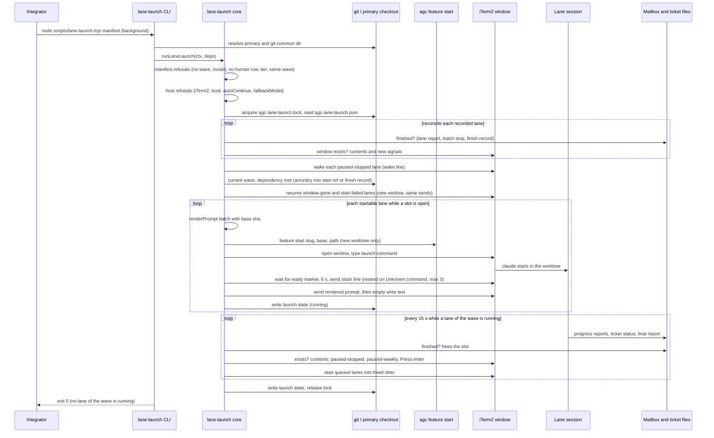

# e443b-lane-launcher — architecture

Blueprint for `specs/e443b-lane-launcher.md` (cut approved under the manifest tier, `specs/fanout-post-v5-w8.md`). Every rule cited as "Decision N" is the cut's *Decisions fixed by this cut*; none is reopened here. This file fixes how they are built: one module `tools/lane-launch.ts`, a thin CLI `scripts/lane-launch.mjs`, two small changes in `tools/config.ts` and `tools/join-precondition.ts`, and the served / doc text, which is copied verbatim from the cut's Copy / Strings.

No server change: no `tw_*` tool, gate, error code, `GATE_REGISTRY` entry (stays 33) or `UPDATE_STATE_GATE_PIPELINE` step (stays 17). `tools/fanout-manifest.ts`, `tools/ticket-file.ts`, `tools/lane-paths.ts` and `tools/lane-status.ts` are imported read-only, never edited. Strict TypeScript, no `any`: every JSON read is `unknown` and narrowed.

## Affected Files

| file | change | task |
|---|---|---|
| `tools/config.ts` | modify: `WorkspaceConfig.laneLaunchLimit?: number` plus a parse filter (positive integer only, no default, no schema bump) | T-E443B-07 |
| `tools/join-precondition.ts` | modify: `checkLaneAncestry(branches, repoRoot, ref)`; a missing `ref` at run time compares with `HEAD` | T-E443B-07 |
| `tools/lane-launch.ts` | create: §A–§F (constants, launch state + lock, manifest refusals, finished signals, dependency + wave plan, the run loop with a basic lane start) | T-E443B-07 (header, §A–§C, the `runLaneLaunch` refusal / lock / state-read wrapper); T-E443B-08 (§D–§F) |
| `tools/lane-launch.ts` | extend: §G–§K (host strings, signal matching, the send method, ready wait + `Unknown command` retry, poll / pause / Enter / wake / resume, host pre-checks, the osascript iTerm2 driver, the `feature start` runner) | T-E443B-09 (start: signals, sends, ready wait, `Unknown command` retry, `featureStartArgv`); T-E443B-10 (poll / pause / Enter / wake / resume); T-E443B-11 (host pre-checks, osascript iTerm2 driver) |
| `tools/lane-launch.ts` | extend: §L (CLI: argv, exit codes, `createHostDeps()`, signal-safe lock release) | T-E443B-12 |
| `scripts/lane-launch.mjs` | create: thin CLI, real seams only | T-E443B-12 |
| `CLAUDE.md` | modify: Layout row `claude.row` after the `tools/config.ts` row, `claude.prompts-row` joined to one line (250 lines kept) | T-E443B-07 (per Open Question 1) |
| `docs/lane-protocol-addendum.md` | modify: §5 tool line → Copy `add.tools` | T-E443B-12 |
| `content/coord-03-core-fallback.md` | modify: Copy `coord03.usage-limit` at the head of the Crash-Resume Protocol section | T-E443B-13 |
| `content/skill-integrator.md` | modify existing lines only: `sop.overview-3`, `sop.lifecycle-4`, `sop.launcher`, `sop.next-wave` | T-E443B-13 |
| `docs/lane-protocol.md` | modify: `lp.s1-step1` in place, `lp.s3-launcher` appended | T-E443B-13 |
| `docs/config.md` | modify: `config.section` after the `knowledge` section | T-E443B-13 |
| `dist/tools/{lane-launch,config,join-precondition}.{js,js.map,d.ts,d.ts.map}` | rebuilt by `npm run build`, committed with each task that changes the source | T-E443B-07..12 |
| `test/e443b-*.test.mjs`, `test/fixtures/e443b/**`, the re-pinned tests | qa-owned deliverables | T-E443B-01, T-E443B-14 |

### Per-task ownership and size (`task_size`: ≤ 5 files / 300 lines; generated `dist/` not counted)

| task | source files | est. changed lines | sections of `tools/lane-launch.ts` | ACs |
|---|---|---|---|---|
| T-E443B-07 | `tools/config.ts` (+10), `tools/join-precondition.ts` (+11/−7), `CLAUDE.md` (+2/−2), `tools/lane-launch.ts` (+~238) | ~270 (measured) | header, §A–§C, `runLaneLaunch` refusal / lock / state-read wrapper | A2-22, A2-23, A2-24 (config), A2-25 (`CLAUDE.md`), A2-11 / A2-12 core subtests |
| T-E443B-08 | `tools/lane-launch.ts` (+~245) | ~245 (measured) | §D–§F (the wave run wired into the wrapper) | A2-1..A2-4, A2-13, A2-14, A2-26, A2-27 |
| T-E443B-09 | `tools/lane-launch.ts` (+~120) | ~120 (≤ ~205 at 1.7×) | §G start constants, signal matching, `sendText` / `sendEnter`, `startSession`, start-failed, `featureStartArgv` | A2-15, A2-16, A2-17 |
| T-E443B-10 | `tools/lane-launch.ts` (+~105) | ~105 (≤ ~180 at 1.7×) | poll / pause / Enter / window-gone, wake, resume | A2-7..A2-10 |
| T-E443B-11 | `tools/lane-launch.ts` (+~135) | ~135 (≤ ~230 at 1.7×) | host pre-checks, `createItermDriver`, `itermInstalled` default | A2-18 |
| T-E443B-12 | `tools/lane-launch.ts` (+~60), `scripts/lane-launch.mjs` (+~15), `docs/lane-protocol-addendum.md` (±1) | ~80 (≤ ~135 at 1.7×) | §L | A2-5, A2-6, A2-11 / A2-12 CLI-level and real-script subtests; A2-25 (addendum) |
| T-E443B-13 | `content/coord-03-core-fallback.md`, `content/skill-integrator.md`, `docs/lane-protocol.md`, `docs/config.md` | ~25 text lines | — | A2-19..A2-21, A2-24 (doc) |

Re-split by PM on 2026-11-27 (T-E443B-02..06 voided): sr built the first scheduling task in full and measured about 509 changed lines (§A–§F 477 in `tools/lane-launch.ts`) against an estimate of about 300, a ratio of about 1.7. T-E443B-07 and T-E443B-08 are sized from that measured build; §G–§K (estimated ~280, so ~476 at the same ratio) is cut into three tasks whose worst case at 1.7× stays under 300. The section boundaries above follow the measured build (it placed `HOST_SIGNALS`, `SLASH_LINE`, `SEND_GAP_MS`, `shellQuote` and `launchCommand` in §A / §F).

## Data Structures

All in `tools/lane-launch.ts` unless noted.

### Config (`tools/config.ts`)

```ts
// Lane launcher parallel limit (scripts/lane-launch.mjs). Surfaced only when
// a positive integer; no default here — the launcher applies its own (3).
laneLaunchLimit?: number;
```

Filter inside `loadConfigEntry`, after the `ticketDir` block, same comment style as its neighbours: `typeof v === "number" && Number.isInteger(v) && v > 0` → `result.laneLaunchLimit = v`. `0`, `-1`, `1.5`, `"2"`, `NaN`, absent → key absent. No `CURRENT_VERSIONS` change, no migration.

### Constants (Copy ids in brackets; each is one exported constant)

```ts
// §A (T-E443B-07)
export const DEFAULT_LANE_LAUNCH_LIMIT = 3;                 // [cfg.default]
export const LAUNCH_STATE_FILE = "agc-lane-launch.json";    // [launch.state-file]
export const LAUNCH_LOCK_FILE = "agc-lane-launch.lock";     // [launch.lock-file]
export const LAUNCH_STATE_VERSION = 1;
export const LAUNCH_STATUSES = ["running", "paused-weekly", "paused-stopped", "finished", "window-gone", "start-failed"] as const; // [state.status]
export type LaunchStatus = (typeof LAUNCH_STATUSES)[number];
export const POLL_INTERVAL_MS = 15_000;

// §G (T-E443B-09..11) — host strings, re-checked on a CLI upgrade
export const SLASH_LINE = "/mcp__agent-governance-mcp__teamwork";     // [launch.slash]
export const READY_MARKER = "permissions on";                         // [launch.ready-marker]
export const WAKE_LINE = "額度已恢復：先 tw_get_state，照 Crash-Resume 流程核對後從中斷處接續。"; // [launch.wake]
export const RESEND_BOUND = 3;                                        // [launch.resend-bound]
/** The one table of host line prefixes (Phase 0 §4 / §2 (2b)). */
export const HOST_SIGNALS = {
  weekly: "You've hit your weekly limit",                             // [sig.weekly]
  continuing: "Continuing automatically at",                          // [sig.continuing]
  stopped: "Automatic continue stopped after repeated usage-limit hits", // [sig.stopped]
  enter: "Press enter to continue",                                   // [sig.enter]
  unknown: "Unknown command",                                         // [sig.unknown]
} as const;
export type HostSignal = keyof typeof HOST_SIGNALS;
export type SignalCounts = Record<HostSignal, number>;
export const TRUST_KEY = "hasTrustDialogAccepted";                    // [host.trust-key]
export const FALLBACK_SETTING = "fallbackModel";                      // [host.fallback-setting]
export const AUTOCONTINUE_SETTING = "autoContinueAtUsageLimit";       // [host.autocontinue-setting]
export const MANAGED_SETTINGS_FILE = "/Library/Application Support/ClaudeCode/managed-settings.json"; // [host.managed-settings]
export const READY_TIMEOUT_MS = 120_000;   // Decision 10
export const READY_POLL_MS = 1_000;        // architect: contents read once a second while waiting
export const READY_SETTLE_MS = 6_000;      // Decision 9
export const SEND_GAP_MS = 500;            // Decision 9
export const UNKNOWN_CHECK_MS = 5_000;     // Decision 10
export const RESEND_GAP_MS = 10_000;       // Decision 10
```

The launch command is a function, not a constant (`launchCommand`, §G): `cd <shellQuote(worktree)> && claude --permission-mode bypassPermissions -n <lane>` [launch.command]. `<lane>` matches `LANE_ID_RE` (`[A-Za-z0-9_.-]+`), so it needs no quoting; the worktree is always single-quoted (`'` → `'\''`).

### Output lines

One exported object `OUT` of formatters, one entry per Copy `out.*` id, text byte-exact (em dash `—`, lane name second). §A defines the scheduling entries (`refused`, `refusedNoWave`, `refusedNoHuman`, `refusedTier`, `refusedSameWave`, `refusedInvalid`, `refusedBusy`, `started`, `queued`, `waiting`, `notStarted`, `finished`, `laterWave`, `exit`); §G adds `refusedIterm`, `refusedTrust`, `refusedAutocontinue`, `refusedFallback`, `resumed`, `woken`, `entered`, `pausedWeekly`, `pausedStopped`, `windowGone`, `startFailed`. Example signatures:

```ts
refused: (reason: string) => `lane-launch: refused — ${reason}`,
waiting: (lane: string, dep: string, why: string) => `waiting ${lane} — depends on ${dep}: ${why}`,
finished: (lane: string, how: FinishedHow) => `finished ${lane} — ${how}`,
```

`out.refused*` go to stderr; every other line goes to stdout.

### Launch-state file — `<git-common-dir>/agc-lane-launch.json`

```ts
export interface LaneLaunchRecord {
  status: LaunchStatus;
  wave: number;
  /** iTerm2 window id as text (a record is first written right after the window opens). */
  windowId: string;
  /** Full sha the lane's render used (`--base`); a resume re-renders with it, so the prompt is byte-identical (A2-10). */
  baseSha: string;
  /** Count of each host signal line in the window just before the last send to it (Decision 11). */
  signals: SignalCounts;
  /** `type: report` messages in the lane's to-integrator.md at the last poll that saw its tickets not settled (finished signal (b), see Decision Records). */
  reportFloor: number;
  /** `start-failed` only: the Copy `out.start-failed` <why>. */
  reason?: string;
  updatedAt: string; // ISO-8601, from clock.now()
}
export interface ManifestLaunchState { lanes: Record<string, LaneLaunchRecord> }
export interface LaunchState {
  version: 1;
  /** Keyed by the manifest path relative to primary, `/`-separated (Decision 2). */
  manifests: Record<string, ManifestLaunchState>;
}
```

Example:

```json
{
  "version": 1,
  "manifests": {
    "specs/fanout-x.md": {
      "lanes": {
        "e1": {
          "status": "running", "wave": 1, "windowId": "42",
          "baseSha": "0123456789abcdef0123456789abcdef01234567",
          "signals": { "weekly": 0, "continuing": 0, "stopped": 0, "enter": 0, "unknown": 0 },
          "reportFloor": 2, "updatedAt": "2026-11-27T09:00:00.000Z"
        }
      }
    }
  }
}
```

Reading: absent file → empty state. A file that does not parse as JSON, or whose shape does not narrow to `LaunchState` (version 1, each record with a known status and the typed fields) → refusal (see Open Question 3). Writing: `JSON.stringify(state, null, 2) + "\n"` to `<file>.<pid>.<now>.tmp` in the same directory, then `fs.renameSync` (Decision 2). Written only when something changed (a status, a window id, a signal baseline, a report floor). Never written under a lane worktree, never a tracked path, never the manifest.

### Lock file — `<git-common-dir>/agc-lane-launch.lock`

Content: `{"pid":<n>,"startedAt":"<ISO>"}`. Created with `fs.openSync(lock, "wx")`. On `EEXIST`: read it; if the JSON names a pid and `isPidAlive(pid)` → busy (refusal `out.refused.busy` with that pid); otherwise (dead pid, unparseable content) → stale: unlink, retry `wx` once; a second `EEXIST` is busy with the pid then read (another run won the race). `release()` unlinks only if the file still holds this run's pid. Staleness is pid liveness only, never age — a run polls for hours (`guards/file-lock.ts`'s age-based `withFileLock` is deliberately not reused).

### Seams (`LaunchDeps`)

```ts
/** The session opener (iTerm2 in production; a stand-in in every automated test). */
export interface WindowDriver {
  /** Opens a new window and types `command` + Return into its shell; resolves to the window id. */
  open(command: string): Promise<string>;
  /** The window's session text (screen + scrollback). Throws if the window is gone. */
  contents(windowId: string): Promise<string>;
  /** `write text <text>` (newline true) or `write text <text> newline NO` (newline false). */
  writeText(windowId: string, text: string, newline: boolean): Promise<void>;
  exists(windowId: string): Promise<boolean>;
}
export interface HostPaths {
  claudeJson: string;        // ~/.claude.json
  userSettings: string;      // ~/.claude/settings.json
  managedSettings: string;   // MANAGED_SETTINGS_FILE
  managedDropInDir: string;  // <dirname(managedSettings)>/managed-settings.d
}
export interface FeatureStartRequest { primary: string; slug: string; base: string; worktree: string }
export type FeatureStartResult = { ok: true } | { ok: false; firstLine: string };
export interface Clock { now(): number; sleep(ms: number): Promise<void> }
export interface GitResult { status: number; stdout: string; stderr: string }
export type GitRunner = (args: string[], cwd: string) => GitResult;
export type AncestryFn = (branches: string[], repoRoot: string, ref: string) => LaneAncestryResult[];
export interface LaunchDeps {
  driver: WindowDriver;
  itermInstalled: () => boolean;
  host: HostPaths;
  featureStart: (req: FeatureStartRequest) => FeatureStartResult;
  clock: Clock;
  git: GitRunner;
  ancestry: AncestryFn;             // production: checkLaneAncestry
  isPidAlive: (pid: number) => boolean;
  pid: number;                      // production: process.pid
  out: (line: string) => void;      // stdout, one line, no trailing newline
  err: (line: string) => void;      // stderr
}
export interface LaunchContext {
  manifestPath: string;   // absolute
  manifestKey: string;    // relative to primary, `/`-separated
  primary: string;        // first entry of `git worktree list --porcelain`
  gitCommonDir: string;   // absolute, realpath'd `git rev-parse --git-common-dir` from primary
}
```

Which seam each AC needs (qa builds stand-ins to this; no test opens a real window or session):

| AC | seams with stand-ins | real |
|---|---|---|
| A2-1, A2-2, A2-26, A2-27 | driver, clock (the `sleep` stand-in appends mailbox messages / edits ticket statuses between polls), featureStart, itermInstalled, host | git + a temp repo, or a git stand-in |
| A2-3, A2-4, A2-14 | as above; `ancestry` real against a temp repo with merged / unmerged branches, or a stand-in | primary `.current/history/<YYYY-MM>/<lane>/` dirs as fixtures |
| A2-5, A2-6 | driver, clock, featureStart, host | a temp git repo: the state file appears under `.git/`, `git status --porcelain` unchanged; manifest bytes compared before / after |
| A2-7..A2-10, A2-17 | driver (scripted `contents` per call or per fake-clock time; `exists` false for A2-10), clock | — |
| A2-11, A2-12, A2-22 | none needed (manifest refusals run before any host seam); the stand-ins record zero calls | temp repo with `.current/.config.json` |
| A2-13 | driver, featureStart; ticket directory fixture under the temp primary | — |
| A2-15, A2-16 | driver (records `open` command and the `writeText` sequence), featureStart (records the request); `featureStartArgv` unit-tested for the real argv | `renderPrompt` / `fanout.mjs render --batch --base <sha>` for the byte comparison |
| A2-18 | host (temp files for `~/.claude.json`, user / managed settings, drop-ins), itermInstalled | project / local settings files in the temp primary and an existing lane worktree |
| A2-23 | — | temp repo; `dist/tools/join-precondition.d.ts` read as text |
| A2-24 | — | temp workspace config; `docs/config.md` |

A test whose lanes never end stops the loop by making `clock.sleep` throw a sentinel after N polls; `runLaneLaunch` releases the lock in `finally` and does not swallow the error.

## Interface Contracts

### `tools/join-precondition.ts` (T-E443B-07)

```ts
/**
 * For each branch, runs `git merge-base --is-ancestor <branch> <ref>` with
 * `cwd` pinned to `repoRoot`. ...(existing never-throws text)...
 * `ref` is required for TypeScript callers. A JavaScript caller written
 * before the parameter existed passes two arguments: at run time a missing
 * `ref` compares with HEAD, so its output does not change.
 */
export function checkLaneAncestry(branches: string[], repoRoot: string, ref: string): LaneAncestryResult[];
```

Body: `const target = (ref as string | undefined) ?? "HEAD";` then the existing `execFileSync("git", ["merge-base", "--is-ancestor", branch, target], { cwd: repoRoot, ... })` — the call site keeps `repoRoot` inside its parentheses (`test/e115-join-precondition.test.mjs` AC5 scans every `execFileSync(` site for it). Only `undefined` falls back; `""` is passed through and comes back as an `error` result. Emitted `.d.ts` line: `export declare function checkLaneAncestry(branches: string[], repoRoot: string, ref: string): LaneAncestryResult[];` (A2-23; T-01 re-pins e115 AC5). `scripts/join-precondition.mjs` is not edited.

### §A–§F — scheduling and state (T-E443B-07, T-E443B-08)

```ts
export function launchLimit(config: WorkspaceConfig): number;                 // config.laneLaunchLimit ?? DEFAULT_LANE_LAUNCH_LIMIT
export function resolveLaunchContext(manifestPath: string, git: GitRunner): LaunchContext | { error: string };
export function launchStatePaths(gitCommonDir: string): { state: string; lock: string };
export function readLaunchState(file: string): { ok: true; state: LaunchState } | { ok: false; error: string };
export function writeLaunchState(file: string, state: LaunchState, now: number, pid: number): void;
export type LockResult = { ok: true; release: () => void } | { ok: false; pid: number };
export function acquireLaunchLock(lockFile: string, pid: number, isPidAlive: (pid: number) => boolean, now: number): LockResult;

/** Manifest-phase refusal reasons, in this order: no-wave, each validation error, no-human, tier, each same-wave pair. [] = none. */
export function manifestRefusals(text: string, config: WorkspaceConfig): string[];
export function sameWaveDependencies(m: Manifest): { dependent: string; dependedOn: string; wave: number }[];

export interface MailboxMessage { headers: Record<string, string>; body: string }
/** `--- msg` blocks of a to-integrator.md, same header rules as tools/lane-status.ts parseMailboxHeaders, plus the body (text up to the next `--- msg` line). */
export function parseMailboxMessages(text: string): MailboxMessage[];
/** `type: report` whose body's first non-blank line starts with `## Lane report:`. */
export function isLaneReport(msg: MailboxMessage): boolean;
/** Status field of each ticket id, read from `<worktree>/<ticketDirRel>/*.md` with parseTicketFile; undefined when no file has that id. */
export function laneTicketStatuses(worktree: string, ticketDirRel: string, ids: string[]): Map<string, string | undefined>;
/** Every status `done` or `stopped — …` (STOPPED_RE /^stopped\s+—\s+\S/), at least one stopped. */
export function ticketsSettled(statuses: Map<string, string | undefined>): boolean;
/** `<primary>/.current/history/<YYYY-MM>/<name>/` is a directory for any HISTORY_BUCKET_RE bucket and any of `names`. */
export function hasFinishRecord(primary: string, names: string[]): boolean;

export type FinishedHow = "lane report" | "batch stop" | "finish record";
export interface FinishedProbe { finished: FinishedHow | undefined; reportCount: number; settled: boolean }
export function probeFinished(input: {
  primary: string; lane: DispatchableLane; worktree: string; mailboxFile: string | undefined;
  ticketDirRel: string; reportFloor: number;
}): FinishedProbe;

export type DepCheck = { met: true } | { met: false; why: string };
export function dependencyMet(input: {
  primary: string; dep: DispatchableLane; startRef: string; knowledgeLocal: boolean; git: GitRunner; ancestry: AncestryFn;
}): DepCheck;
/** The manifest's `base:` for the first (lowest) 波次, `main` for any later one. */
export function startRefFor(m: Manifest, wave: number): string;

/** Whole run (Decision 12). Returns the exit code: 0, or 1 on a refusal. */
export async function runLaneLaunch(ctx: LaunchContext, deps: LaunchDeps): Promise<number>;
```

Rules the functions implement:

- **Manifest refusals** (Decision 13, A2-11, A2-12, A2-22): `lanesSectionsWithoutWave(text).length > 0` → `out.refused.no-wave`; each `validateManifest(text).errors` entry → `out.refused.invalid` with `<code> <message>`; no `m.decisions.rows` row with `decider === "人類"` → `out.refused.no-human`; `config.cutApprovalAutoTier?.manifest !== true` → `out.refused.tier` (an unusable config loads empty, so it refuses here too); each `sameWaveDependencies` pair → `out.refused.same-wave`. All lines are printed; any line → exit 1 before any host check, lock, git write or window.
- **Finished** (Decision 4, A2-26, A2-27): read the lane's `to-integrator.md` (`<resolveMailboxHeader(m.mailbox, primary)>/<lane>/to-integrator.md`; no header → no messages) and the lane's ticket statuses (ids = `ticketIds(lane.ticket)`, `ticketDirRel = path.relative(primary, resolveTicketDir(primary))`, read in the lane worktree; no worktree → not settled). `reportCount` = `type: report` messages. Finished when, in this order: any message `isLaneReport` → `lane report`; `settled && reportCount > reportFloor` → `batch stop`; `hasFinishRecord(primary, [lane.lane, resolveLaneName(<branch without feat/>)])` → `finish record`. A launch record with status `finished` short-circuits all three.
- **Report floor**: set to the current `reportCount` when a lane is started, resumed or woken; at every poll that sees the lane's tickets not settled it is raised to the current `reportCount`. A progress report therefore never finishes a lane, and a report counts for (b) only if it arrived after the last unsettled observation. A lane without a record uses floor 0.
- **Current wave**: the lowest `波次` holding a lane not finished (record `finished`, or `probeFinished` says so). None → print `out.exit` with the highest wave and exit 0. For each higher wave that has lanes, print `out.later-wave` once.
- **Dependency met** (Decision 5, Q1 (b), A2-3, A2-4, A2-14) for dependent L (current wave W) and each `D ∈ L.depLanes` in 相依 order; start ref = `startRefFor(m, W)`:
  - `knowledgeLocal` (`loadConfig(primary).knowledge === "local"`): met iff `hasFinishRecord(primary, names(D))`; else `agc feature finish --shipped has not run for <D>`.
  - otherwise, D's branch exists (`git show-ref --verify --quiet refs/heads/<branch>`, status 0): `ancestry([branch], primary, startRef)[0]` — `isAncestor` → met; `error` → `git: <first line of error>`; else `branch <branch> is not an ancestor of <startRef>`.
  - D's branch is gone: met iff a finish record; else `branch <branch> is gone and <D> has no finish record`.
  - One `out.waiting` line per unmet D.
- **Batch-lane filter** (Decision 7, A2-13), per lane of W without a record: `approval === "human"` → `not started <lane> — approval is human`; for each id of `ticketIds(lane.ticket)`, `lookupTicketFiles(primary, [id])` failing with `FANOUT_CODES.ticketFileAbsent` → `not started <lane> — no ticket file for <id>` (first such id). These lanes get no record and still count as not finished.
- **Slots** (Decision 12): open = `launchLimit(config)` − lanes of W with status `running`, `paused-weekly` or `paused-stopped`. Startable lanes beyond the open slots print `out.queued` once and start, in manifest order, as slots free during the poll loop.
- **Basic start** (§F; T-E443B-09 replaces the session part with `startSession`): `baseSha` = `git rev-parse --verify --quiet <startRef>^{commit}` from primary, or the start ref itself when that fails (render then reports `BASE_INVALID`, or `feature start` reports the bad ref). Render first: `renderPrompt(m, lane, { batch: true, base: baseSha, primary })` — failure → `not started <lane> — render failed: <first error code>`, no worktree created. Then, unless the resolved worktree is listed by `git worktree list --porcelain` (realpath compared): `featureStart({ primary, slug: <branch without feat/>, base: startRef, worktree })` — failure → `not started <lane> — agc feature start failed: <firstLine>`. Then `driver.open(launchCommand(worktree, lane))`, record `running` (state written at once), the two sends, `out.started`.
- **Run order** (Decision 12) — see the Sequence Diagram. The run ends with exit 0 and `out.exit` when no lane of W is `running`.

### §G–§K — window driving and host (T-E443B-09, T-E443B-10, T-E443B-11)

```ts
export function shellQuote(s: string): string;
export function launchCommand(worktree: string, lane: string): string;

/** Lines of `contents`, each with leading whitespace and leading non-letter/digit glyphs (box drawing, ⎿, ●, │) stripped. */
export function signalLines(contents: string): string[];
export function signalCounts(contents: string): SignalCounts;
export interface NewSignals { weekly: boolean; stopped: boolean; enter: boolean; unknown: boolean }
/**
 * New = count above `baseline` (Decision 11). `weekly` is true only when a new
 * weekly line has no `continuing` line after the last weekly line.
 */
export function newSignals(contents: string, baseline: SignalCounts): NewSignals;

/** Reads the counts, then `write text <text> newline NO`, sleep SEND_GAP_MS, `write text ""`. Returns the counts read before the send (the new baseline). */
export async function sendText(driver: WindowDriver, clock: Clock, windowId: string, text: string): Promise<SignalCounts>;
/** One empty `write text` (A2-9); returns the new baseline. */
export async function sendEnter(driver: WindowDriver, windowId: string): Promise<SignalCounts>;

export type StartOutcome = { ok: true; signals: SignalCounts } | { ok: false; why: string };
/**
 * Ready wait (READY_MARKER substring, polled every READY_POLL_MS, timeout READY_TIMEOUT_MS from the call
 * → `not ready after 120 s`), sleep READY_SETTLE_MS, send SLASH_LINE; then up to RESEND_BOUND times:
 * sleep UNKNOWN_CHECK_MS, a new `unknown` → sleep (RESEND_GAP_MS − UNKNOWN_CHECK_MS) and resend SLASH_LINE;
 * a new `unknown` after the third resend → `Unknown command after 3 resends`. Otherwise send `prompt` (one sendText).
 */
export async function startSession(driver: WindowDriver, clock: Clock, windowId: string, prompt: string): Promise<StartOutcome>;

/** Host-phase refusal reasons (Decision 13, A2-18), in this order: iTerm2, trust, each autoContinue file, each fallbackModel file. */
export function hostRefusals(ctx: { primary: string; laneWorktrees: string[] }, deps: Pick<LaunchDeps, "itermInstalled" | "host">): string[];

export type OsascriptRunner = (scriptLines: string[], args: string[]) => string;
/** iTerm2 driver over `osascript -e <line>… <args>`; every text goes in `args` (`on run argv`), never into a script line. */
export function createItermDriver(run: OsascriptRunner): WindowDriver;
/** `[<installRoot>/bin/agc-init.mjs, "feature", "start", slug, "--base", base, "--path", worktree]` (spawned with process.execPath, cwd primary). */
export function featureStartArgv(installRoot: string, req: FeatureStartRequest): string[];
```

Rules:

- **Signal matching** (Decision 11, A2-7..A2-9): prefix match on `signalLines`; counts recorded by every send (`sendText`, `sendEnter`, the wake) from the contents read just before writing. A poll of a `running` lane: `stopped` → `paused-stopped` + `out.paused-stopped`; else `weekly` → `paused-weekly` + `out.paused-weekly`; else `enter` → `sendEnter`, stays `running`, `out.entered`. `unknown` is read only inside `startSession`. Every other line (session limit, `Continuing automatically at` alone, `Automatic continue cancelled`) leaves the lane `running`.
- **Poll** (every POLL_INTERVAL_MS) of each lane of W with status `running`, `paused-weekly` or `paused-stopped`: `probeFinished` (raising `reportFloor`) → `finished` + `out.finished`; else `driver.exists` false → `window-gone` + `out.window-gone`; else, `running` only, `contents` + signals (a `contents` throw skips that lane this poll). Then queued lanes start into freed slots.
- **Wake** (A2-8): on a run's reconcile step, each `paused-stopped` lane whose window exists gets `sendText(WAKE_LINE)`, status `running`, `out.woken`. `paused-weekly` is never woken. No `featureStart`, no `open`, nothing under the worktree.
- **Resume** (A2-10, Decision 10): each `window-gone` or `start-failed` lane of W, as slots allow: re-render with the recorded `baseSha`, `driver.open(launchCommand(...))`, `startSession`, `out.resumed`. No `featureStart`. A `start-failed` lane's old window, if still open, is left alone.
- **Start failure**: `startSession` not ok → status `start-failed`, `reason` = its why, `out.start-failed`; the slot frees at once; resumed on the next run only.
- **Host pre-checks** (Decision 13, A2-18): `itermInstalled()` false → `out.refused.iterm`. `~/.claude.json` (`host.claudeJson`) → `projects[<primary>]` or `projects[<realpath(primary)>]` must have `hasTrustDialogAccepted === true`, else `out.refused.trust` (absent / unparseable file refuses too). `autoContinueAtUsageLimit` present (any value) in `.claude/settings.json` or `.claude/settings.local.json` of primary or of any existing lane worktree of the manifest → one `out.refused.autocontinue` per file. `fallbackModel` set (present and not `null`, `""` or `[]`) in `host.userSettings`, `host.managedSettings`, each `host.managedDropInDir/*.json` (sorted), or the project / local settings of primary or an existing lane worktree → one `out.refused.fallback` per file. `<file>` is the absolute path checked. An absent file is "not set"; an unparseable settings file is "not set" (the CLI itself rejects it).
- **iTerm2 driver**: four fixed AppleScript programs, each `on run argv … end run`: open (`create window with default profile`, `write text (item 1 of argv)` to its current session, return `id of` the window as text), contents (`contents of current session of (first window whose id is (item 1 of argv as integer))`), write (`write text (item 2 of argv)` with `newline NO` unless `item 3 of argv` is `"1"`), exists (`exists (first window whose id is …)` → `"true"`/`"false"`). The default runner is `execFileSync("osascript", [...lines.flatMap(l => ["-e", l]), ...args])`. `itermInstalled` default: `process.platform === "darwin"` and `/Applications/iTerm.app` or `~/Applications/iTerm.app` exists.

### §L — CLI (T-E443B-12)

```ts
export const LANE_LAUNCH_USAGE = "usage: node scripts/lane-launch.mjs <manifest>";
/** Real seams: iTerm2 driver, host paths under os.homedir(), feature-start runner, real clock, git via execFileSync, checkLaneAncestry, process.pid, stdout/stderr writers. */
export function createHostDeps(): LaunchDeps;
/** argv → exit code 0 / 1 / 2. */
export async function runLaneLaunchCli(argv: string[], deps: LaunchDeps): Promise<number>;
```

`scripts/lane-launch.mjs`:

```js
#!/usr/bin/env node
// Coded by @sr-engineer
// Thin CLI wrapper (all logic in tools/lane-launch.ts): starts the batch lanes of
// the current wave of a fan-out manifest in iTerm2 windows. Usage / exit codes below.
// Usage: node scripts/lane-launch.mjs <manifest>
// Exit: 0 = no lane of the current wave is running, 1 = refused (stderr), 2 = usage.
import { runLaneLaunchCli, createHostDeps } from "../dist/tools/lane-launch.js";
process.exitCode = await runLaneLaunchCli(process.argv.slice(2), createHostDeps());
```

CLI contract:

| case | output | exit |
|---|---|---|
| no argument, more than one, or any `-`-prefixed argument | stderr `LANE_LAUNCH_USAGE` | 2 |
| manifest unreadable | stderr `lane-launch: cannot read <manifest>: <first line of the error>`, then usage | 2 |
| manifest not inside a git repo (`resolveLaunchContext` error) | stderr `lane-launch: <manifest> is not inside a git repository` | 2 |
| manifest-phase or host-phase refusal, live lock, unparseable launch state | stderr one `out.refused` line per reason; nothing started | 1 |
| normal end | stdout per-lane lines, last line `out.exit` | 0 |

`runLaneLaunchCli` installs `SIGINT` / `SIGTERM` handlers for the run's duration that release the lock and exit 130 / 143 (the integrator stops a polling run before re-running to wake, Decision 3). Tests call `runLaneLaunchCli` in-process with stand-in `LaunchDeps` (A2-5, A2-6, A2-11, A2-12 at CLI level). A spawned `node scripts/lane-launch.mjs` is used only for paths that end before any host seam: exit 2 usage, and A2-11 / A2-12 manifest refusals against a temp repo — those are hermetic because manifest refusals are printed and returned before host checks.

## Sequence Diagram



## Decision Records

| Context | Decision | Consequences |
|---|---|---|
| Where the launcher logic lives | One module `tools/lane-launch.ts` with sections §A–§L; the CLI only wires real seams | The owned column allows no other new `tools/` file; the module is long (~620 lines) but each task owns contiguous sections |
| How CLI-level tests inject stand-ins (Decision 15 leaves it to the architect) | `runLaneLaunchCli(argv, deps)` is exported and tested in-process with stand-in `LaunchDeps`; the spawned script is tested only for paths that end before any host seam | No environment-variable or module-path hook in production code; the spawned-script tests stay hermetic because manifest refusals return before host probing |
| Refusal order | Manifest-phase refusals first; if any, print them all and exit 1 without probing the host; else host-phase refusals (all printed); then the lock | A manifest with both kinds of problem names only the manifest ones on the first run; no test touches the real `~/.claude.json` or iTerm2 |
| Lane starts and polls | Sequential and awaited (one lane's start, up to ~160 s worst case, runs before the next poll) | Deterministic with a fake clock; a pause signal in another lane is noticed up to one start later — harmless, the paused lane is waiting anyway |
| Finished signal (b) "arrives while" (Decision 4) | Persisted `reportFloor`: a report counts for (b) only if the report count exceeds the count at the last poll that saw the lane's tickets not settled | A progress report sent before the batch stop never finishes the lane (A2-26), and (d)+(e) landing between two polls still finishes it (A2-27); see Open Question 2 |
| Signal baselines across runs | Persist `signals` per lane; counts are read just before each send | A re-run after a crash compares with the last send, not with zero; lines that scroll out of iTerm2's scrollback can lower a count, so a signal that both appears and scrolls away between two polls can be missed |
| Signal line normalisation | Strip leading whitespace and leading non-letter/digit glyphs, then prefix-match | Matches host UI decoration (`⎿`, `●`) without matching the signal text in the middle of a sentence; a lane that prints a line starting with a signal string (e.g. while quoting this spec) would still match |
| Ready marker | Substring match of `permissions on` anywhere in the contents | It sits inside the status line, not at a line start |
| Render before worktree creation | `renderPrompt` runs before `feature start` | A lane whose render fails leaves no worktree or branch behind |
| `baseSha` | Full sha from `git rev-parse <startRef>^{commit}`, persisted per lane; falls back to the ref string when it does not resolve | A resume renders byte-identically even after `main` moves (A2-10); an unresolvable ref surfaces as the existing `render failed: BASE_INVALID` or `agc feature start failed:` lines, no new copy |
| `feature start --base` | The start ref as such (`main`, or the manifest's `base:` sha) per Decision 8 / A2-15 | The worktree branches from `main` as it is at that moment; the prompt carries the sha resolved a moment earlier |
| Existing worktree (Decision 8) | Listed by `git worktree list --porcelain` → creation skipped, the session is opened in it | A lane the human started by hand in a launcher-accepted wave would get a second session; the integrator SOP keeps such waves launcher-only |
| Persisting `running` | State written right after `driver.open`, before the sends | A crash mid-start leaves a `running` record with an idle session; the next run sees the window and does not double-start |
| Lock staleness | pid liveness only, not age; own `wx` lock, not `guards/file-lock.ts` | A run polling for hours keeps its lock; a crashed run's lock is replaced on the next run |
| First wave | `startRefFor` uses the manifest's lowest `波次` as "wave 1" | A manifest numbered from 2 still starts its first wave from `base:`; see Open Question 5 |
| History record name | Look under the manifest lane id and under `resolveLaneName(<branch without feat/>)` (the name `agc feature finish` writes) | Identical in the usual case; a lane id that differs from its ticket-id prefix is still recognised; see Open Question 4 |
| `checkLaneAncestry` fallback | `ref` typed `string` (required), `undefined` at run time → `HEAD` | Every TypeScript caller must pass a ref (A2-23); `scripts/join-precondition.mjs` stays outside the lane and unchanged |

## Deferred Resources

_None — the spec's Dependencies / Prerequisites lists six external references, all recorded `fetched` in the handoff's `external_refs`; none was marked ignore or defer._

## Open Questions

None of these needs a human ruling; each has a recommended answer the integrator can close at the second pre-review.

1. **When the `CLAUDE.md` Layout row lands.** `test/e395-claude-md-tail.test.mjs` AC-E395-5 (forbidden column, must stay green) requires every `tools/*.ts` to have a Layout row. `tools/lane-launch.ts` appears in T-E443B-02, the row is in T-E443B-04, so e395 is red across T-02 and T-03. **Recommended:** move the `CLAUDE.md` part of T-E443B-04 (`claude.row` plus `claude.prompts-row`, together, so the net line count stays 0) into T-E443B-02; A2-25's addendum half stays in T-04. T-02 then has four source files, still within `task_size` files; its line count grows by ~3.
2. **Finished signal (b) implementation.** Decision 4 (b) says the report "arrives while" every ticket is settled. A stateless check (a report exists and tickets are settled) would also count a progress report sent before the stop, and finish the lane between the §3 (e) commit and its report. **Recommended:** the persisted `reportFloor` above (A2-26 and A2-27 both hold; qa appends the A2-27 report after the lane is started, e.g. from the `sleep` stand-in).
3. **Architect-authored strings beyond the cut's Copy.** **Recommended, all as written:** `usage: node scripts/lane-launch.mjs <manifest>`; `lane-launch: cannot read <manifest>: <reason>` (exit 2); `lane-launch: <manifest> is not inside a git repository` (exit 2); refusal reason `the launch state <file> does not parse; move it aside` (exit 1, after the lock, which is then released — treating a corrupt state as empty could start a running lane twice); `finished <lane> — finish record` (a third `out.finished` form, for a recorded lane whose only finished signal is the history record).
4. **History record name.** Decision 4 names `.current/history/<month>/<lane>/`; `agc feature finish` names the directory after the ticket id it derives from the slug. **Recommended:** check both names (Decision Records), so a lane id that differs from its ticket-id prefix does not hold a wave back forever.
5. **"Wave 1" for the start ref.** Decision 5 says the start ref is `base:` in wave 1 and `main` later. **Recommended:** read "wave 1" as the manifest's lowest `波次` (Decision Records); with lanes numbered from 1, which is the usual case, nothing changes.
6. **An abandoned depended-on lane.** `agc feature finish --abandoned` also writes `.current/history/<month>/<lane>/`, so under `"knowledge": "local"` (and for a gone branch) it satisfies "finish record" although nothing merged. **Recommended:** accept as a documented limitation (telling the two apart needs `tasks.md`'s Closed Lanes, outside the cut); the integrator re-plans the dependents of an abandoned lane before re-running the launcher.
